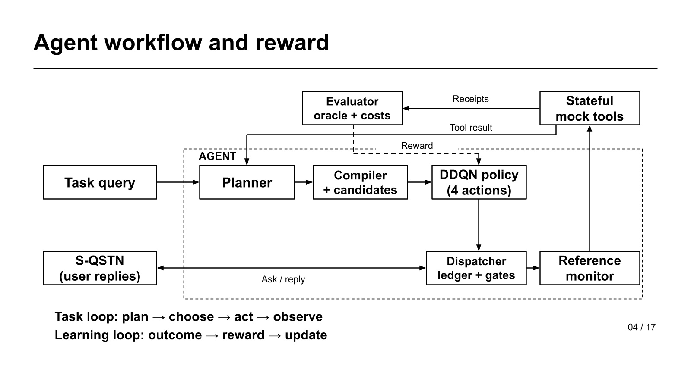

# Learning Permission Decisions for AI Agents

Current four-action permission controller, stateful mock tools, S-QSTN user simulator,
and the retained logistic-regression and contextual-bandit baselines.

**Start here:** [Method](docs/METHOD.md) · [中文方法说明](docs/METHOD.zh-CN.md) ·
[Run the code](docs/RUNNING.md) · [Data and evaluation](docs/DATA_AND_EVIDENCE.md)

The agent receives a task, proposes tool calls, obtains actual user consent, and
chooses scoped permission actions before execution. A reference monitor enforces
consent. DDQN learns choices among legal candidates from task outcomes and costs.
The executable implementation uses **REQUEST, EXECUTE, RELEASE, END**.

## Agent workflow and reward



- **Task query:** Defines the user's goal for one task episode.
- **Planner:** Proposes the next tool call using the task, prior tool results and feedback.
- **Compiler + candidates:** Validates the proposal and builds scoped, legal action candidates.
- **DDQN policy:** Chooses a concrete REQUEST, EXECUTE, RELEASE or END candidate from the public state.
- **Dispatcher, ledger + gates:** Applies the chosen action, records actual consent and manages active access gates.
- **Reference monitor:** Checks the exact execution permit before a mock tool can read or send data.
- **S-QSTN:** Simulates user permission replies using a persona and previously observed answers.
- **Stateful mock tools:** Execute local task operations and return results plus auditable receipts.
- **Evaluator:** Checks task outcomes and costs; supplies training rewards without granting permissions.
- **Task loop — plan → choose → act → observe:** Repeats task and permission decisions until completion or a stop.
- **Learning loop — outcome → reward → update:** Uses observed transitions and rewards to improve DDQN during training.

The evaluator's oracle is outside the decision policy. The reference monitor is
the execution guard. During frozen inference, the task loop runs without DDQN updates.

## Components

| Directory | Purpose | Entry point |
| --- | --- | --- |
| [rl_agent_structure](rl_agent_structure/README.md) | Agent, consent ledger, gates, monitor, evaluator, DDQN | `run_noapi.py`; `run_online.py`; `rl_testing/run.py` |
| [mock_tools](mock_tools/README.md) | Minimal stateful read/write tools and receipts for 65 Wu tasks | `python -m mock_tools.run` |
| [s-qstn](s-qstn/README.md) | Retrieval-calibrated simulation of four human permission responses | `python s-qstn/run.py` |
| [classification](classification/README.md) | Flat, independent cumulative-threshold, and factored logistic regression | `classification/run_four_label_benchmark.py` |
| [bandit_experiment](bandit_experiment/README.md) | Canonical offline stated-policy contextual bandits | `bandit_experiment/run_stated_policy_bandit.py` |
| [online_bandit_experiment](online_bandit_experiment/README.md) | Warm-started Personalized Factored Thompson Sampling (WP-FTS) | `python -m online_bandit_experiment.run_wp_fts` |
| [online_mab](online_mab/README.md) | Detailed Chinese MAB methods and final result interpretation | Documentation |
| [in_context_learning](in_context_learning/README.md) | Retained four-label ICL implementation and S-QSTN adapter | `in_context_learning/run_ic_four_label.py` |
| [data/processed](data/processed/README.md) | Four-label survey table and build metadata | 16,361 answers, 201 participants |
| [external/ai-agent-permissions](external/ai-agent-permissions/README.md) | Attributed upstream task and survey inputs | `queries.json`, `data/` |

The LR/MAB **four permission-response labels** and the Agent's **four controller
actions** are different action spaces. A predicted permission label never grants
permission to execute a tool.

## Quick start: offline functional check

Python 3.12 is the reference runtime. From the repository root:

```bash
python -m venv .venv
# Activate .venv using your shell.
python -m pip install -r requirements-agent.txt
python rl_agent_structure/run_noapi.py --persist-rounds 3 --all-wu --output rl_agent_structure/outputs/functional_demo
```

Use a new output directory for every run. This command uses a scripted planner,
explicit fixture answers and a rule controller. It performs no LLM API calls and
no optimizer updates. The [running guide](docs/RUNNING.md) covers CPU DDQN checks,
S-QSTN installation, baseline reproduction, and all offline test suites.

## Online API setup

The online Agent uses **OpenRouter for both the LLM Planner and S-QSTN**. One key
can serve both roles. DDQN and the mock tools run locally and need no API key.
The tracked `.env.example` files contain placeholders, not working credentials.

From the repository root, install the online dependencies and create the Agent's
local configuration once. PowerShell:

```powershell
python -m pip install -r requirements-online.txt
if (-not (Test-Path rl_agent_structure/.env)) { Copy-Item rl_agent_structure/.env.example rl_agent_structure/.env }
```

Set `OPENROUTER_API_KEY` in `rl_agent_structure/.env` to your own OpenRouter key.
A process environment variable takes precedence over the file. An alternative
file can be selected with `--env-file`. Real `.env` files are ignored by Git.

Initialize the cumulative ledger **once for a new campaign**. Keep an existing
ledger when continuing; this command refuses to overwrite it:

```bash
python s-qstn/run.py --init-budget
```

Preview the configuration without loading a key or making any network requests:

```bash
python rl_agent_structure/run_online.py --queries 40 41 --user-id online-demo --profile persistent_granters --persist-rounds 3
```

Add `--execute` and a new output directory to enable paid Planner/S-QSTN calls:

```bash
python rl_agent_structure/run_online.py --queries 40 41 --user-id online-demo --profile persistent_granters --persist-rounds 3 --max-model-calls 32 --execute --output rl_agent_structure/outputs/online_demo
```

- **Default controller:** The explicit rule baseline; the Planner and S-QSTN use live APIs.
- **Frozen DDQN:** Install `requirements-rl.txt`, then add `--policy ddqn --checkpoint PATH_TO_CHECKPOINT`; `--user-id` must match the checkpoint. No trained checkpoint is bundled.
- **Shared budget:** Both API roles use `s-qstn/state/budget.json`, the existing USD 5 cumulative ceiling, and one combined request-attempt cap. There are no automatic paid retries.
- **Session memory:** Queries in one invocation share consent and interaction history. A new invocation starts fresh; a model checkpoint does not restore consent.
- **Manual items:** Unsupported questionnaire extensions or clarification requests stop at `awaiting_human`; the CLI does not invent an answer or resume a saved human inbox.
- **Evidence:** `summary.json` records task outcomes, authorization audits and API attempts. This runner performs inference only, with zero optimizer updates and no reported RL reward.

For **standalone S-QSTN**, create its own local env file (or reuse a process
environment variable), using PowerShell:

```powershell
if (-not (Test-Path s-qstn/.env)) { Copy-Item s-qstn/.env.example s-qstn/.env }
```

Set the same `OPENROUTER_API_KEY` variable in that file. With the existing ledger:

```bash
python s-qstn/run.py --profile persistent_granters --sample-id demo --send
```

This makes one permission-response call. Omit `--send` for an offline prompt
preview. See [S-QSTN setup](s-qstn/README.md#optional-paid-response-mode) and the
[Agent online guide](rl_agent_structure/README.md#online-api-inference) for details.
API wiring is tested with mocked provider responses; live paid execution has not
been validated by this repository update.

## Current evidence

- The four-action workflow and all 65 task paths have passed offline functional checks.
- Native DDQN optimizer updates have been observed. Stable execution without
  exploration and individualized preference gains remain research questions.
- The retained DDQN comparison uses Q40/Q41/Q55 with a fixed simulated response
  rule. Its final success counts are 6/9 and 5/9 for the two exploration settings.
- LR, MAB and S-QSTN have their own evaluation protocols. Their scores do not
  establish the Agent's end-to-end task or personalization performance.

Evidence dates and compact original result files are listed in
[Data and evaluation](docs/DATA_AND_EVIDENCE.md). Shared-policy personalization,
few-shot/meta-RL and model-based alternatives are [research directions](docs/RESEARCH_DIRECTIONS.md),
not implemented methods in this release.

## Repository scope

This tree contains the current implementations, required inputs, tests, method
documentation and compact final evidence. Retired implementations, six-action
snapshots, local environments, model checkpoints, credentials and raw run logs
are excluded. Previous commits remain available through normal Git history.
See [third-party attribution](THIRD_PARTY_NOTICES.md) for upstream data licensing.
