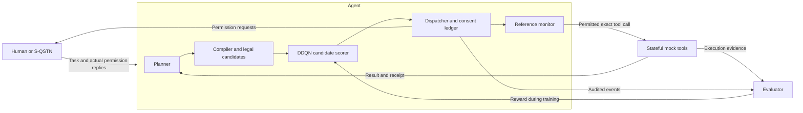

# Method: task-local permission control with persistent user context

## 1. Problem and system boundary

The controller chooses how to obtain and use permission while completing a user's
task. It balances task completion, unnecessary data access/disclosure, extra
permission questions, and idle execution gates. Actual consent is an execution
constraint enforced by the reference monitor, not a preference prediction or a
cost that the policy may trade away.

The task loop is **plan → choose → act → observe**. The learning loop is
**observed transition → reward → replay → parameter update**. The evaluator uses
declared task requirements and actual effects to calculate outcomes; hidden
oracle labels and the simulator's private persona are not policy inputs.

## 2. Inputs, outputs and modules

The user supplies a task query. The planner proposes a next tool call using the
task, previous tool results and control feedback. The compiler validates its
arguments and constructs scoped candidates. The DDQN input is the public state
plus candidate features and their validity mask. Its output is one candidate ID,
representing an action type together with its exact scope or ending reason.

The current offline runners use `ScriptedPlanner` and explicit fixture answers.
An LLM planner interface and an external S-QSTN responder adapter are implemented;
the retained DDQN results do not establish a full live LLM/S-QSTN training run.

| Module under `rl_agent_structure/src/personal_assistant/` | Responsibility |
| --- | --- |
| `planning/` | Planner interfaces, scripted proposals and compilation |
| `execution/user_session.py`, `execution/user_runner.py` | Per-user state and per-query control |
| `permissions/persistent_ledger.py` | Actual answers, scope, expiry and authorization history |
| `permissions/user_candidates.py`, `permissions/user_dispatch.py` | Candidate construction and action dispatch |
| `permissions/monitor.py` | Last check before an actual tool effect |
| `interaction/sqstn_bridge.py` | Permission requests/replies and observed-memory integration |
| `learning/driver.py`, `learning/outcomes.py` | Transition closure and reward accounting |
| `learning/policy.py`, `learning/ddqn.py` | Candidate scoring, replay and Double-DQN updates |

## 3. Consent C, execution gates G and permits P

- **C — consent record:** an actual user answer for a specific permission scope,
  with its validity period and provenance. A persistent answer lasts the
  configured number of task rounds; reuse does not extend that period.
- **G — execution gate:** an active, task-local gate backed by valid consent.
  The agent may close G while leaving persistent C intact.
- **P — single-use permit:** an execution credential bound to one exact tool call.
  The monitor issues it only after checking the required consent/gate bundle.

A scope identifies the tool/backend, recipient, read/write direction, and data
fields; an execution also binds its resource and arguments. Past answers can
inform preferences even after expiry, but expired consent cannot authorize an
effect. Allow-once consent is consumed on successful use or expires at task end.
Persistent refusal prevents prohibited re-asking. External withdrawal and newer
answers invalidate conflicting stale requests.

## 4. Four controller actions

| Action | Effect |
| --- | --- |
| `REQUEST(scope)` | Request missing consent, or activate G using already-valid C without asking again |
| `EXECUTE(scope)` | Attempt the compiled call; the monitor checks C/G and binds a one-use P |
| `RELEASE(keys)` | Close selected G entries; persistent C remains valid until its own expiry/revocation |
| `END(reason)` | Finish the query when the protocol permits completion or a justified stop |

The set is dynamic: several REQUEST, EXECUTE or RELEASE candidates can differ by
scope. A mask excludes invalid candidates; DDQN cannot make an invalid candidate
legal. The monitor still checks execution independently of the policy's choice.

## 5. State and user-specific learning

Public state includes task progress, observed answer counts, current C/G status,
permission-message counts and the current phase. Candidate features describe
action type, field/key counts, permission-scope identity, and relevant observed
answers. Explicit options expose public action consequences, transform growing
counts, or add remaining runtime-budget features. The selected feature schema
is saved with checkpoints.

The current implementation keeps a separate policy, replay buffer, consent
ledger and observed-answer history for each user. It does not train a shared
population policy. A synthetic persona label or a future permission answer is
not supplied as an oracle feature.

**One query is one episode.** A query may contain many tool steps and controller
decisions, each yielding a transition `(s, a, r, s_next, done)`. Terminal targets
do not bootstrap into the next query. Within-query discount is gamma = 1.
The same user's history, valid C, model parameters and replay persist across
queries; G is task-local. Task order can therefore change context and learning.

## 6. Reward and accounting

For a completed query, the sum of incremental rewards is

$$R = \alpha S - \beta F - \lambda_r E^r - \lambda_d E^d - \lambda_m M - \lambda_g K.$$

| Term | Meaning |
| --- | --- |
| S / F | Task success / failure; the terminal outcome is settled once |
| E^r / E^d | Extra actual field reads / disclosures relative to predeclared task requirements |
| M | Extra permission questions caused by the agent's path |
| K | Idle active G keys accumulated at designated checkpoints |

`PB` separately counts all permission messages. Valid persistent C does not
itself incur the G cost. RELEASE can reduce later K but cannot undo an earlier
disclosure. Task failures remain in completion denominators. Blocked attempts
and actual unauthorized effects are separately audited.

Weights are explicit run inputs, not values learned by DDQN. The three-query
diagnostic used success/failure magnitudes 1, extra-read/disclosure/question
prices 0.01, and idle-gate price 0.001. These are diagnostic settings, not an
established optimum. Unknown tool effects or invalid audit evidence must not
be converted into fabricated exact rewards.

## 7. Double-DQN policy and update

The network scores each `(state, candidate)` pair. During evaluation it chooses
the legal candidate with highest Q; training additionally allows configured
exploration. The online network selects the next candidate, and the target
network evaluates that candidate:

$$a^* = \arg\max_{a\in\mathcal A_{legal}(s')} Q_\theta(s',a),$$
$$y = \begin{cases}r,&done,\\r+\gamma Q_{\bar\theta}(s',a^*),&otherwise.\end{cases}$$

Observed transitions enter replay. The implementation uses Huber loss, gradient
clipping and periodic target-network copying. Optional mechanisms include public
consequence features, action-type-balanced exploration, observed n-step returns,
and retention from same-user training experience. They are not all enabled in
every experiment. The November 3 exploration study has no rule demonstrations,
rule warm start or auxiliary supervision.

The defaults in `learning/policy.py` and the deliberately small configuration in
`rl_testing/exploration_trial.py` differ. Reproduce a reported experiment with
its exact runner/configuration. The proposed bounded bootstrap target discussed
on November 4 is not implemented in this release's `double_dqn_targets`.

## 8. Tools, simulator and authored assumptions

Mock tools execute minimal local state changes and produce results, receipts and
field-flow evidence. They do not reproduce complete external business systems.
S-QSTN answers permission requests using its reference corpus, persona, rules,
and observed interaction context. It is outside the Agent's policy boundary.

The integration layer explicitly adds three execution extensions requiring
manual handling by the S-QSTN bridge: Q54 content and Q63/Q64 setup permissions.
For Q55, the approved execution assumption permits the common ten fields plus
either email or phone. Disclosing both contact fields adds one extra field.
These are authored execution assumptions, not newly collected survey labels.

## 9. Evaluation and current scope

Compare a history-aware rule controller, a matched frozen DDQN, and an updating
DDQN. A frozen controller still maintains actual history and valid C; its
network weights stay fixed. Match task order, response mechanism, starting
weights/context and evaluation budgets. Freeze learning during evaluation and
do not return test answers to training state.

Report completion, extra reads/disclosures, PB/M, K and unauthorized effects,
alongside learning curves. Separate new-query generalization from repeated
training-task diagnostics, and synthetic persona behavior from real-user
personalization. See [the evidence ledger](DATA_AND_EVIDENCE.md) and
[open research directions](RESEARCH_DIRECTIONS.md).
