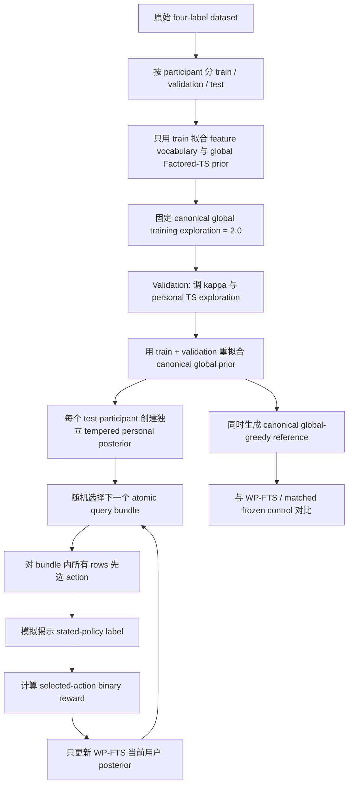

# Online MAB 是怎么做的：WP-FTS 详细流程

## 1. 先把研究问题说清楚

这版 online MAB 不是在学习“真实隐私损害值多少钱”，而是在回答一个更基础、可以被当前 survey data 支持的问题：

> 当系统看到一个新的 data-permission context 时，能否利用这个用户过去已经揭示的 permission feedback，逐步更准确地预测该用户的 stated policy？

因此当前 reward 是 stated-policy exact match，而不是 privacy leakage、task utility 和 interruption cost 的人工加权和。

当前模拟的实际反馈来自 survey label，所以实验名称必须写成：

> randomized sequential online-feedback replay simulation using human stated-policy labels

它不是 live online deployment。

## 2. 整体流程图



## 3. 数据切分

切分单位是 `participant_id`，不是单行。这样同一个人的回答不会同时进入训练和测试。

| Split | Participants | Rows | 用途 |
|---|---:|---:|---|
| Train | 120 | 9,826 | 拟合 global prior |
| Validation | 40 | 3,212 | 选择 \(\kappa\) 和 personal exploration |
| Test | 41 | 3,323 | 最终 held-out replay |

最终 test 使用 20 个固定 replay seeds：1001--1020。每个 seed 都重新产生确定性的 participant-specific bundle order 和 Thompson action stream。

## 4. Action space：为什么仍然是四个联合动作

原始问题分成两个 factor：

\[
 a_{access}\in\{deny,allow\},
 \qquad
 a_{persist}\in\{ask\_next\_time,persist\}.
\]

在实现中用四个联合 action id 表示：

| Action id | Access | Persistence |
|---:|---|---|
| 0 | deny | persist |
| 1 | deny | ask next time |
| 2 | allow | ask next time |
| 3 | allow | persist |

模型仍然是 factored policy：先采样 access，再让 persistence factor 使用 context 和刚刚采样出的 access action。这样既保留 access/persistence 的解释性，又避免直接训练一个完全没有结构的四臂模型。

## 5. Features：online 与 offline 保持完全一致

为了让比较真正反映“是否有 online feedback”，v2 没有给 online 方法额外加入新 feature。

### 5.1 进入模型的 features

| Feature | 类型 | 含义 |
|---|---|---|
| `domain` | categorical | 请求所在应用/任务领域 |
| `tool` | categorical | agent 要调用的工具或 recipient |
| `raw_data_type` | categorical | 原始数据类型 |
| `generic_data_type` | categorical | 泛化后的数据类型 |
| `concern_domain` | categorical | 用户担忧的隐私领域 |
| `privacy_importance` | numeric | survey 中的 privacy importance 数值 |

### 5.2 明确排除的字段

以下字段不能作为 runtime feature：

- `participant_id`、`query_id`；
- `label_id`、`label_text`、`access_target`、`persistence_target`；
- `necessity_status` 等只有 oracle 才知道的字段；
- age、gender、education、AI familiarity、AI frequency、AI trust 等人口统计或 profile 字段；
- 由未来测试反馈才能得到的 historical allow/persist rates。

`participant_id` 只用于索引“这个用户自己的 posterior”，不作为模型输入特征。`query_id` 只用于形成 atomic feedback bundle。

## 6. Reward：为什么没有人工 reward weights

每一行的 stated label 是 (y_t\in\{0,1,2,3\})，系统选择 (a_t)。当前 online MAB 只观察所选择 action 的 joint reward：

\[
r_t=\mathbb{1}[a_t=y_t].
\]

这意味着：

- 选择完全正确的四分类 policy，reward 是 1；
- access 或 persistence 任一 factor 错误，joint reward 是 0；
- 不把 privacy、task utility、prompt burden 人为写成 (w_1,w_2,w_3)；
- 不向模型揭示未选择 action 的 reward 来更新其他 arms。

当前 reward 的含义是 **stated-policy fidelity**，不是 welfare function，也不是现实 privacy harm 的数值。

## 7. Global prior 与个体化 posterior

### 7.1 Canonical global prior

首先用 training participants 的数据训练 canonical factored Thompson state。global training 使用 offline baseline 的设置：

\[
\text{global training exploration}=2.0.
\]

test participant 的 feedback 永远不会更新这个 global state，也不会流入其他 participant。

### 7.2 用户个人的 warm-start

对每个新 test participant (u)，从 global state 复制出两个独立 state：

1. `wp_fts_online`：会吸收当前用户过去 bundle 的 selected-action feedback；
2. `frozen_tempered_fts_control`：初始化相同，但永远不更新。

个人 state 不是完全复制 global 数据，而是做 tempering：

\[
\Lambda_{u,0}=I+\kappa(\Lambda_0-I),
\qquad
b_{u,0}=\kappa b_0.
\]

其中 (I) 是 ridge prior，最终 validation 选择：

\[
\kappa=0.01.
\]

直观理解：新用户可以从群体/global prior warm-start，但不会被 global 数据完全锁死；随后该用户自己的 feedback 会逐步改变自己的 posterior。

### 7.3 两个 exploration 参数不要混淆

| 参数 | v2 设置 | 作用 |
|---|---:|---|
| Global training exploration | 2.0 | 生成 canonical offline-compatible global prior |
| Personal online exploration | 0.5 | test participant 上的 Thompson action sampling |

v1 曾把这两个概念混在一起；v2 已经分开，因此 offline comparison 更严谨。

## 8. 一个 query bundle 内到底发生什么

bundle key 是：

```text
(participant_id, query_id)
```

一个 bundle 可能包含同一个自然语言 query 关联的多行 data-item permission request。严格顺序如下：

```text
开始 bundle
  1. 对所有 rows 读取 context
  2. WP-FTS 和 frozen control 为所有 rows 选择 action
  3. 此时不使用任何 bundle label，也不更新 posterior
  4. bundle 内所有 action 都选完
  5. evaluator 才揭示 survey stated-policy labels
  6. 根据各自 selected action 计算 0/1 reward
  7. 只将 WP-FTS 当前用户选中 factor arm 的 reward 写入 posterior
结束 bundle
```

因此，同一个 query 的第一行不会因为已经看到第二行或第一行的 label 而“偷看答案”。

## 9. 三个 test policy role

### 9.1 WP-FTS online

- 从 tempered global state 开始；
- 用 personal exploration 做 Thompson sampling；
- 每个 bundle feedback 后更新当前 participant 的 access/persistence state；
- 不更新 global prior。

### 9.2 Matched frozen control

- 使用相同 global prior、相同 \(\kappa\)、相同 personal exploration；
- 使用配对的 random stream；
- 也会选择 Thompson actions，但从不吸收用户 feedback。

它是主要的机制比较：如果 WP-FTS 更好，说明“更新这个用户的历史 feedback”带来了额外收益。

### 9.3 Canonical offline global-greedy reference

- 使用 canonical global prior；
- test 时使用 posterior-mean greedy action；
- 不做 tempering，不做用户更新。

它是回答“online baseline 相对原 offline baseline 怎么样”的参考。它不是 mechanism-matched control，因为它和 WP-FTS 同时不同于 personalization 和 action-selection mechanism。

## 10. Validation 如何选择参数

validation candidates 是：

\[
\kappa\in\{0.01,0.03,0.1,0.3,1.0\},
\]

\[
\text{personal exploration}\in\{0.25,0.5,1.0,2.0\}.
\]

选择规则是：

1. online false-allow 不高于同一 validation split 上的固定 canonical global-greedy reference；
2. 在满足条件的 candidates 中最大化 online prequential JEM；
3. 若 JEM 相同，再倾向更低 false-allow。

这只是 fixed-reference non-degradation diagnostic，不是绝对 safety threshold。因为 canonical validation false-allow 本身是 100%，所以这个 gate 在当前数据上并不能保证安全。

最终选择：

```text
kappa = 0.01
personal exploration = 0.5
global training exploration = 2.0
```

## 11. Test 与 bootstrap

选定参数后，用 train+validation 重新训练 canonical global prior，然后锁定 test participants。test 全程不调参数、不更新 global prior。

输出三类 metrics：

### 11.1 Fidelity

\[
\text{JEM}=\frac{1}{n}\sum_t\mathbb{1}[a_t=y_t].
\]

同时报告 four-class macro-F1。

### 11.2 Access diagnostics

\[
\text{FalseAllowRate}
=P(\hat a_{access}=allow\mid a^*_{access}=deny),
\]

\[
\text{FalseDenyRate}
=P(\hat a_{access}=deny\mid a^*_{access}=allow).
\]

并报告 deny recall。

### 11.3 Persistence diagnostics

报告 persistence accuracy、over-persistence 和 under-persistence。后期 round 10--18 用来观察用户反馈是否已经产生适应效果。

bootstrap 的重抽样单位是 participant cluster，共 5,000 次；当前 summary 是 pooled row-level fidelity 的 cluster bootstrap，而不是 equal-participant mean 的 CI。

## 12. 这版 online 的“online”边界

它有 online learner 的结构：动作先发生，反馈后到达，posterior 随用户历史反馈更新。但反馈来自已有 survey label 的 replay，而不是现实 agent 与用户交互时自动获得的真实 outcome。

当前没有：

- 真实 disclosure harm；
- 用户实际 override/revoke；
- 用户没有被 prompt 时的可观测 disagreement；
- 真实 task success 或 prompt burden；
- Thompson propensity 的 IPS/DR 估计（`propensity_draws=0`）。

所以这一步的研究价值是验证 online personalization 的 baseline signal；真正的安全课题应放到后续 constrained MDP / RL。
