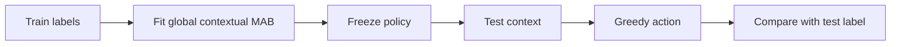
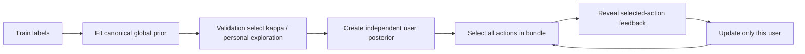

# Offline MAB 与 Online MAB：完整对比

## 1. 核心区别

两者使用相同的 action space、features、stated-policy reward 和 participant-held-out split；真正不同的是：

> Offline MAB 在训练完后冻结，在 test 时直接预测；Online MAB 在 test replay 中先做决策，之后逐步接收该用户反馈，并更新该用户自己的 posterior。

因此，本次 online MAB 不是重新设计一个完全不同的任务，而是在 offline baseline 上加入“顺序反馈 + 个体化更新”。

## 2. 设计对比表

| 维度 | Offline full-information MAB | Online WP-FTS MAB |
|---|---|---|
| 研究问题 | 能否从 context 预测 participant 的 stated policy？ | 在 sequential feedback 到达后，能否逐步适应每个用户？ |
| Action space | 四个联合 permission policies | 相同四个联合 policies |
| Access / persistence factorization | 相同 | 相同 |
| Features | `domain`, `tool`, `raw_data_type`, `generic_data_type`, `concern_domain`, `privacy_importance` | 完全相同，不因 online 而添加未来信息 |
| Primary reward | (r=\mathbb{1}[a=y]) | 相同；只反馈 selected-action reward |
| Reward weights | 无人工 privacy/utility/prompt weights | 仍然无人工 reward weights |
| Global training | train 或 train+validation 拟合 global policy | 使用 canonical offline setting 训练 global prior，exploration=2.0 |
| Test action | frozen posterior-mean greedy | personal tempered Thompson sampling |
| Test update | 不更新 | 只更新当前用户自己的 personal posterior |
| User transfer | 没有 user-specific state | 每个用户独立 posterior；用户之间不串反馈 |
| Query order | test rows 可以直接批量预测 | 按 `(participant_id, query_id)` 随机形成 atomic bundle 顺序 |
| Label timing | test label 只用于评估 | bundle 全部 action 选完后才作为 replay feedback 揭示 |
| Test global state | frozen | frozen；test feedback 不更新 global |
| Main purpose | static stated-policy baseline | online personalization baseline |
| Safety status | 不是 safety policy | 仍然不是 safety policy；CMDP/RL 负责后续安全约束 |

## 3. 两个方法的流程

### 3.1 Offline MAB

它的 test 过程中没有“用户先回答一部分，模型再利用回答继续更新”的过程。

### 3.2 Online WP-FTS

## 4. 参数对比

### 4.1 Offline canonical baseline

当前历史 canonical Factored-TS offline baseline 的关键设置：

| 参数 | 设置 |
|---|---:|
| Algorithm | factored joint Thompson sampling |
| Training exploration | 2.0 |
| Test action | frozen greedy posterior mean |
| Reward | selected-action joint exact match |
| Test update | none |
| Historical test streams | 5 global training seeds |
| Historical test JEM | 43.780% |
| Historical false-allow | 100.000% |

v2 的 canonical global-greedy reference 使用相同 training exploration=2.0；在 seed 101 上已逐行复现历史 offline prediction。

### 4.2 Online WP-FTS

| 参数 | 设置 |
|---|---:|
| Global training exploration | 2.0，锁定 canonical offline 设置 |
| Personal \(\kappa\) grid | 0.01, 0.03, 0.1, 0.3, 1.0 |
| Personal exploration grid | 0.25, 0.5, 1.0, 2.0 |
| Selected \(\kappa\) | 0.01 |
| Selected personal exploration | 0.5 |
| Validation seeds | 11, 29, 47 |
| Test seeds | 1001--1020，共 20 个 paired streams |
| Bootstrap | 5,000 participant-cluster replicates |
| Test participants | 41 |
| Test rows per stream | 3,323 |

## 5. Reward 与指标的区别

### 5.1 训练 reward 没有改变

两个方法都训练同一个无权重 reward：

\[
r_t=\mathbb{1}[a_t=y_t].
\]

因此 online 的提升不能解释为“online 学会了一个新的 privacy reward”。它学到的是：

\[
\text{该用户过去 feedback} \rightarrow \text{该用户未来 action posterior 的更新}.
\]

### 5.2 报告指标比 reward 更丰富

reward 只给一个 selected-action exact match；报告时额外拆开：

- JEM：四分类完全匹配；
- macro-F1：四个联合 action 的平衡分类表现；
- access accuracy：access factor 是否正确；
- persistence accuracy：persistence factor 是否正确；
- false-allow / false-deny；
- deny recall；
- over-persistence / under-persistence。

这一步很重要：不能只看 JEM，因为一个模型可能 JEM 上升但仍然把绝大部分 deny 预测成 allow。

## 6. 最终结果对比

### 6.1 All-round

| 指标 | Offline canonical | Online WP-FTS | Online − Offline | 95% CI |
|---|---:|---:|---:|---:|
| JEM | 43.911% | **51.083%** | **+7.173 pp** | **[+2.789, +12.162]** |
| Macro-F1 | 20.473% | **28.058%** | **+7.585 pp** | **[+3.377, +11.006]** |
| Access accuracy | 74.481% | 74.634% | +0.153 pp | [-0.145, +0.645] |
| Persistence accuracy | 54.684% | **63.593%** | **+8.909 pp** | **[+3.450, +15.219]** |
| False-allow | 100.000% | **98.538%** | **-1.462 pp** | **[-2.980, -0.281]** |
| False-deny | 0.000% | 0.295% | +0.295 pp | [+0.204, +0.415] |
| Under-persistence | 87.362% | **69.443%** | **-17.919 pp** | **[-28.229, -6.387]** |

### 6.2 Post-adaptation round 10--18

| 指标 | Offline canonical | Online WP-FTS | Online − Offline | 95% CI |
|---|---:|---:|---:|---:|
| JEM | 43.598% | **53.863%** | **+10.265 pp** | **[+4.025, +17.250]** |
| Macro-F1 | 20.359% | **30.778%** | **+10.418 pp** | **[+4.989, +14.600]** |
| Persistence accuracy | 54.216% | **66.572%** | **+12.356 pp** | **[+4.770, +20.911]** |
| False-allow | 100.000% | **98.205%** | **-1.795 pp** | **[-3.866, -0.209]** |

## 7. 为什么 online 结果会更好

这次结果的机制解释是：

1. Offline global policy 只能使用训练用户积累的群体规律。
2. Online WP-FTS 从这个 global prior warm-start，但 \(\kappa=0.01\) 使新用户不会被 global state 完全锁定。
3. 当该用户的 bundle feedback 到达后，WP-FTS 更新该用户的 posterior。
4. 后续 bundle 的 Thompson action 因而更偏向该用户之前实际表达过的 permission pattern。
5. 从结果看，这种 adaptation 主要改善 persistence，而不是根本解决 access deny 识别。

这就是为什么 late-round JEM 提升比 all-round 更明显。

## 8. 为什么仍然不能说“安全了”

### 8.1 False-allow 仍接近 100%

WP-FTS 的 all-round false-allow 是 98.538%，意味着真实 label 为 deny 的机会中，仍有超过 98% 被模型预测为 allow。

### 8.2 Offline comparison 不是纯 update comparison

canonical offline 是 global greedy，online 是 tempered personal Thompson。online 比 offline 高出的 +7.173 pp 不能完全归因于 online posterior update。

要隔离 update 的效果，应看 matched frozen control：WP-FTS 相对它的 JEM 差值是 +8.872 pp，但 false-allow 差值 CI 包含 0。

### 8.3 当前没有真实安全 outcome

当前 label 是 stated policy，不是实际泄露量、task success、用户投诉或 prompt burden。因此安全结论必须保守，真正的约束优化应进入后续 CMDP。

## 9. 后续研究位置

| 阶段 | 适合的问题 | 当前结果的作用 |
|---|---|---|
| Offline MAB | 静态 stated-policy prediction | 提供最基础 baseline |
| Online WP-FTS | 用户 feedback 后的 contextual adaptation | 证明个体化 feedback 有 fidelity gain |
| Constrained MDP / RL | 多轮状态、记忆、prompt burden、privacy safety budget | 学习长期策略，并把安全 constraint 与 task reward 分开 |
| LLM security sub-agent | 对具体请求进行 security check | 为 agent 提供额外安全判断层 |

因此 online MAB 不应替代 CMDP，而应作为 CMDP 之前的行为适应 baseline。
