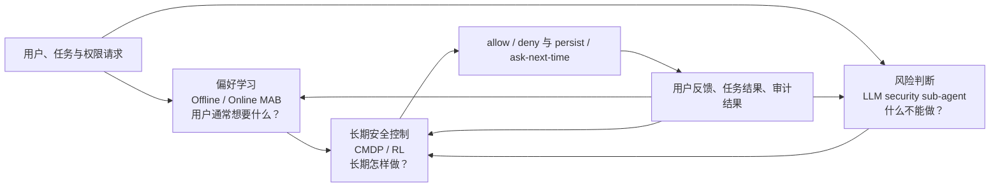
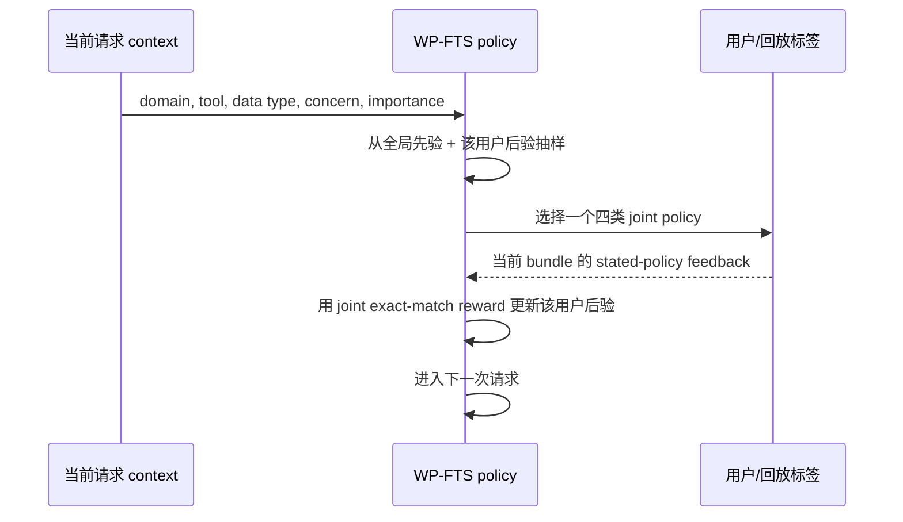
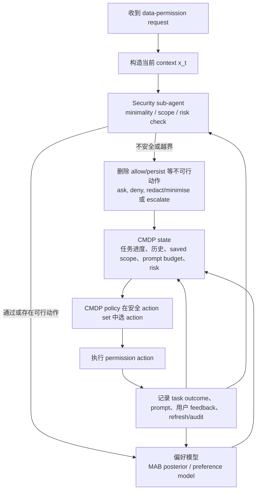

# 从偏好学习到安全长期控制：MAB、CMDP/RL 与 LLM Security Sub-agent 的角色分工

> **状态更新（2026-08-03）：** MAB 已冻结为 stated-policy baseline。本文原第 5.2 节的 task-only CMDP v1 是新动态 outcome 数据尚未存在时的保守方案；在 QSTN Dynamic UserSim 与安全 outcome logging 就绪后，CMDP 的正式 reward、privacy leakage 定义、scope-aware action space 和 adaptive preference learning 以 [CMDP 重设计与 QSTN 可行性评估](../../Dynamic_UserSim_Research_Design/CMDP_REWARD_POLICY_QSTN_FEASIBILITY_zh.md) 为准。

## 一句话定位

本研究的主题是 **安全的 permission automation**：既要逐渐理解某位用户通常愿意接受什么权限决策，也要避免系统因为“预测用户可能同意”而收集不必要或不安全的数据。

三类模块并不相互替代，而是回答三个不同的问题：

| 模块 | 它回答的核心问题 | 主要作用 |
|---|---|---|
| Offline / Online MAB | 用户在当前请求中通常会接受什么 policy？ | 学习用户偏好，并提供逐请求决策的强基线 |
| CMDP / RL | 有记忆、反复请求、可撤销和 prompt 成本时，长期应怎样决策？ | 在明确安全与打扰约束下优化长期 permission relationship |
| LLM security sub-agent | 此次请求是否违反最小必要性、用途/接收者边界或安全规则？ | 提供独立的风险判断、行动过滤与审计信号 |

可以用下图概括研究逻辑：

这里的箭头不是说 MAB 必须决定 CMDP 的每个动作，而是说：MAB 给出用户偏好的可学习信号和合理基线；security sub-agent 给出不可忽略的风险信息与安全边界；CMDP/RL 在二者基础上做长期决策。

---

## 1. 共同的问题定义：先保持同一个 action space

在 MAB 到 CMDP 的第一版比较中，建议先固定相同的四类 joint policy，而不要一开始更换动作空间。这样可以清楚归因：性能变化来自“是否使用长期状态与安全约束”，而不是来自“给了后者更多动作”。

\[
a^{\mathrm{access}} \in \{\mathrm{deny},\ \mathrm{allow}\},
\qquad
a^{\mathrm{persist}} \in \{\mathrm{ask\_next\_time},\ \mathrm{persist}\}.
\]

因此 joint action 为：

\[
\mathcal A=
\{(\mathrm{deny},\mathrm{persist}),\
(\mathrm{deny},\mathrm{ask\_next\_time}),\
(\mathrm{allow},\mathrm{ask\_next\_time}),\
(\mathrm{allow},\mathrm{persist})\}.
\]

它们分别回答两个问题：

1. 当前这次请求是否允许访问数据？
2. 这次决定是否可在未来相似请求中自动复用，还是下次仍应询问？

当前 MAB 与未来 CMDP 都可使用的请求级 context 包括：

\[
x=\{\mathrm{domain},\ \mathrm{tool},\ \mathrm{raw\_data\_type},\
\mathrm{generic\_data\_type},\ \mathrm{concern\_domain},\ \mathrm{privacy\_importance}\}.
\]

其中 `concern_domain` 的未填写值必须编码为 `NOT_STATED`，不能解释为“用户没有隐私关切”；`privacy_importance` 是用户整体的预先陈述，不应被错误解释为某个具体请求的客观风险。

---

## 2. Offline MAB：验证“偏好能否从 context 中学习”

### 2.1 它的意义

Offline full-information contextual-bandit benchmark 是研究的第一块地基。它不模拟真实部署，而是在 participant-held-out 的 survey-derived stated-policy data 上回答：

> 只观察一个权限请求及其 context，模型能否预测一个从未见过的用户会陈述接受哪类权限 policy？

它的价值有三点：

1. **可学习性检验**：如果静态 context 根本无法预测用户陈述的 policy，直接进入复杂 RL 不会解决基础信息不足的问题。
2. **固定可比问题**：它确定 action space、features、数据切分与指标，后续 online MAB 和 CMDP 都能在同一基础上比较。
3. **最简单且可复现的 baseline**：它给出“不使用该用户在线历史”的表现下界。

### 2.2 当前训练信号，而不是“安全效用”

当前 survey 中能被直接观察的可靠标签是用户接受的四类 stated policy。因此 MAB 的训练信号定义为：

\[
r_{\mathrm{joint}}(x,a)=
\mathbb{1}\big[a=(y^{\mathrm{access}},y^{\mathrm{persist}})\big].
\]

即只有预测的 joint action 与用户陈述的 access 与 persistence 两个因子都一致时，\(r_{\mathrm{joint}}=1\)；任一因子不一致则为 \(0\)。

这不是“隐私伤害 + 任务效用 + 打扰”的加权 reward。它只是一个明确、可审计的 **stated-policy exact-match learning signal**。使用它的原因是当前静态问卷没有真实的任务完成结果、实际 prompt burden、可验证的最小必要数据集合，或真实的错误复用结果；给这些不可观测量手工设权重，会把研究者假设伪装成数据事实。

### 2.3 Offline MAB 不主张什么

Offline MAB 的高 exact match 不等于安全；它也不等于真实用户在实际使用环境中的选择。它不能回答：

- 若某项权限曾被允许，未来是否仍可安全复用；
- 多次询问造成的累积打扰是否值得；
- 用户撤销、后悔或任务失败后的长期后果；
- 一次“用户可能同意”的请求是否仍违反安全或最小必要性原则。

因此，Offline MAB 的论文角色应是 **静态偏好预测基线**，不是最终的 permission automation solution。

---

## 3. Online MAB：验证“用户反馈能否带来个体化改进”

### 3.1 它的意义

Online MAB 是与 Offline MAB 处于同一动作空间、同一 feature set、同一无权重 stated-policy reward 下的顺序学习版本。它回答：

> 当请求按同一用户的时间顺序到达，且系统在每个 query bundle 后收到用户的 policy feedback 时，能否比冻结的静态模型更快适应该用户？

当前实现为 **WP-FTS（warm-started personalized Factored Thompson Sampling）**：

- `warm-started`：从训练用户学得全局先验，而非每位新用户从零开始；
- `personalized`：为每名 held-out user 维护独立的在线后验，不把该用户的新反馈混入其他用户；
- `Factored`：仍分别表示 access 和 persistence 的决策结构；
- `Thompson Sampling`：根据当前不确定性抽样探索，得到反馈后更新后验。

它的实验目的不是构造多套 online MAB，而是形成一个足够强、可解释的“会利用用户反馈”的单步 baseline。

### 3.2 在线交互流程

对于每位未见参与者，按 query bundle 顺序重复以下过程：

在现有实验中，反馈来自 survey 的 stated-policy label，因此准确说是 **随机化的 sequential online-feedback replay simulation**，而不是已经部署到真实用户的 live online learning。

### 3.3 Online MAB 的贡献与边界

Online MAB 的贡献是检验个体化反馈是否有效。例如目前结果显示，它主要提高了 persistence decision 的表现，说明“是否复用/下次是否再问”比一次性 access 更依赖个体历史。

但它仍是 bandit：它只处理当前一步的学习与即时 feedback，不优化跨时间的总收益，也没有显式安全预算。即使 online MAB 的 JEM 上升，只要 false-allow 仍很高，就不能把它称为安全控制器。

这正是它对后续 CMDP 的重要作用：它暴露了“更会预测用户”与“更安全”之间并不等价的缺口。

---

## 4. 为什么 MAB 阶段不使用人为加权 reward vector

MAB 并非理论上不能有多维 reward；它当然可以。但当前阶段不应该把未观测的目标强行合成为一个分数。

例如，下面的量都很重要：

\[
\mathbf o_t=(Q_{\mathrm{task}},E_{\min},M_{\mathrm{pref}},B_{\mathrm{prompt}},
O_{\mathrm{reuse}}^{+},U_{\mathrm{reuse}}^{-},H_{\mathrm{assessed}}).
\]

| 成分 | 含义 | 当前静态问卷是否直接可靠测量 |
|---|---|---|
| \(Q_{\mathrm{task}}\) | 任务成功、输出质量、fallback、retry、人工接管 | 否 |
| \(E_{\min}\) | 是否超出已验证的最小必要数据集合 | 否；至多有 proxy |
| \(M_{\mathrm{pref}}\) | reject、override、revoke、偏好不匹配 | 只有 stated-policy proxy |
| \(B_{\mathrm{prompt}}\) | prompt 次数、延迟、重复打扰、负担评分 | 否 |
| \(O_{\mathrm{reuse}}^{+}\) | 旧 allow 被错误复用，实际应拒绝 | 否；需 refresh/audit |
| \(U_{\mathrm{reuse}}^{-}\) | 旧 deny 被错误复用，实际可允许且任务受阻 | 否；需 refresh/audit 与任务结果 |
| \(H_{\mathrm{assessed}}\) | 独立 threat model 下的风险等级 | 否；需安全评估器 |

如果写成

\[
r=w_1Q_{\mathrm{task}}-w_2E_{\min}-w_3B_{\mathrm{prompt}}-\cdots,
\]

那么不仅 \(w_i\) 是人为选择，许多被加权的量本身也尚未被当前数据测量。即使用 adaptive learning 去调整 \(w_i\)，也不能凭空恢复没有记录的真实任务效用、伤害或打扰。故当前 MAB 使用可直接观察的 \(r_{\mathrm{joint}}\)，将上述向量保留为后续在线系统应记录的 outcome schema。

### 4.1 文献审计后的精确表述：这不是“已有论文的同一 reward”

这里必须避免一个 reviewer 很容易指出的问题：**没有已核验的权限自动化 RL 论文恰好提出并验证了上述七维 reward vector 或其固定权重。** 因而论文不能写成“following prior work, we use \(\mathbf{o}_t\) as the established reward”。

更准确的主张是：

1. 权限研究直接支持 contextual preference、prompt burden、context change 与 permission-usability 后果是必须区分的现象 [R1–R6]；
2. GDPR 直接支持 data minimisation、purpose limitation 和 storage limitation 是不能被普通效用随意抵消的规范要求 [R7]；
3. CMDP / safe RL 文献直接支持把优化 reward 与安全 costs / constraints 分开，而不是把全部目标压进一个人工加权分数 [R8, R9]；
4. 因此，\(\mathbf{o}_t\) 是本项目把这些已有证据落到 permission agent 上的 **可测 outcome schema**。其中错误复用、agent task outcome 和风险评估的操作化是本研究的设计贡献，必须通过后续 simulator / pilot log 验证，而不是假装已经由 survey 验证。

完整的逐项证据、可测定义、不可作出的强主张与参考文献见 [07_CMDP_REWARD_EVIDENCE_AUDIT_zh.md](07_CMDP_REWARD_EVIDENCE_AUDIT_zh.md)。

---

## 5. CMDP / RL：研究的核心安全长期控制问题

### 5.1 它解决什么新问题

CMDP/RL 不再把每个 permission request 当作完全独立的一步。它将 permission relationship 看成一个序列过程：

- 本次 allow 是否会影响未来数据暴露；
- persist 是否会减少未来 prompt，也是否会造成过期或越界复用；
- 用户的 override、revoke 和偏好变化如何改变后续 policy；
- 在有限 prompt budget 和隐私风险预算下，长期如何保持任务可用性。

因此其状态至少应包括当前请求 context，以及动态历史：

\[
s_t=\{x_t,\ \text{已保存 policy 的 scope/expiry},\ \text{历史 feedback},\
\text{prompt history},\ \text{task progress},\ \text{risk metadata},\ \text{uncertainty}\}.
\]

其中 `uncertainty` 只能在系统实际具有可校准不确定性时使用；不能事后从标签中泄漏。

### 5.2 历史的数据受限方案：task-only reward 与 safety constraint 分开

CMDP 的关键不是设置一个“大而全的负 reward”，而是把可补偿的任务目标与不可轻易补偿的安全边界分开。例如：

\[
\max_{\pi} J_{Q_{\mathrm{task}}}(\pi)
\]

subject to

\[
J_{E_{\min}}(\pi)\le d_{\mathrm{privacy}},\qquad
J_{B_{\mathrm{prompt}}}(\pi)\le d_{\mathrm{burden}},\qquad
J_{O_{\mathrm{reuse}}^{+}}(\pi)\le d_{\mathrm{reuse}}.
\]

- \(Q_{\mathrm{task}}\)：主要优化目标，来自真实任务成功、质量、retry、fallback 或人工接管。
- \(E_{\min}\)、\(B_{\mathrm{prompt}}\)、\(O_{\mathrm{reuse}}^{+}\)：分别是数据最小化、打扰和危险复用的累计 cost，设为约束而非用一个固定惩罚权重抵消。
- \(M_{\mathrm{pref}}\)：可用于反馈/个人化信号，或在有证据后成为辅助目标；不应自动等同于真实 harm。
- \(U_{\mathrm{reuse}}^{-}\)：表示不必要的阻断及任务可用性损失，可纳入任务效用或单独报告。
- \(H_{\mathrm{assessed}}\)：风险等级、状态或 gate 信号，而非用一次用户回答替代的 reward。

这是采用 CMDP 的方法论理由，而不是任意偏好：CPO 明确将 reward 与 constraints 分开建模，适用于不能仅靠 reward 设计来保证安全的情形 [R8]。在 privacy engineering 中，风险也应经独立风险模型识别、评估与处置，而不是由一次用户允许/拒绝直接推断 [R10]。

**推荐的 CMDP v1（在收集新交互数据后）** 不把七项相加，而是先采用最小、可解释的形式：

\[
r_t=q_t\quad\text{(observed task outcome)},
\]

\[
c^{\min}_t=\mathbb{1}[\text{verified minimality / scope fails}],\quad
c^{\mathrm{prompt}}_t=\text{observed prompt burden},\quad
c^{\mathrm{reuse}}_t=\mathbb{1}[\text{audited unsafe allow-reuse}].
\]

其中 \(M_{\mathrm{pref}}\) 用于人类反馈和个人化学习，\(U_{\mathrm{reuse}}^-\) 作为 task-availability diagnostic，\(H_{\mathrm{assessed}}\) 作为风险状态与 hard gate 的输入。这个选择与现有证据的可测边界一致，也避免在没有数据时引入无法辩护的 \(w_i\)。

### 5.3 “adaptive weight” 在 CMDP 中真正指什么

如果使用拉格朗日式 constrained RL，系统可随 constraint 是否被违反而更新对偶变量：

\[
\lambda_i \leftarrow \left[\lambda_i+\eta_\lambda\big(\widehat J_{C_i}-d_i\big)\right]_+.
\]

这里的 \(\lambda_i\) 是为满足约束而更新的 **dual multiplier**，不是研究者主观宣布“隐私永远值 0.7、打扰永远值 0.3”的道德权重。它可以减少固定 reward-weight 的任意性，但仍需要事先明确：

1. 哪些成本是约束；
2. 每个阈值 \(d_i\) 的来源；
3. 阈值在何种场景下适用；
4. 对阈值和算法超参数进行 sensitivity analysis。

安全阈值不能简单交给模型自行学习，因为那等于让模型自行决定可接受的伤害上限。阈值应来自政策、威胁模型、风险等级、用户体验研究或预注册的实验假设。

### 5.4 CMDP 前需要新增什么数据

当前 survey 足以支持 stated-policy MAB，但不足以证明 CMDP 的真实长期安全与效用。进入 CMDP 前，需要一个至少可控的交互环境、任务模拟器或 pilot log，记录：

- 任务是否完成、是否 fallback/retry/人工接管；
- 每轮真实 prompt、响应延迟与用户主观 burden；
- policy scope、expiry、recipient、purpose 和 processing change；
- 用户 accept、reject、override、revoke 与 refresh response；
- 独立 minimality/risk check 的结果；
- 错误复用 allow/deny 的审计标签。

问卷自动回答 agent（QSTN）可以是构建模拟器或扩展反馈来源的一部分，但必须用 held-out participant data 校准，并明确它模拟的是 stated preference，而不是现实世界中的安全伤害。

---

## 6. LLM security sub-agent：独立回答“什么不能做”

### 6.1 它不负责预测偏好

LLM security sub-agent 的职责不是猜测“用户大概会不会接受”，而是针对当前请求评估：

- 所请求的数据是否超过已验证的最小必要集合；
- purpose、recipient、tool、processing 是否在用户授权 scope 内；
- policy 是否过期、是否已被 revoke，或上下文是否发生实质变化；
- 是否命中高风险数据类型、法规或明确禁止规则；
- 是否需要 deny、ask、redact/minimise 或 escalation。

因此它与 MAB 是互补关系：MAB 给出 **偏好可能性**；security sub-agent 给出 **安全可行性**。

### 6.2 在决策系统中的三个位置

security sub-agent 的输出可在 CMDP 中有三种明确用途：

| 位置 | 做法 | 目的 |
|---|---|---|
| Hard gate / shield | 先删除违反硬规则的 action | 防止高风险行为被高任务 reward 抵消 |
| 状态输入 | 将 risk tier、minimality 与 scope check 作为 \(s_t\) 的一部分 | 让策略能在不同风险上下文下调整行为 |
| Audit signal | 记录评估理由、置信度与审计结果 | 用于分析、纠错、监控和未来 reward/cost 建模 |

第一版最安全、最容易解释的做法是优先实现 **hard gate + audit log**。例如：若 policy 已撤销/过期、purpose 或 recipient 越过 scope、最小必要性未通过，或命中明确禁令，则 `allow` 或 `persist` action 直接不可选。CMDP 只在剩余安全可行动作中优化任务效用与用户体验。

这不是把 LLM 当作“天然正确的裁判”。其结构借鉴 safe RL 中的 shielding：先基于外部安全 specification 过滤或纠正不安全 action，再让学习策略在可行动作中优化 [R9]。在本研究里，sub-agent 的判断规则、置信度和审计标签都必须单独评估。

### 6.3 它也必须被验证

security sub-agent 不应因“使用 LLM”而被视为天然可信。后续需要以专家规则、威胁模型样例和对抗性请求测量：

- 风险识别的 precision / recall；
- 最小必要性判断的一致性；
- false block（安全但被阻断）与 false pass（危险但被放行）；
- 对 tool、recipient、purpose 改变的鲁棒性；
- 理由与 policy/rule 的可追溯性。

它的 role 是安全判断层，而不是无需审计的“裁判”。

---

## 7. 三者在最终系统中的完整流程

以下是推荐的运行顺序。需要强调的是：安全 gate 在行动选择之前，不能只在事后作为负 reward 记录。

在第一阶段，系统只运行 Offline/Online MAB，并评估 stated-policy matching；在 CMDP 阶段，MAB 可以作为 policy 初始化、用户偏好表征或比较基线，但不能单独承担长期安全控制。

---

## 8. 论文中的递进实验设计

建议按“从弱假设到强主张”的顺序报告：

| 层级 | 方法 | 应回答的研究问题 | 不能声称什么 |
|---|---|---|---|
| 1 | Rule / global baseline | 简单规则或全局偏好能达到什么水平？ | 不代表个体化或安全 |
| 2 | Offline MAB | 静态 context 能否预测 held-out 用户的 stated policy？ | 不代表真实在线适应或长期安全 |
| 3 | Online WP-FTS | 顺序用户反馈是否提升个体化 stated-policy match？ | 不代表真实部署或安全预算满足 |
| 4 | Unconstrained RL | 使用长期状态本身能带来怎样的 task/UX 变化？ | 不代表安全，因为没有约束 |
| 5 | CMDP | 明确 privacy/prompt/reuse budgets 能否降低长期违规，同时保持任务效用？ | 不代表具体风险判断器已可靠 |
| 6 | CMDP + security sub-agent | 独立风险判断层是否进一步降低 unsafe pass，并保持可接受效用？ | 不代表 LLM judge 无需验证 |

最终的核心比较不是 “RL 是否比 MAB 的 accuracy 高”，而是：

> 在已具备个体化偏好学习能力的前提下，长期状态、显式安全预算和独立风险判断，能否以可接受的任务效用代价降低数据最小化违规、危险复用和用户负担？

---

## 9. 各阶段应该报告的 metrics

### 9.1 MAB：偏好学习指标

- Joint Exact Match (JEM)；
- macro-F1；
- access accuracy 与 persistence accuracy；
- false-allow / false-deny；
- under-persistence / over-persistence；
- online adaptation curve（例如每个 feedback round 的表现）；
- participant-level bootstrap confidence interval；
- 与 frozen policy 的 matched comparison（隔离在线更新本身的贡献）。

这些指标衡量的是 **与用户 stated policy 的一致性**。尤其 false-allow 在现有标签下表示“模型 allow，但用户 stated policy 为 deny”；它不是已观测的真实 privacy breach。

### 9.2 CMDP：长期任务、安全与体验指标

- 长期 task completion / quality / retry / fallback / human takeover；
- 实际披露量与 minimality violation rate；
- prompt count、重复询问率、响应时间和 burden rating；
- unsafe reuse-allow rate、unnecessary reuse-deny rate；
- revoke/override 后的恢复与响应时间；
- 每项 constraint 的 violation rate、累计 cost 和 budget satisfaction；
- Pareto frontier：task utility 与 privacy/burden 的关系；
- worst-group / high-risk scenario 表现，而不是只报告平均值。

### 9.3 Security sub-agent：风险判断指标

- unsafe pass rate；
- false block rate；
- high-risk recall；
- minimality/scope 判断的准确率或与专家标注的一致性；
- 对 purpose、recipient、tool、数据类型变化的鲁棒性；
- 可审计解释的覆盖率与规则可追溯性。

---

## 10. 最重要的边界结论

1. **MAB 的作用是偏好学习与 baseline，不是最终安全控制。** Offline MAB 证明静态可学习性；Online MAB 证明反馈是否带来个体化适应。
2. **更高 stated-policy accuracy 不自动意味着更安全。** 用户可能愿意给出权限，也不代表请求满足最小必要性或 scope 约束。
3. **CMDP/RL 才是长期 permission automation 的主要研究对象。** 它显式处理状态、记忆、复用、prompt burden 与风险预算。
4. **安全不是一个可任意抵消的 reward term。** 对明确不可接受的行为，应使用 hard gate 或 CMDP constraint，而不是只给一个固定负分。
5. **LLM security sub-agent 是独立风险判断层。** 它告诉控制器“哪些 action 不应做、为什么”，但本身也必须经过系统评估和审计。
6. **现有 survey 只支持 stated-policy 的 MAB 结论。** 要对长期任务效用、真实 privacy safety 与 prompt burden 做强主张，必须收集或构建相应的交互、审计与风险数据。

这套分工使论文形成一个连贯的研究链条：先证明系统能学习用户偏好，再证明它能从反馈中个体化，最后检验在独立风险判断和明确安全约束下，是否能形成真正安全、可用且可持续的 permission automation。

---

## 11. 本文档的关键参考文献

- **[R1]** Wijesekera et al. (2017), *The feasibility of dynamically granted permissions: Aligning mobile privacy with user preferences*. IEEE S&P. https://doi.org/10.1109/SP.2017.51
- **[R2]** Liu et al. (2016), *Follow my recommendations: A personalized privacy assistant for mobile app permissions*. SOUPS. https://www.usenix.org/conference/soups2016/technical-sessions/presentation/liu
- **[R3]** Tsai et al. (2017), *Turtle Guard: Helping Android users apply contextual privacy preferences*. SOUPS. https://www.usenix.org/conference/soups2017/technical-sessions/presentation/tsai
- **[R4]** Smullen et al. (2020), *The best of both worlds: Mitigating trade-offs between accuracy and user burden in capturing mobile app privacy preferences*. PoPETs. https://doi.org/10.2478/popets-2020-0011
- **[R5]** Bilogrevic et al. (2021), *“Shhh... be quiet!” Reducing the unwanted interruptions of notification permission prompts on Chrome*. USENIX Security. https://www.usenix.org/conference/usenixsecurity21/presentation/bilogrevic
- **[R6]** Ismail et al. (2017), *To permit or not to permit, that is the usability question*. PoPETs. https://doi.org/10.1515/popets-2017-0041
- **[R7]** European Parliament & Council of the European Union. (2016). *GDPR, Article 5*. https://eur-lex.europa.eu/eli/reg/2016/679/oj
- **[R8]** Achiam et al. (2017), *Constrained policy optimization*. ICML/PMLR. https://proceedings.mlr.press/v70/achiam17a.html
- **[R9]** Alshiekh et al. (2018), *Safe reinforcement learning via shielding*. AAAI. https://doi.org/10.1609/aaai.v32i1.11797
- **[R10]** Brooks et al. (2017), *NISTIR 8062: Privacy engineering and risk management*. https://doi.org/10.6028/NIST.IR.8062

完整 APA-style reference list、每一项 reward/constraint 的 evidence status 与检索/核验记录见 [07_CMDP_REWARD_EVIDENCE_AUDIT_zh.md](07_CMDP_REWARD_EVIDENCE_AUDIT_zh.md)。
