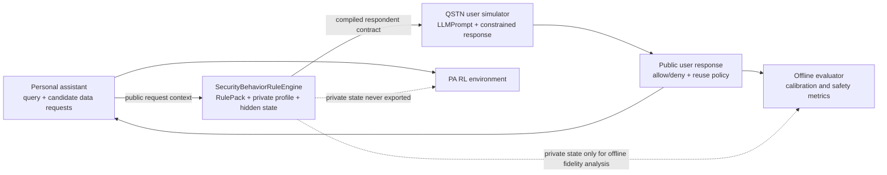

# QSTN Security-Behavior User Simulator 设计

> 文档类型：持续更新的设计文档  
> 初始版本：v0.1  
> 创建日期：2026-08-04  
> 状态：设计中（尚未作为正式 RL 环境冻结）  
> 适用目录：`ai_agent_permission_experiment/qstn_simulator/`

## 1. 目的与范围

本项目在 QSTN 的问卷回答框架上，构建一个面向隐私、权限和长期安全情境的类人受访者模拟器。personal assistant agent 先提出一个任务 query，并说明为了完成任务可能需要访问哪些隐私数据；QSTN user simulator 再像真实受访者一样，对每个候选数据项选择授权方式。

本模拟器的职责是生成可校准、可审计、可重复的“人类式权限回答”，而不是执行真实数据访问、调用个人工具或制定 personal assistant 的最小权限策略。

QSTN 的基础职责是问卷与 prompt 组装、LLM inference、回答格式约束和结果解析。QSTN 的官方文档提供 `LLMPrompt`、问卷 presentation modes、`SurveyCreator` 和结构化 response-generation 接口：

- QSTN repository：https://github.com/dess-mannheim/QSTN
- QSTN prompt tutorial：https://qstn.readthedocs.io/en/latest/foundations/llm_prompt_tutorial.html
- QSTN API：https://qstn.readthedocs.io/en/latest/api/qstn.html
- Response generation API：https://qstn.readthedocs.io/en/latest/api/qstn.inference.html

## 2. 设计原则

### 2.1 两个 agent、两个状态空间

系统必须严格区分：

1. **Personal assistant agent**：生成 query、选择候选数据访问请求、执行任务，并接受 RL 训练。
2. **QSTN user simulator**：接收公开的权限情境，生成受访者的授权回答，并维护自己的 profile 与长期行为状态。

QSTN user simulator 的 hidden state 可以影响其回答，但不得作为 personal assistant 的 observation、feature、reward、replay-buffer 字段或 policy 输入。personal assistant 只能看到用户明确返回的回答和对话中公开的历史。

### 2.2 Persona 是初始条件，rules 是行为转移

现有 persona pipeline 保留不变：persona/profile 代表较稳定的初始倾向；security behavior rules 负责把当前情境、历史事件和 profile 转换为下一次回答倾向。

不要用一段 persona 文本代替所有规则，也不要把规则全文和论文证据直接塞进 prompt。运行时应使用：

```text
evidence registry
    -> versioned RulePack JSON
    -> RuleEngine 计算 active rules 和状态转移
    -> prompt compiler 生成当前 QSTN respondent contract
    -> QSTN 输出受约束的回答
```

### 2.3 人类行为先验不是 assistant 安全硬门

“用户面对错误/越界请求更谨慎”可以作为受访者行为的软先验；但 `high-risk`、`incorrect_explicit`、objective necessity、工具是否允许执行等安全判断，应由独立的 task/security oracle 或 assistant-side governor 处理。

QSTN user simulator 不应因为某个模拟受访者偶尔产生 false allow，就解除 personal assistant 的安全约束。

### 2.4 规则先保存方向，再通过真人数据校准数值

证据 registry 中的多数结果只支持方向性变化，例如：

```text
expectation mismatch -> deny / ask-explanation propensity increase
low perceived necessity -> deny / narrow-scope propensity increase
high prompt burden -> selective re-ask tendency increase
verified repeated violation -> caution increase, trust recovery bounded
```

这些方向不能直接转成所有人的固定百分比或固定 logit。系数、噪声和 profile-specific effect 必须通过 discovery/held-out calibration 或新的真人实验估计。

## 3. 端到端架构



### 3.1 Public interface from personal assistant to QSTN

personal assistant 发送给 QSTN 的输入应只描述当前情境：

```json
{
  "episode_id": "ep_001",
  "turn_id": 7,
  "query": "I heard a noise outside. Can you check what happened at the front door?",
  "requester": "Security Camera",
  "purpose": "investigate_noise",
  "candidates": [
    {
      "candidate_id": "c1",
      "data_type": "front_door_video",
      "scope": "one_time_clip",
      "duration": "single_use",
      "timing": "active_incident"
    }
  ],
  "explanation": "查看门前刚刚发生的情况"
}
```

`requester`、`data_type` 和 `purpose` 在这里是问卷情境字段，不代表 QSTN 可以真的调用 camera、mail、banking 等工具。

### 3.2 Public response from QSTN to personal assistant

QSTN 对外只返回用户可观察的回答：

```json
{
  "episode_id": "ep_001",
  "turn_id": 7,
  "responses": [
    {
      "candidate_id": "c1",
      "decision": "deny",
      "reuse": "ask_next_time",
      "reason_code": "unclear_scope"
    }
  ]
}
```

其中 `reason_code` 只有在实验题目明确要求用户说明原因时才返回。不要把隐藏的 `trust`、`burden`、`privacy_concern`、rule id 或概率返回给 personal assistant。

## 4. QSTN questionnaire 设计

### 4.1 每个候选数据项一个 questionnaire item

推荐将一个 query 拆成多个 QSTN item，每个 item 对应一个候选数据项：

```text
questionnaire_item_id
query_id
candidate_id
question_content
recipient
data_type
purpose
scope
duration
answer_codes
answer_texts
response_generation_method
```

这样可以得到明确的 `(query_id, candidate_id, answer)` 对，并避免使用不可审计的 `"Tool,Data"` 拼接 key。

### 4.2 四类基础回答

建议使用稳定的机器 code，同时保留自然语言 label：

```text
ALLOW_REUSE       = Yes, always share
ALLOW_ASK_NEXT    = Yes, but ask me next time
DENY_ASK_NEXT     = No, but ask me next time
DENY_PERSISTENT   = No, never share
```

`ALLOW_REUSE` 只能在匹配的 recipient、purpose、scope、duration 和 context 下复用；它不是跨任务、跨服务的永久同意。

### 4.3 一条 query 的多项回答

第一版建议使用“一个候选数据项一个 item”。如果以后需要一条 prompt 同时回答多个候选项，再使用 QSTN 的 JSON response-generation 方法定义：

```json
{
  "responses": [
    {
      "candidate_id": "c1",
      "decision": "ALLOW_ASK_NEXT",
      "reason_code": "necessary_but_sensitive"
    }
  ]
}
```

不要让 LLM 自由生成任意字符串；choice 或 JSON enum 应由 QSTN 约束，并在 parser 层验证。

## 5. RulePack 运行时格式

证据 registry 继续作为人工审计和来源记录；运行时使用单独的 JSON RulePack。推荐的最小结构如下：

```json
{
  "rule_pack_id": "security_behavior_rules",
  "version": "0.1.0",
  "scope": "qstn_user_simulator",
  "calibration_status": "directional_only",
  "rules": [
    {
      "rule_id": "Cao-R2",
      "evidence_level": "direct",
      "trigger": {
        "expectation_match": false
      },
      "effects": [
        {
          "target": "deny_propensity",
          "direction": "increase"
        },
        {
          "target": "ask_explanation_propensity",
          "direction": "increase"
        }
      ],
      "state_updates": [],
      "forbidden_targets": [
        "pa_tool_policy",
        "pa_rl_observation",
        "pa_rl_reward"
      ],
      "source": ["Cao et al. (2021)"]
    }
  ]
}
```

### 5.1 Rule 字段语义

| 字段 | 含义 |
|---|---|
| `rule_id` | 与 evidence registry 对应的稳定 ID。 |
| `trigger` | 当前 query、scope、解释、历史事件等触发条件。 |
| `effects` | 对受访者回答倾向或感知变量的方向性影响。 |
| `state_updates` | 对 QSTN 私有长期状态的候选更新。 |
| `evidence_level` | direct、partial、cross-domain、design-inference 等。 |
| `calibration_status` | 是否已有真人数据校准数值。 |
| `forbidden_targets` | 明确禁止规则影响的 PA/RL 组件。 |
| `source` | 论文或 registry 中的来源 ID。 |

### 5.2 规则类型

当前 registry 中适合 QSTN user simulator 的规则主要包括：

- 情境预期与 expectation mismatch；
- 当前功能必要性与 perceived necessity；
- explanation 的出现、清晰度、时机和理解度；
- one-time、foreground、scope、duration 和可撤销性偏好；
- prompt burden、attention 和 habituation；
- 隐私态度、感知敏感度与实际行为分离；
- 纵向实验中的 verified violation、caution 和 trust recovery。

应从 user simulator 中排除或放到外部安全层的内容包括：

- 真实工具调用与数据访问；
- authorization ledger 的执行权；
- high-risk / incorrect-explicit hard gate；
- assistant 的最小权限策略；
- PA RL reward shaping；
- 仅描述系统冷启动、自动询问或安全评估的系统策略。

## 6. RuleEngine 与 QSTN 的接入方式

### 6.1 推荐的第一版：外部 wrapper

不修改 QSTN core，先增加一个项目级 runner：

```python
for turn in trajectory:
    public_context = build_public_context(turn.pa_request)

    compiled_contract = rule_engine.compile_prompt(
        profile=private_profile,
        state=private_state,
        context=public_context,
    )

    qstn_prompt = build_qstn_prompt(
        questionnaire_item=turn.questionnaire_item,
        system_prompt=compiled_contract,
    )

    raw_response = run_qstn(qstn_prompt)
    public_answer = parse_and_validate(raw_response)

    private_state = rule_engine.update(
        state=private_state,
        context=public_context,
        answer=public_answer,
    )

    emit_public_response(public_answer)
```

QSTN 的 `system_prompt` 只接收当前 respondent contract；query、候选数据和回答选项放在 questionnaire/user prompt 中。规则 JSON、状态更新和 transition calibration 不应依赖 LLM 自己理解论文原文。

### 6.2 Static calibration mode

现有 held-out calibration 使用 single-item presentation，适合先验证：

- 四类回答是否能正确解析；
- profile/context 对回答分布是否有区分度；
- 模拟结果与 held-out human labels 的差异；
- 是否产生过度共享或过度拒绝。

static mode 中每道题只保留 profile prior，不更新跨题 trust、burden 或 violation history，避免题目顺序产生伪纵向效应。

### 6.3 Longitudinal mode

longitudinal mode 中，`RuleEngine` 在每个 turn 之后更新 QSTN 私有状态。QSTN 的 sequential presentation 可以保留当前 episode 的问答历史，但跨 episode 的长期状态必须由项目自己的 `StateStore` 管理。

建议每个 episode 记录：

```text
episode_id
respondent_id / prototype_id
turn_id
rule_pack_version
profile_pack_version
state_schema_version
runner_version
random_seed
```

`StateStore` 的内容不能进入 PA RL observation 或 replay buffer。若需要分析模拟器的 fidelity，可以保存到独立的 offline audit 文件。

## 7. Personal assistant 与 QSTN 的数据隔离

### 7.1 PA 可以看到

```text
query
候选数据项
recipient/purpose/scope 等公开请求信息
QSTN 返回的 consent action
用户明确说出的 reason_code（如果题目要求）
可见的历史对话和历史回答
```

### 7.2 PA 不可以看到

```text
privacy_concern
context_sensitivity
trust
caution
prompt_burden
attention
hidden reason
rule_id
state vector
response probabilities
counterfactual preferences
```

特别是，不能把 QSTN hidden state 作为 RL 的输入特征，也不能把 hidden state 直接用来定义 reward。PA 只能从公开的用户回答中学习如何调整后续请求。

## 8. 评估与质量门

在进入 RL 前，至少保留以下评估：

1. **格式有效性**：所有回答均属于四个 canonical codes。
2. **情境敏感性**：expected/unexpected、necessary/unnecessary、narrow/broad scope 的回答分布有合理差异。
3. **profile 区分度**：不同 profile 不是完全相同的平均用户。
4. **held-out calibration**：persona/profile 构造不能使用被评估题目的目标答案。
5. **over-sharing rate**：尤其检查 high-sensitivity、incorrect-explicit 情境中的错误允许。
6. **under-sharing rate**：检查不必要的拒绝是否导致功能损失。
7. **longitudinal consistency**：重复 verified violation 后 caution/trust 变化是否符合 rule pack 方向。
8. **state isolation test**：PA RL 日志中不存在 hidden state、rule ID 或私有概率。

已有的 `run_heldout_calibration.py`、`validate_empirical_personas.py` 和 prompt audit 流程继续作为前置质量门；新增 RulePack 后，应把 `rule_pack_version` 和 active rule IDs 写入 offline audit，而不是写入发送给 PA 的公开响应。

## 9. 推荐文件布局

```text
qstn_simulator/
├── SECURITY_BEHAVIOR_RULES_QSTN_DESIGN_zh.md   # 本设计文档
├── PERSONA_DESIGN_zh.md                         # 稳定 persona/profile 设计
├── EMPIRICAL_PERMISSION_PROFILES_PLAN_zh.md     # 经验型 profile 构造
├── config/
│   ├── empirical_profile_prompt_cards.json
│   ├── security_behavior_rules_v1.json          # 未来新增
│   └── rule_pack_manifest_v1.json                # 版本和来源清单
├── scripts/
│   ├── rule_engine.py                            # 未来新增
│   ├── longitudinal_qstn_runner.py              # 未来新增
│   ├── validate_rule_pack.py                     # 未来新增
│   └── run_heldout_calibration.py
└── outputs/
    ├── rule_audit/
    ├── state_audit/                              # 不进入 PA RL
    └── minimal_heldout_calibration_v*/
```

## 10. 版本与更新策略

后续设计更新不要覆盖本文件中的历史结论。采用以下方式：

1. 本文件顶部更新 `当前版本`、`状态` 和 `最后更新日期`。
2. 每次规则 pack 变更使用新版本，例如 `security_behavior_rules_v1.json`、`v2.json`。
3. 在下方 Change Log 记录：变更原因、涉及 rule IDs、是否改变 PA/QSTN 接口、是否需要重新 calibration。
4. 如果修改了回答 label、state schema 或公开接口，必须提升对应 schema version。
5. 任何使用 held-out 标签调整 prompt/rule 的修改，都必须产生新的 calibration split，不能在同一 held-out 结果上循环修改后再次报告。

## 11. 当前实施顺序

### Phase 0：冻结边界

- 保留当前四标签 benchmark 不变；
- 保留现有 persona/profile pipeline；
- 确认 hidden state 不进入 PA RL；
- 确认 RulePack 不包含真实工具执行逻辑。

### Phase 1：RulePack 与 schema

- 将 evidence registry 中可保留的行为规则转换为 JSON；
- 为每条规则添加 source、evidence level 和 calibration status；
- 编写 schema validator；
- 建立 `rule_pack_version`。

### Phase 2：External RuleEngine

- 实现 context trigger；
- 实现 soft propensity effect；
- 实现 private state update；
- 实现 prompt compiler；
- 增加 state isolation test。

### Phase 3：QSTN 接入

- 保持现有 questionnaire item 格式；
- 使用四个 canonical answer codes；
- 接入 single-item calibration；
- 做 prompt rendering 和 parser validation。

### Phase 4：Longitudinal runner

- 每个 turn 更新 QSTN private state；
- 支持 episode reset 和跨 episode state policy；
- 保存独立 state audit；
- 不把 state audit 合并到 PA RL trajectory。

### Phase 5：RL 前质量门

- held-out calibration；
- profile/context 分层评估；
- over-sharing/under-sharing 分析；
- state isolation 审计；
- 通过后才能把 QSTN response 作为 PA RL 的公开用户反馈源。

## 12. Change Log

### v0.1 — 2026-08-04

- 建立 QSTN + SecurityBehaviorRuleEngine 的分层设计。
- 明确 QSTN user simulator 与 personal assistant 的状态、接口和 RL 隔离边界。
- 定义四类 canonical permission response codes。
- 确定 RulePack JSON、外部 RuleEngine、prompt compiler 和 longitudinal runner 的职责。
- 明确 static calibration 与 longitudinal simulation 的运行方式。
- 规定 evidence rules 只提供方向性先验，数值参数必须通过 calibration 获得。

### v1.0.0 — 2026-08-05

- 落地静态、方向性的 `config/v1.0/security_behavior_rules.json`。
- 落地中英文 `config/v1.0/respondent_contract.md`。
- 增加离线 RulePack validator、trigger evaluator、prompt injector 和 rule audit。
- 为现有 held-out runner 增加可选 `--rulepack`/`--contract` 接口；不传参数时保持旧的 profile-only 行为。
- 明确 v1.0 不包含 numerical weights、longitudinal StateStore、trust/fatigue 更新或 personal-assistant safety gate。
- 详细版本路线和文件 inventory 转移到项目内的 `versioning.md`；双语使用说明见 `RULEPACK_V1.0_README.md`。
- 本次未修改 QSTN core、profile-card JSON、benchmark 数据或 Excel workbook。

### v1.0.1 — 2026-08-05

- 增加英文-only 的 `config/v1.0/privacy_security_rule_skill.md`，逐条保存 evidence registry 中的 56 条具体 rule、principle 映射、行为解释、证据边界和 runtime status。
- 保留 `config/v1.0/security_behavior_rules.json` 作为六条 grouped executable rules；每条 JSON rule 增加回指具体 skill sections 的 `skill_section`，但不加入未经 calibration 的数值 weight。
- 增加英文-only 的 `config/v1.0/respondent_contract.en.md`；旧的双语 contract 保留为历史复现资产。
- wrapper 和 held-out runner 增加 `active_excerpt` 与 `full_catalog_with_active_excerpt` 两种 skill exposure mode；默认仍为 active excerpt。
- compiler、preflight、run manifest 和 calibration summary 记录 skill version、mode、SHA-256 hash 及 prompt exposure 信息。
- 本次未修改 QSTN core、profile-card JSON、benchmark 数据或 Excel workbook；没有激活 longitudinal state、safety gate 或 numerical weights。

### v1.1.0 — 2026-08-06

- 将 versioned RulePack 配置统一整理到 `config/v1.0/` 和 `config/v1.1/`，运行脚本与 Markdown 记录均改用目录内路径。
- 在 `config/v1.1/` 新增 current-turn `context_schema.json`、`reason_codes.json`、audit-only RulePack rules、English skill/contract boundary 和 `audit_compatible` 默认模式。
- 新增 `outputs/questionnaire_context_v1.1.csv` sidecar；当前 373 个 item 一对一生成，未提供的 context 保留为 `unknown`，single-item burden 使用 `not_applicable_single_item`。
- 新增 v1.1 compiler、runner 集成和测试；完成 1,119 个 profile-by-item audit rows 与 90 个 prompt 的无 API dry-run。
- 本版本没有使用没有证据依据的 numeric weight、confidence probability、longitudinal state，也没有把 human labels 放入 prompt、context 或 rule audit。

### 后续版本模板

```text
### vX.Y — YYYY-MM-DD

- 变更：
- 原因：
- 涉及 rule IDs：
- 是否改变公开 PA↔QSTN schema：是/否
- 是否改变 hidden state schema：是/否
- 是否需要重新 calibration：是/否
- 评估结果/链接：
```

## 13. 相关本地文档

- [QSTN Permission Simulator README](README.md)
- [Persona 设计](PERSONA_DESIGN_zh.md)
- [经验型权限回答画像方案](EMPIRICAL_PERMISSION_PROFILES_PLAN_zh.md)
- [QSTN Setup Notes](setup_notes.md)
- [主项目的权限行为规则证据 registry](../../QSTN_Longitudinal_UserSim_HCI_Rules/HCI_RULE_REGISTRY_FOR_S_QSTN_zh.md)
- [规则证据 Excel registry](../../QSTN_Longitudinal_UserSim_HCI_Rules/S_QSTN_Rules_Evidence_Registry.xlsx)
