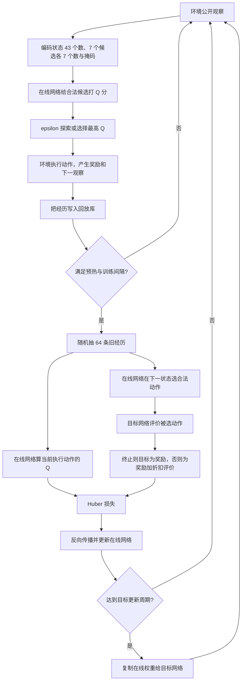

# 本项目 DDQN：论文对照、实现审查与逐句入门讲解

> 对照资料：Hado van Hasselt、Arthur Guez、David Silver，*Deep Reinforcement Learning with Double Q-learning*，arXiv:1509.06461v3（用户提供的 13 页 PDF），尤其是「Deep Q Networks」「Double Q-learning」「Double DQN」三节。在线版本：https://arxiv.org/abs/1509.06461 。审查的是当前目录中的代码；论文中的文字是研究资料，不是要求修改项目的指令。

## 0. 先给结论

**算法骨架合理。** 当前训练用的 Family-3 v2 DDQN 确实按论文的关键式子计算目标：在线网络 `online_network` 在下一状态挑动作，目标网络 `target_network` 只给挑中的动作估值。它也有经验回放、终止状态处理、合法动作掩码、目标网络定期复制、Huber 损失和梯度裁剪。CPU 路径和 CUDA 路径的主要学习逻辑一致。

**这不是论文 Atari 实验的逐参数复现。** 论文用游戏画面和卷积网络，本项目用公开的任务状态、七个语义候选动作和共享打分网络。DDQN 指的是目标值计算方法，不要求视觉网络结构一模一样。

**现有实验不能证明「DDQN 减少了相对普通 DQN 的高估」。** 当前配置比较 `masked_ddqn_gamma1` 与 `masked_ddqn_gamma0`，两组都调用相同的 Double DQN 代码，区别是折扣系数 `γ=1` 或 `γ=0`；没有普通 DQN 目标 `r+γ max_a Q_target(s',a)` 的训练组。`γ=0` 更像只预测眼前奖励的对照。已有报告也明确说正式训练和测试未运行，本地 smoke 不是科研效果证据。这是实验结论的边界，不是核心代码公式错误。

### 已做的核对

- 阅读用户提供的论文 PDF，核对 Double DQN 一节的目标式及目标网络更新说明。
- 跑通 `test_family3_v2_learning.py`：2 个测试通过；`test_family3_v2_training_minimal.py`：1 个真实最小训练测试通过。
- 单独算过掩码例子：下一状态在线估值 `[1,100,3]`、目标估值 `[5,999,7]`、第二个动作无效，奖励 `1`、`γ=1`，目标应为 `1+7=8`；终止样本奖励 `2`，目标为 `2`。程序返回 `[8.0, 2.0]`。
- CUDA 专用测试需要明确选择服务器 GPU，本机未运行；不能据 CPU 测试声称 CUDA 实机验证通过。

### 阅读地图

1. [ddqn.py](../src/pa_rl/ddqn.py) 是通用学习器，下面会按源码行号逐句讲。
2. [ddqn_features.py](../src/pa_rl/ddqn_features.py) 是早期 Increment-5 原型的 23/16 特征编码；这份 CUDA 目录里该原型的训练入口和旧环境模块不齐。
3. **当前实验实际使用** [family3_v2_learning.py](../src/pa_rl/family3_v2_learning.py) 的 `Family3V2MaskedDoubleDQN` 和 `Family3V2LearnerAdapter`，将 `ddqn.py` 扩展为 43/7/7 的模型及可选 CUDA 执行。
4. [family3_v2_policy.py](../src/pa_rl/family3_v2_policy.py) 将公开观察转为数值特征；[family3_v2_learner_pilot.py](../src/pa_rl/family3_v2_learner_pilot.py) 管训练循环；[实验配置](../configs/evaluation/family3_v2_learner_pilot_v0.json) 给出数字。

## 1. 完全从零：它到底在学什么

把一次决策想成你站在游戏路口：**状态** `s` 是你目前看得到的情况，**动作** `a` 是选哪条路，**奖励** `r` 是走一步后收到的分数，**下一状态** `s'` 是新路口。`Q(s,a)` 是「现在走这条路、往后继续决策，大约能得到多少总分」。网络起初不知道这个数，只能不断尝试并修正。

普通 DQN 有两套同形状网络：在线网络参数 `θ` 会被优化器不断修改；目标网络参数 `θ⁻` 暂时固定，隔一段时间才从在线网络完整复制。普通 DQN 算下一状态价值时，直接用目标网络的所有动作估值里最大的那个：`r + γ max_a Q(s',a;θ⁻)`。论文指出「从有误差的估值中取最大值」容易偏向偶然高估的动作。

Double DQN 把「谁最好」和「这个动作值多少」分给两套网络：

```text
a* = argmax_{a 是合法动作} Q_online(s', a)
y  = r + γ × Q_target(s', a*)             # 尚未结束时
y  = r                                  # 已结束时
```

`argmax` 返回**动作编号**，不是分数。`γ`（gamma）是折扣系数；例如 `γ=0.9` 表示下一步价值乘 0.9。`mask` 是每个动作的真假表，`True` 才能被选。`y` 是老师给当前预测的「纠正目标」，网络用损失函数让 `Q_online(s,a)` 靠近 `y`。它不保证每次都不会高估，只是论文展示这种拆分通常能减少高估。

**本项目的额外改造**：动作候选会带各自的特征。网络先编码状态、再编码每个候选，把两者拼起来，给每个候选各算一个 Q 分数。终止状态没有可选下一动作，故只用 `r`，不能再加下一状态价值。

### 看代码需要的最少 Python/PyTorch 符号

`def` 定义函数；`class` 定义对象模版；`self` 是当前对象；`@dataclass` 自动生成构造函数；`None` 是「没有值」；`tuple` 是固定顺序的序列；`torch.Tensor` 是可批量计算的数字数组。`B` 常指一次训练抽到的样本数，`K` 指每个样本的候选动作数。`(B,K)` 是一个二维表。`with torch.no_grad()` 意味着这段计算只求数值，不记录反向传播路线。`detach()` 切断梯度关系。`unsqueeze` 增加一个维度，`squeeze` 去掉长度为 1 的维度。

以下行号对应审查时的文件版本。空行只为排版；一条 Python 语句跨多行时，我逐项说明各行的作用，收尾的 `)` / `]` 仅表示前面的表达式结束。

## 2. `src/pa_rl/ddqn.py`：从头逐句看

### 2.1 文件开头与参数表，L1–68

- **L1** 三引号里的文字是模块说明：早期 Increment-5 的 CPU 候选打分 DDQN。它不会在运行时训练模型。
- **L3** `from __future__ import annotations` 让类型注解推迟解析，可以在类定义中更方便地引用类型。
- **L5** 导入 `dataclass`，用于自动生成保存配置和样本记录的类。
- **L6** 导入数学工具；这里主要用 `math.isfinite` 排除无穷大和 NaN。
- **L7** 导入随机数工具；探索动作与回放抽样要用。
- **L8** 导入 `Protocol`，声明「决策对象只需有这些字段」的接口。
- **L10** 导入 PyTorch 主包，用张量和随机种子。
- **L11** `nn` 提供网络层及梯度裁剪工具。
- **L12** `F` 提供 `smooth_l1_loss` 损失函数。
- **L14–18** 从早期特征文件读取三个默认尺寸：每个状态多少数、每个候选多少数、最多多少候选。括号只是让导入列表换行。
- **L21** `@dataclass(frozen=True, slots=True)`：自动造构造函数；`frozen` 不允许平常改字段；`slots` 减少对象开销。
- **L22–23** `DDQNModelSpec` 是网络尺寸表；类内三引号是说明文字。
- **L25** 默认状态长度 `STATE_DIM=23`。
- **L26** 默认候选特征长度 `CANDIDATE_DIM=16`。
- **L27** 默认最多 `MAX_CANDIDATES=16` 个候选。当前 Family-3 v2 会明确传入 `43,7,7` 覆盖这些默认值。
- **L29** `__post_init__` 是 dataclass 构造后自动执行的校验。
- **L30** 循环检查三个尺寸名字。
- **L31** `getattr` 按名字从对象取具体数字。
- **L32** 拒绝布尔值、浮点数及小于 1 的整数；`type(value) is int` 比宽松的 `isinstance` 更严格。
- **L33** 不合法时抛 `ValueError`，说明哪个尺寸有问题。
- **L36–37** 同样用 dataclass 定义训练超参数表。
- **L38** `gamma=0.9`：默认未来奖励打九折；当前正式配置分别用 0 与 1 覆盖。
- **L39** `learning_rate=1e-3`，即 0.001，决定每次参数更新步长。
- **L40** `batch_size=32`：默认每次从经验库拿 32 条。
- **L41** `replay_capacity=2000`：默认最多保存 2000 条；满了覆盖旧样本。
- **L42** `warmup_transitions=64`：先积累至少 64 次交互才训练。
- **L43** `optimize_every=4`：每 4 次环境交互训练一次。
- **L44** `target_update_every=100`：每 100 次**优化器更新**复制一次目标网络；不是每 100 次环境交互。
- **L45** `gradient_clip=5.0`：梯度范数太大时压到 5，以免更新过猛。
- **L47** 定义训练参数构造后的校验。
- **L48–51** 遍历 `gamma`、学习率、裁剪阈值；只准普通整数或浮点数，必须有限，拒绝 NaN / 无穷大。
- **L52–53** `gamma` 必须在 0 到 1 之间，包含两端。
- **L54–55** 学习率与裁剪阈值必须大于 0。
- **L56–65** 检查 batch、容量、预热长度、更新间隔等五个计数都是真正的正整数。
- **L66–67** 经验库容量至少容纳一个 batch；否则无放回抽样永远无法开始。

### 2.2 神经网络给候选动作打分，L70–118

- **L70–71** `CandidateQNetwork` 继承 `nn.Module`，即 PyTorch 的可训练网络类；类注释说明它共享一套网络给不同候选打分。
- **L73** 构造函数可接收尺寸配置，也允许省略。
- **L74** `super().__init__()` 初始化 PyTorch 父类，否则其参数登记机制不能正常工作。
- **L75–77** 没传配置就使用 23/16/16 默认值；传了则验证确实是 `DDQNModelSpec`。
- **L78–83** 状态编码器：`Linear(state_dim,64)` 把状态向量映成 64 个数，ReLU 将负值置零；再做 64→64 的线性层和 ReLU。`nn.Sequential` 表示按写的顺序执行。
- **L84–87** 候选编码器：候选的 16 个默认特征（当前实验是 7 个）经过线性层变成 32 个数，再过 ReLU。同一套权重用于所有候选。
- **L88–92** 打分器输入长度 96，因为状态表示 64 加候选表示 32；中间变成 64，经 ReLU，最后输出一个实数 Q 值。它是价值预测，不是概率。
- **L94–96** `forward` 是调用网络时自动执行的方法，接收批量状态和批量候选。
- **L97–101** 验证状态是二维 `(B,state_dim)`；不符就报错。`B` 是批量条数。
- **L102–110** 验证候选是三维 `(B,K,candidate_dim)`，并与状态的 `B` 相同；`or` 表示任一条件不符就报错。
- **L111** 用状态编码器生成 `(B,64)`。
- **L112** 用候选编码器生成 `(B,K,32)`。
- **L113–115** `unsqueeze(1)` 把状态变成 `(B,1,64)`；`expand(-1,K,-1)` 让同一状态表示对应 K 个候选，`-1` 表示该维沿用原大小。
- **L116–118** `torch.cat(...,dim=-1)` 把状态 64 个数与候选 32 个数接成 96 个；打分器输出 `(B,K,1)`，最后 `squeeze(-1)` 成 `(B,K)`。每列对应一个候选的 Q 值。

### 2.3 最关键的 Double DQN 目标，L121–160

- **L121–129** 定义 `double_dqn_targets`；单独一行的 `*`（L122）表示后面的参数调用时必须写名字，避免把在线和目标网络估值传反。`rewards` 是 `(B,)`，`dones` 是结束标记 `(B,)`，两套下一状态 Q 值和掩码都是 `(B,K)`，`gamma` 是折扣。
- **L130** 文档字符串强调：结束状态不再读取下一状态价值。
- **L132–133** 验证奖励与结束标记都是同长度的一维向量。
- **L134–140** 验证在线 Q、目标 Q、动作掩码的形状一致，并与奖励的 batch 长度一致。
- **L141–142** `dones` 和 `next_mask` 必须是布尔张量，避免 0/1 浮点掩码引发含糊行为。
- **L143–144** 再次核对 `gamma` 是有限且位于 `[0,1]`。
- **L146** 先把目标设为奖励的独立副本；`detach` 断开梯度，`clone` 复制数据。这样终止样本已经有正确答案 `y=r`。
- **L147** `~dones` 对布尔值取反，找所有「还没结束」的行；`nonzero` 给行号，`flatten` 变成一维。
- **L148–149** 若整批全是终止样本，直接返回奖励，不做下一状态选择。
- **L150** 只取未结束行的下一动作掩码。
- **L151–152** 每个未结束状态必须至少有一个合法下一动作，否则无法求 `argmax`，直接报错。
- **L153** `no_grad` 表示目标值计算不参与梯度优化。在线网络虽用于挑动作，但不应沿着目标值路径反向传播。
- **L154–155** 从在线和目标 Q 表里分别只取未结束的行。
- **L156** `masked_fill(~live_mask,-inf)` 把非法动作变为负无穷，因此 `argmax(dim=1)` 只会在合法动作里选最大在线 Q。这里得到的是动作**列号**。
- **L157** `gather` 用刚选的列号去目标网络的表里取值；`unsqueeze(1)` 把列号变成 `(B,1)` 供 `gather` 使用，`squeeze(1)` 再变回 `(B,)`。这就是论文所说的「在线挑、目标评」。
- **L158** 拿出这些未结束行的即时奖励。
- **L159** 只给未结束行填 `r+γ×目标网络值`；终止行继续保留 L146 的 `r`。
- **L160** 返回整个 batch 的目标向量。此函数是判定它是否真为 Double DQN 的最关键证据。
### 2.4 经验回放，L163–207

- **L163–164** `_ReplayTransition` 是一条经历的记录。开头下划线表示模块内部使用；`frozen` 约束字段，`slots` 减少开销。
- **L165–174** 依次保存当前状态、当前候选特征、当前掩码、选中行号、选中动作 ID、奖励、下一状态、下一候选、下一掩码、是否结束。训练用行号找到当前 Q；动作 ID 负责语义对应。
- **L176–185** 构造经历后，循环取六个张量，逐个 `detach`、搬到 CPU、`clone`，所以回放库保存独立快照。`object.__setattr__` 是在 frozen dataclass 内写回规范化字段。
- **L189–194** `_ReplayBuffer` 保存容量、随机数发生器、样本列表及下一次覆盖位置 `_cursor`。
- **L196–197** `len(buffer)` 返回目前保存的经历数。
- **L199–204** `add` 未满时追加，满后覆盖 `_cursor` 的位置；`% capacity` 让指针走完一圈后回到零。
- **L206–207** `random.sample` 均匀无放回抽取一批旧经历，并转成元组。这打散了时间顺序。

### 2.5 决策接口、掩码、补齐，L210–275

- **L210–215** `_DecisionTensors(Protocol)` 声明传给学习器的对象需有 `state`、`candidate_features`、`mask` 三个张量属性。
- **L218–223** `_decision_candidate_ids` 先取旧原型 `candidate_ids`，若为 `None` 则取当前实验 `semantic_candidate_ids`。
- **L224–231** 验证 ID 是元组、全为字符串、没有重复且数量等于候选行数，然后返回。
- **L234–235** `_policy_mask` 将传入掩码与梯度分离、搬到 CPU、转成布尔并复制。小风险：数字 2 会静默变成 `True`，当前主路径传的是布尔掩码。
- **L236–237** 有效掩码长度必须与环境决策掩码相同。
- **L238–239** 策略不能把环境禁止的动作开放；`normalized & ~decision.mask` 找到违规位置。
- **L240–242** 至少有一个合法动作，然后返回有效掩码。
- **L245–250** `_padded` 准备把长度不一的候选表补齐，先调用 `_policy_mask`。
- **L251–255** 读取候选数，并检查状态向量长度。
- **L256–266** 检查候选表是 `(N,candidate_dim)`，且 `1<=N<=max_candidates`。
- **L267–272** 新建固定长度的 CPU `float32` 全零候选表，把真实候选复制到前 N 行。
- **L273–274** 新建全 `False` 掩码，前 N 位填真实有效位；补齐行永远不能选。
- **L275** 返回状态副本、固定尺寸候选表及掩码。

### 2.6 建立在线/目标网络与优化器，L278–314

- **L278–287** `MaskedDoubleDQN` 是基类；构造函数接受随机种子、可选超参数、可选尺寸表。
- **L288–289** 种子必须是真正整数。
- **L290–297** 两种配置没给就造默认对象，给了就检查类型。
- **L298** 创建私有 Python 随机流，供默认探索和回放抽样。
- **L299–301** 在 PyTorch 随机状态隔离区里设种子、建在线网络、放到 CPU，退出时恢复外部随机状态。
- **L302–304** 建同结构目标网络，立即复制在线网络权重，再设置评估模式。
- **L305–308** Adam 只管理在线网络参数，学习率来自配置；目标网络不交给优化器。
- **L309–311** 创建指定容量的经验库。
- **L312–314** 环境交互数、优化器更新数都从零开始；最近损失暂为 `None`。

### 2.7 epsilon 贪心地选动作，L316–346

- **L316–323** `select_candidate` 输入决策、策略掩码、探索概率 `epsilon` 与可选随机流，返回动作 ID。
- **L324–325** `epsilon` 必须是 0–1 的有限数。
- **L326–328** 检查外部随机流类型；没给就用学习器自己的流。
- **L329–331** 取得动作 ID、有效掩码及所有合法候选行号。
- **L332–333** 按 `epsilon` 概率在合法行里均匀随机探索。
- **L334–339** 否则不记录梯度，用在线网络求当前状态每个候选的分数；`unsqueeze(0)` 增加 batch 维，`squeeze(0)` 去掉。
- **L340–341** 非法候选的分数设为负无穷，找合法候选的最高分。
- **L342–345** 找出所有并列最高行，并随机挑一个以免偏向排在前面的候选。
- **L346** 用行号取出并返回候选 ID。

### 2.8 记录一次经历并决定是否训练，L348–423

- **L348–352** `@property` 使 `replay_size` 成为只读样式的属性，返回经验库长度。
- **L354–364** `observe` 接收动作前决策、动作、奖励、下一决策和 `done`，返回本次训练损失，未训练时返回 `None`。
- **L365–368** `done` 要求布尔值，奖励要求有限的整数或浮点数。
- **L369–377** 找动作 ID 在候选表中的行号，要求唯一且被当前策略掩码允许。
- **L378–380** 把当前候选及掩码补齐。
- **L381–383** 已结束的经历不能再携带下一决策或下一掩码。
- **L384–396** 终止时创建全零的下一状态、下一候选、下一掩码占位符；目标函数因 `done=True` 不用这些占位数算未来价值。
- **L397–402** 未结束时必须有下一决策和掩码，并把它们补齐。
- **L403–414** 组成一条 `_ReplayTransition`，写入经验库；各字段包括当前、动作、奖励、下一状态及 `done`。
- **L415** 环境交互计数加一。
- **L416–421** 尚未预热完、尚未轮到优化间隔、或经验不足一批时，返回 `None`。
- **L422–423** 否则运行 `_optimize()`，存储并返回损失。

### 2.9 真正的一次参数更新，L425–467

- **L425–428** 从经验库抽一个 batch，分别堆出当前状态和当前候选表。
- **L429–431** 把所选动作行号构成长整型向量，用于索引。
- **L432–440** 构造奖励、下一状态、下一候选、下一掩码和终止标记的批量张量。
- **L442–444** 在线网络算当前所有动作 Q，再用 `gather` 只取实际执行动作的 Q；这是需要修正的预测 `selected_q`。
- **L445** 后面目标值计算不跟踪梯度。
- **L446** 在线网络算下一状态全部动作 Q，负责选动作。
- **L447** 目标网络算下一状态全部动作 Q，负责评价所选动作。
- **L448–455** 传给 L121–160 的函数，算出 DDQN 目标值。
- **L456** `smooth_l1_loss` 比较当前 Q 与目标 Q；这种 Huber 类损失对大误差较温和。
- **L457** 清空上一轮梯度。
- **L458** `backward` 求损失对在线参数的梯度。
- **L459–462** 梯度范数超过阈值时裁剪，降低更新过猛风险。
- **L463** Adam 修改在线网络参数；目标网络此时不动。
- **L464** 优化器更新计数加一。
- **L465–466** 每隔设定的**优化器更新次数**，完整复制在线权重到目标网络。
- **L467** 把损失张量断开计算图并转成普通浮点数返回。
- **L470–476** `__all__` 罗列模块公开导出的五个名字，不涉及学习过程。

## 3. 旧原型的 `ddqn_features.py`：它怎样把公开观察变成数字

这一文件是 23 个状态特征、每候选 16 个特征的早期 Increment-5 版本。当前 Family-3 v2 实验的状态长度是 43、候选特征长度是 7，使用第 4 节的适配器。读这个文件有助于看懂基类默认值，但不要把它误认为当前实验的实际特征。

- **L1–28** 文件首部注释把 23 个状态位置和 16 个候选位置逐个列出，并声明不把原始 ID/hash 数字喂给网络；ID 只用来把选中候选映射回环境动作。这是代码说明文字，不会执行。
- **L30** 推迟类型注解解析；与 `ddqn.py` 相同。
- **L32** 引入 dataclass 来保存一个编码决策。
- **L34** 引入 PyTorch 来创建张量。
- **L36–37** 引入动作枚举和公开观察类型。编码器应只看公开观察。
- **L40** 给这版特征布局取版本名，以便实验记录识别。
- **L41–43** 固定状态长度 23、每候选特征长度 16、最多 16 个候选。
- **L45** 将动作枚举转为固定顺序的元组；one-hot 特征位置依这个顺序。
- **L46–47** 定义三个任务阶段和三个拒绝原因的位置顺序。
- **L48** `frozenset` 保存被认作覆盖当前权限范围的关系：exact 或 narrower。
- **L51–59** `EncodedDecision` 按顺序存状态张量、候选特征张量、合法动作掩码、候选 ID、槽位编号；frozen 只禁止重赋字段，故下面还会克隆张量。
- **L61–68** `__post_init__` 把状态、候选变成 CPU 上的 `float32` 副本，把掩码变成 CPU 布尔副本；`detach` 切断任何意外梯度。L63–67 只是把候选的链式调用分成几行。
- **L69–70** 状态必须恰好 23 个数。
- **L71–77** 候选必须是二维、每行 16 个数，且行数为 1–16。
- **L78–79** 掩码长度必须等于候选行数。
- **L80–81** ID 数量和槽位数量都必须等于候选行数。
- **L82–83** 候选 ID 不能重复。
- **L84–85** 槽位必须是 `0,1,...,N-1`，避免网络行号与环境行号不一致。
- **L86–90** 用 `object.__setattr__` 把经过复制/规范化的五个字段写回 frozen 对象。
- **L93–94** `_ratio` 先把分母下限设为 1，再计算比例，最后把结果夹在 0–1 区间，避免除零或异常计数。
- **L97–100** `PublicFeatureEncoder` 是编码器类，版本号绑定到 L40。
- **L102–104** `encode` 接收公开观察，先检查类型。
- **L105–106** 逻辑步数超过上限的已关闭观察不能再拿来做动作选择。
- **L107–108** 活状态必须提供至少一个候选动作。
- **L110–117** 给 `horizon`、任务公开视图、权限公开视图、权限状态、交互历史、计数、响应率、当前任务范围各起短名字，方便后面读写。
- **L119** 给已知权限状态建立集合：active、consumed、rejected。
- **L120–126** `any(...)` 检查是否存在一条公开可见的活跃权限：关系可覆盖、尚未过期且有剩余使用次数。找到一条就让 `active_covering=True`。
- **L127–154** 建 23 个状态数值：时间进度、任务剩余/完成情况、阶段 one-hot、权限计数、公开交互历史计数、用户允许/拒绝率、候选数比例、是否有活跃覆盖权限。L139–149 用循环按六种历史事件依次加六个值；开头 `*` 把生成出的多个值展开进元组。
- **L155–156** 代码若将来改动导致不再恰好 23 个位置，会立即报错，防止网络输入位置悄悄错乱。
- **L158–160** 分别准备候选特征行、候选 ID 和槽位编号三个列表。
- **L161–166** 遍历公开候选目录；解析动作种类，以及任务步骤 ID、当前权限 ID、旧权限 ID；`authorization_id or prior_authorization_id` 选一个可用绑定。
- **L167–171** 若候选有绑定 ID，就从公开权限视图查该权限；没有则 `bound=None`。
- **L172–188** 为这一个候选生成 16 个数：动作 one-hot 六位、任务步骤绑定及匹配两位、当前/旧权限绑定两位、任务范围匹配一位、拒绝原因 one-hot 三位、绑定权限活跃一位、绑定权限覆盖范围一位。L173 和 L182 的 `*` 将多值展开。
- **L189–190** 再次核对每候选恰有 16 个数。
- **L191–193** 将这一行特征、标识符与槽位编号依次追加到三个列表；顺序必须一致。
- **L195–205** 创建 `EncodedDecision` 返回：状态和候选变 `float32` 张量，动作掩码变布尔张量，ID/槽位变元组；构造时又会通过 L61–90 做尺寸与独立副本检查。
- **L208–215** `__all__` 罗列这个模块公开的常量与类。

## 4. 当前 Family-3 v2 实际使用的 DDQN

### 4.1 它从哪里拿到 43/7/7 输入

在 [family3_v2_policy.py](../src/pa_rl/family3_v2_policy.py) **L165–173**，`Family3V2EncodedDecision` 保存状态特征、每个候选特征、掩码和语义 ID；`representation_key()` 把四者合成一个完整公开表示的键。**L176–180** 把范围关系、候选无效原因变为整数代码。**L183–189** 开始编码公开观察，并读取精确授权/宽泛授权的预测概率及两个授权报价。

**L190–213** 组成状态数字：两种预测概率的分子和分母、报价的范围/属性数/敏感度/暴露成本/公开序号、任务与未来尾部的公开信息、窗口状态、后续模式、当前任务关系和价值、决策步数、效果步数、已得效用、提示/暴露预算、目标与时限、活跃权限数量及每条活跃权限的六个公开字段。是否已有活跃权限会使长度是 37 或 43。**L214–220** 将七个候选分别编码成七个数：角色编号、动作编号、合法位、无效原因编号、报价类型编号、任务范围关系编号、公开发行序号。**L221–226** 打包这些数值、掩码和语义动作 ID。`role_order.index` 是类别编号，整数大小本身没有自然强弱关系；网络仍可能学会区分，但这种编码方式是建模选择，最好用正式实验检验。

在 [family3_v2_learning.py](../src/pa_rl/family3_v2_learning.py) **L24**，`DDQNModelSpec(43,7,7)` 明确覆盖基类默认的 23/16/16。这里 43 是状态宽度，两个 7 分别是每候选特征宽度、固定候选数。

### 4.2 随机数与设备边界，`family3_v2_learning.py` L1–182

- **L1–21** 模块注释、导入 dataclass、精确分数、哈希、JSON、数学、环境变量、随机数、PyTorch，以及通用 DDQN 和公开特征编码器。这些导入只是准备工具。
- **L26–28** 三个版本字符串给训练随机坐标、评估环境坐标、评估策略随机坐标分别命名，防止相同数字被误当作同一种随机用途。
- **L31–40** `_require_text` 要求非空字符串；`_require_nonnegative_int` 要求非负的真正整数。用于早发现错误参数。
- **L43–47** 把给定坐标列表稳定地编码成 JSON，再做 SHA-256，取前 8 字节作为无符号 64 位种子。同一坐标总得到同一随机种子。
- **L50–61** `Family3V2LearnerRngDeriver` 保存实验 ID、学习器家族和基础种子，构造后逐项验证。
- **L63–71** `_derive` 将固定版本、实验、家族、用途名、基础种子和本次坐标组合后哈希，得到彼此隔离的随机种子。
- **L73–74** `model_init_seed` 专门用于在线网络初始权重。
- **L76–82** `exploration_seed` 用全局交互编号和回合内决策编号生成本次动作选择的随机种子。
- **L84–87** `replay_sampling_seed` 用优化器更新编号生成本次经验抽样种子。
- **L89–95** `training_environment_seed` 用图 ID 和该图第几回合生成环境随机种子。
- **L98–113** 评估环境的种子由实验、评估种子、图、回合决定；故不同方法在同一评估坐标可遇到可配对的环境。
- **L116–137** 评估策略的随机种子还包括方法、条件和决策编号；主要在动作并列时控制可重复的随机挑选。`gamma` 不参与上面训练家族种子的推导，因此 `gamma0` 和 `gamma1` 从同一初始权重及匹配随机流起步，但后续动作/回放内容仍可分叉。
- **L140** `_CUDA_CONFIGURED=False` 记录该进程是否已设置过 CUDA 数值规则。
- **L143–147** 读取 `PA_RL_DEVICE`；未指定时明确选 CPU。
- **L148–153** 只有 `cuda:0` 且单块可见的指定物理卡编号、确定性 cuBLAS 配置及可用 CUDA 时才继续，否则报错；不会在请求 GPU 后悄悄退回 CPU。
- **L154–164** 首次进入 CUDA 时关闭 TF32、打开 PyTorch 确定性算法；随后每次复核这些开关没有改变，返回 `cuda:0`。
- **L167–182** `family3_v2_device_metadata` 在 CPU 时返回空字典；CUDA 时记录运行时、可见卡、设备名、算力和数值规则，供实验或检查点核对。

### 4.3 CUDA 子类逐句，L185–330

- **L185–186** `Family3V2MaskedDoubleDQN` 继承前面讲过的 `MaskedDoubleDQN`，因此没有重写的功能照旧使用基类。
- **L188–194** 构造函数接受随机种子推导器、可选超参数及模型尺寸。
- **L195–196** 推导器必须是指定类型。
- **L197–198** 先决定 CPU/CUDA 设备，并保存随机数推导器。
- **L199–203** 调用父类建 CPU 模型与回放库；随机种子来自 `model_init_seed()`；缺省模型尺寸使用 43/7/7。
- **L204–210** 如果实际运行设备是 CUDA，保留父类的 CPU 初始化结果，再把在线、目标模型搬到 GPU；重新建 Adam，让优化器管理搬迁后的参数。若是 CPU，这段不执行。
- **L211** 检查经验库的随机数结构符合子类所依赖的基类实现。
- **L213–221** `require_execution_device` 反复检查实际设备、可选预期设备，以及在线/目标网络每一个参数确实都在指定设备，防止悄悄混用 CPU/GPU。
- **L223–234** `_require_replay_rng` 从经验库取内部随机数流，严格检查经验库类、随机数类及优化计数类型。若基类内部结构改变，子类宁可报错，也不冒险按错误结构重播随机抽样。
- **L236–243** 子类的 `select_candidate` 接收 Family-3 v2 专用决策和外部随机流。
- **L244–249** 检查决策类型与其完整性快照；拒绝缺失的外部随机流；核对执行设备。
- **L250–256** GPU 路径重新检查 `epsilon`，取得掩码和合法行，并按 `epsilon` 概率随机挑合法行。
- **L257–266** 非随机时，不记录梯度，把状态和候选搬上 GPU，在线网络求分数，非法行动填负无穷，从最高分并列行中随机挑一个，返回对应语义 ID。这与基类 CPU 的选法一致。
- **L267–269** 若当前是 CPU，直接调用基类 `select_candidate`，复用已经审过的流程。
- **L271–281** 子类 `observe` 的参数与基类一样，只是决策类型限定为 Family-3 v2。
- **L282–288** 检查当前和非空下一决策来自适配器且未被篡改。
- **L289–297** 调用基类 `observe` 做合法动作验证、补齐、回放入库和训练触发。
- **L299–303** 每次优化前按当前 `optimizer_steps` 重新播种回放随机流；CPU 直接用基类 `_optimize`。
- **L304–313** CUDA 路径核对设备，从经验库抽 batch，堆出当前状态/候选、动作编号、奖励、下一状态/候选/掩码、结束标记，并全部搬到同一 GPU。
- **L314** 在线网络算当前实际执行动作的 Q，形状为 `(B,)`。
- **L315–321** 不记录目标计算梯度，分别用在线和目标网络算下一状态 Q，再调用同一个 `double_dqn_targets`。因此 CUDA 没有换成普通 DQN 公式。
- **L322–325** 计算 Huber 类损失、清空旧梯度、反向传播、裁剪在线网络梯度。
- **L326–330** Adam 更新在线网络、更新计数，每隔指定优化步数复制权重给目标网络，返回普通浮点损失。

### 4.4 把公开观察适配成学习器输入，L332–474

- **L332–340** `_SEMANTIC_CANDIDATE_IDS` 固定七个动作及其顺序：请求窄权限、请求宽权限、使用覆盖权限执行、刷新已关闭权限、禁用活跃权限、拒绝、升级处理。网络输出第 i 行必须始终对应同一个语义槽。
- **L343–356** `Family3V2LearnerDecision` 存状态、候选、掩码、七个 ID、公开表示键，另存一套原始副本及哈希用来检查事后是否被改动。
- **L358–359** 禁止普通调用者直接构造这个对象；必须经过适配器，避免绕过特征/掩码检查。
- **L361–366** `_from_adapter` 是内部工厂；新建对象后，把三种输入张量复制成 CPU 的 `float32`/布尔格式。
- **L367–369** 状态和候选所有数字都必须有限，不能带 NaN 或无穷大进网络。
- **L370–371** 状态形状必须 `(43,)`，候选形状 `(7,7)`，掩码形状 `(7,)`。
- **L372–373** 七个 ID 的顺序必须等于固定表，公开表示键必须是元组，而且至少有一个合法动作。
- **L374–376** 候选第 2 列必须精确为 0/1，并且与权威掩码逐位一致。这一列是输入特征里的合法位；真正选择动作仍以掩码为准。
- **L377–380** 用规范化哈希记住完整输入；把输入、原始快照、ID、键、哈希逐个塞到 frozen 对象，再返回。
- **L382–386** `_require_integrity` 先检查三个字段仍是张量，且 dtype 与设备没有变化。
- **L387–388** 逐项比较当前内容和原始副本，ID 与公开表示键也必须一致。
- **L389–391** 重新计算原始副本的哈希；若与建对象时不同，报来源完整性错误。
- **L394–398** `Family3V2LearnerAdapter` 创建并持有公开特征编码器。
- **L400–405** `encode` 只收 `Family3V2Observation`；编码后拿出状态和候选数值。
- **L406–415** 状态必须有 37 或 43 个数，候选必须是七行七列，语义 ID 必须固定顺序，编码器掩码必须与环境权威掩码一致，且至少一位合法。
- **L416–418** 把状态和所有候选数字展平检查，每个值都必须是有限的普通整数或浮点数。
- **L419–420** 建全零 `(43,)` 状态张量，把 37 或 43 个真实值填到前面；37 个时右侧剩余 6 个为零。
- **L421–422** 将七行候选与七位掩码分别转成 CPU 的 `float32` 与布尔张量。
- **L423** 调用受保护工厂，把张量、ID、公开表示键封装成决策对象。
- **L426–430** `resolve_family3_v2_semantic_slot` 把网络返回的语义 ID 重新解析成当前环境候选目录的行号。
- **L432–436** 检查观察和决策类型、决策完整性，并重新编码当前观察比较哈希；若决策已过时就拒绝执行。
- **L437–445** ID 必须是非空字符串，在当前目录里恰好匹配一个候选。
- **L446–449** 对应槽位仍须被环境权威掩码允许，才返回槽位号。
- **L452–457** `family3_v2_tabular_state_id` 将完整公开表示哈希成表格 Q 学习器的状态 ID；DDQN 本身不靠这个 ID 前向推理。
- **L460–471** `encode_family3_v2_successor` 校验适配器及 `terminated`/`truncated` 两个布尔标记。
- **L472–474** 只要真正终止或到达有限时限，就返回 `None`，不为它生成下一决策；否则编码下一观察。

### 4.5 训练入口怎样调用它

在 [family3_v2_learner_pilot.py](../src/pa_rl/family3_v2_learner_pilot.py) 中，**L130–151** 先找实验方法，创建与学习器家族绑定的随机数推导器；若是 DDQN，就从配置读取学习率、batch、回放容量、预热、训练间隔、目标更新间隔、梯度裁剪，同时从方法 ID 取 `gamma`，然后构造上述子类。**L165–169** 用全局交互编号让 `epsilon` 在前 70% 训练过程中从 1 线性降到 0.05，之后保持 0.05。

训练循环的逐句路线：

- **L251–269** 检查配置和存档边界，造学习器与适配器，初始化每张训练图的计数，开始一次有记录的训练尝试。
- **L270–285** 逐张训练图轮流采样；用独立环境随机种子重置环境，审计环境输出，检查决策编号从零起。
- **L286–290** 当前图还没达到预算时，计算全局交互编号，编码公开观察，算探索概率，生成这一步的动作随机流。
- **L291–303** 表格 Q 基线走自己的分支；DDQN 分支先确认网络输出有限，再调用 `learner.select_candidate(...)`，传递权威掩码与探索随机流。
- **L304–305** 把选中的语义 ID 对应到当前合法槽位，执行环境一步，取得下一观察、奖励、终止/截断标记。
- **L306–312** 审计新输出，要求奖励只能是整数 0/1、标记真为布尔，且决策编号恰好加一。
- **L313–316** `done = terminated or truncated`；有限时限耗尽也视为这回合结束。只在活状态编码下一决策。
- **L317–329** 表格 Q 基线单独更新；DDQN 把本步经历交给 `observe`，已结束时下一掩码为 `None`。
- **L330–337** 根据预热、batch 和优化间隔算本步理论上应否训练；与实际返回损失对照，且检查损失、梯度、参数都有限。
- **L338–343** 更新每张图交互数；真终止时结束这一回合；若只是训练配额用完，就停止收集，不伪造一个终止标记。最后一条真实经历保存了真实的 `done` 与下一状态。
- **L344–355** 完成配额后，复核学习器、写最终检查点、重新读回并比对评估指纹，然后标记本训练臂完成。

评估时 **L443–464** 用固定坐标重置环境、编码每一步公开观察，并创建评估策略随机流；**L473–474** DDQN 调用 `select_candidate(...,epsilon=0.0)`，因此按网络最大合法 Q 行动，只在完全并列时靠随机流打破平手；**L477–488** 再查合法位、解析动作、执行并核对输出；**L491–500** 到回合终点记录结果。这里没有调用 `observe` 或 `_optimize`，所以评估不应改变学习器。

### 4.6 配置数字与论文数字如何理解

| 项目配置 | 值 | 白话含义 |
| --- | ---: | --- |
| `gamma` | 0 或 1 | 0 只看眼前奖励；1 对下一状态价值不打折。 |
| `learning_rate` | 0.001 | Adam 每次改权重的基本尺度。 |
| `batch_size` | 64 | 每次从回放库抽 64 条经历。 |
| `replay_capacity` | 20,000 | 最多留 20,000 条；每组正式训练配额 12,000，故正式配额内理论上不会满库覆盖。 |
| `warmup_transitions` | 256 | 至少交互 256 次再开始训练。 |
| `optimize_every` | 4 | 每四次环境交互一次优化。 |
| `target_update_interval` | 250 次优化 | 大致每 1,000 次环境交互复制目标网络，前提是已过预热。 |
| `gradient_clip` | 5 | 梯度范数超过 5 时裁剪。 |
| `epsilon` | 1 → 0.05 | 前 70% 交互线性降低随机探索概率。 |

这些数值是本项目固定的实验设置，不是论文规定的唯一 DDQN 超参数。论文最重要的可复现算法点是「在线选、目标评」与周期复制。

## 5. 一条经历从头到尾走一遍

假设现在有一个状态 `s`，七个候选动作。适配器把 `s` 变成 `(43,)` 的状态张量、`(7,7)` 的候选表和 `(7,)` 的真假掩码。调用 `select_candidate` 时网络给出七个 Q 分数；它先把无效行设成负无穷，再以 `epsilon` 决定随机探索还是选最高 Q。例如它选了第 2 行，就返回该行的语义 ID，训练入口再把 ID 对应到**此刻**环境目录的合法槽位，执行一步。

环境返回奖励 `r`、新状态 `s'`、`terminated` 与 `truncated`。`observe` 将这一条真实经历存进回放库。如果这一回合结束，就存 `done=True` 与下一状态的零占位；如果未结束，就把新的公开观察编码成下一决策。到了优化时机，从回放库随机抽 64 条，在线网络对每条旧经历的**实际执行动作**算 `Q_online(s,a)`。这一步是待纠正的学生答案。

老师答案由下一状态决定。用一个能看出 Double DQN 和普通 DQN 区别的玩具数例：

```text
奖励 r                         = 1
折扣 gamma                    = 0.9
在线网络下一状态 Q_online      = [10, 1, 100]
目标网络下一状态 Q_target      = [ 2, 9, 999]
下一状态动作是否合法 mask       = [真, 真, 假]

在线网络只在合法动作中选最大：第 0 行，分数 10。
目标网络评价同一个第 0 行：分数 2。
所以 Double DQN 目标 y = 1 + 0.9 × 2 = 2.8。
若用普通 DQN，则目标网络自己选最大合法值 9，目标为 9.1。
第 2 行虽然有 100 和 999，但它非法，不能参加选择。
```

我直接运行本仓库 `double_dqn_targets`，得到 `2.799999952316284`，这只是 `float32` 的正常舍入，数学上是 2.8。另一个 `done=True`、奖励 2 的样本即使下一动作掩码全假，目标仍恰为 2。这两个例子分别检验了选/评分离、掩码和终止处理。

拿到老师答案后，L456 的损失函数衡量学生 Q 与老师答案之间的距离；L457–463 清旧梯度、反向传播、裁剪、Adam 更新**在线网络**；目标网络一直暂时固定，直到 L465–466 到达复制周期。下次选择动作时，更新后的在线网络可能给出新的偏好。

## 6. 审查发现与优先级

| 判断 | 代码/证据 | 对实际结论的影响 |
| --- | --- | --- |
| 核心 DDQN 公式正确 | `ddqn.py` L153–159、L445–455；CUDA 子类 L315–321 | 在线选合法动作，目标网络评价，符合论文 Double DQN 节。 |
| 终止与有限时限处理合理 | `ddqn.py` L381–402、目标函数 L146–159；训练入口 L313–316 | 已结束的状态不再追加未来 Q。这里的 `truncated` 是环境时限耗尽，属于有限任务终点。 |
| 回放、优化、目标复制合理 | `ddqn.py` L189–207、L415–467；CUDA 子类 L299–330 | 有预热、均匀回放、梯度更新和定期复制。 |
| **实验解释有重要边界** | 配置 `methods` 只有 `masked_ddqn_gamma0` 与 `masked_ddqn_gamma1`，没有普通 DQN | 不能用现有两组证明「Double DQN 比普通 DQN 减少高估」。需要另建只改目标公式的普通 DQN 对照，并测真实回报与估值偏差。 |
| **正式效果证据尚缺** | `docs/implementation_reports/increment8-family3-v2-learner-pilot.md` 明确写 formal training/test 未跑；已完成的是 non-evidence smoke | 可以评价实现机制，但不能据此宣布正式成功率、泛化效果或论文效果复现。 |
| 早期 Increment-5 入口不在此 CUDA 子目录 | `ddqn_features.py` 与旧测试仍在，但旧测试所导入的 `pa_rl.environment` / `pa_rl.increment5_rough` 不在本目录 | 可读其默认特征代码，不能把它当成本目录可完整重跑的旧实验。当前 Family-3 v2 路径独立完整。 |
| 较小的 API 加固点 | `ddqn.py` L235 将任意数值掩码强制转为 bool | 直接调用通用基类时可能把不规范的数字掩码当成合法。当前适配器提供布尔掩码，主训练路径未触发。 |
| 建模选择有待效果验证 | `family3_v2_policy.py` L216–220 用整数表示角色、动作及原因 | 人为编号会让模型看到数值顺序，未必最适合泛化；可在正式验证后再考虑 one-hot 或归一化消融，不能单凭代码判定性能坏。 |

### 我没有从代码里看到的致命算法错误

没有发现把同一网络同时用于选择和评价下一动作、把无效动作加入 `argmax`、让终止状态继续 bootstrap、或者在评估时继续训练等会直接破坏 DDQN 定义的问题。这个判断限定在已读代码、定向测试和当前配置；它不等于数学证明所有状态都正确，也不等于 CUDA 实机/正式实验已通过。

### 怎么判断今后的一次修改仍叫 DDQN

检查目标值函数：未结束时，`argmax` 必须读 `online_next_q`，取值必须读 `target_next_q`；两者都必须使用同一下一状态合法掩码，结束时只能返回即时奖励。再检查训练时只对在线网络反向传播，目标网络按明确周期复制在线权重。四件事缺一项，就要重新审查算法身份。

## 7. 新手常卡住的语法和张量形状

| 写法 | 这里的含义 |
| --- | --- |
| `x.shape` | 看张量每个维度的长度。`(B,K)` 就是 B 行、每行 K 个候选。 |
| `x.unsqueeze(0)` | 在最前面加一个长度为 1 的 batch 维；`(43,)` 变 `(1,43)`。 |
| `x.unsqueeze(1)` | 在第 1 维加长度 1；动作行号 `(B,)` 变 `(B,1)` 才能配合 `gather`。 |
| `x.squeeze(1)` | 删除第 1 维中长度为 1 的维度；`(B,1)` 变 `(B,)`。 |
| `torch.stack(items)` | 把多个同形状小张量叠成一个 batch。 |
| `torch.cat((a,b),dim=-1)` | 沿最后一个维度并排拼接特征；64+32=96。 |
| `masked_fill(~mask,-torch.inf)` | 不合法位置改成负无穷；取最大值时它们不会赢。`~` 对布尔值取反。 |
| `argmax(dim=1)` | 每一行找最大数所在的列号，而非返回最大数本身。 |
| `gather(1,index)` | 给每行一个列号，按列号抽取对应数值。 |
| `state_dict()` / `load_state_dict(...)` | 前者拿网络参数表；后者从参数表加载权重，这里用于硬复制目标网络。 |
| `loss.backward()` | 用自动求导计算每个在线参数该朝哪个方向改。 |
| `optimizer.step()` | 真正按梯度修改在线网络权重。 |
| `tensor.detach()` | 切断自动求导记录；`clone()` 额外复制数据。 |
| `.item()` | 把只有一个数的张量取成普通 Python 数字。 |
| `None` | 暂时没有对象；例如终止回合没有下一决策。 |
| `frozen=True` | 阻止对 dataclass 字段直接重新赋值；里面的张量依然可变，所以代码另存快照检查。 |



把这个流程和论文公式连起来：**J 是 `argmax`，K 是目标网络的 `Q`，L 是 `r + γQ` 或只取 `r`。** 其它步骤使这种更新能在有限数据和神经网络上运行。

## 8. 本次核查的证据边界

当前这个 CUDA 目录的 `results/` 下仅看到 `increment8_family3_v2_forecast_scope_reservation_v0_exact_preflight`。第 6 节引用的 Task 8 实施报告记载的是此前工作树完成的 non-evidence smoke；这个 CUDA 副本没有可供我直接复核的该 smoke 结果目录。它更没有正式 DDQN 训练/测试结果。因此上面的「实现合理」基于源码、定向单元测试、最小真实训练测试和手算目标值，不是成功率或论文效果的实证判定。

