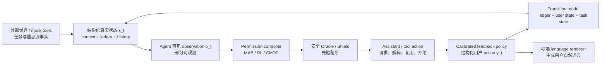

# 动态 User Simulator 设计蓝图（研究草案 v0.1）

状态：**设计中，未冻结，未实现，未微调。**  
适用范围：本项目中 privacy-permission controller、safe support LLM、security sub-agent 与后续 Constitutional SFT/RL 的研究环境。

---

## 0. 先说清楚：我们在设计什么

不是一个“能把问卷选项答出来的 LLM”，也不是一个替代真人的黑箱。

我们要设计的是一个**可审计、可校准、可拒绝回答不确定情境的动态用户环境**。它应让 agent 在一段任务中反复遇到数据/工具权限请求，并产生结构化的用户反馈与授权状态变化：确认、拒绝、要求解释、缩小范围、一次性允许、有限期复用、覆盖原决定、撤销、延后或结束任务。

目标不是宣称“复制了人类”；目标是建立一个足够可信的研究环境，使我们能够在经过验证后比较 permission policy / MAB / shielded RL / CMDP，并把安全失败显式阻断。

### 0.1 本项目的核心研究主张

> 我们研究一个由真实多轮用户轨迹校准的 permission-user environment；它把用户偏好、授权状态、任务结果和安全规则分开建模，并以高风险 false allow 与真人策略排序作为使用于 RL 前的硬性验证门槛。

### 0.2 明确不做什么

- 不从现有四标签静态问卷“推断” trust、fatigue、revoke 或长期偏好漂移。
- 不让 LLM 自由生成文字后再事后猜测它代表什么 permission action。
- 不让“模拟用户愿意”覆盖安全/法律/Contextual Integrity 规则。
- 不在缺乏真人轨迹验证时，宣称 dynamic simulator 可以替代人类研究。
- 不在本设计阶段安装、实现、微调、训练或招募参与者。

---

## 1. 从已有成果借鉴什么，绝不误用什么

### 1.1 最重要的新发现：Janus 是高度相关的环境壳，不是 UserSim

[Janus](https://arxiv.org/abs/2607.01510)（2026 年 7 月 preprint）专门研究 user-involved agentic permission management。它提供 agent—tool—permission manager—user 的循环、default-deny ABAC、可插拔 permission assistant、攻击/越界场景和评测 harness。它的三个核心授权结果 `approve_once`、`create_policy`、`reject` 与本项目非常接近。[架构说明](https://raw.githubusercontent.com/GraceBrigham/Janus/main/architecture.md)

但它的 synthetic responder 只有 `always_yes`、`always_no`、`alignment_aware`；最后一个依赖场景预置的“正确/攻击”标签。因此：

- **可以借鉴**：permission interception、scope policy、攻击场景、日志字段、baseline family、工具调用循环；
- **不能借鉴为真人行为**：三种 responder 不包含真实个体差异、解释请求、授权历史、撤销、负面反应或安全校准；
- **许可提醒**：当前公开仓库页面未显示可复用许可；实际复用代码前必须再次核验许可证。

### 1.2 其他成果的部件级分工

| 成果 | 应借鉴的部件 | 不能借来宣称的能力 |
|---|---|---|
| [QSTN](https://aclanthology.org/2026.eacl-demo.37/) | 问卷/选项渲染、受限 JSON 输出、prompt robustness | 多轮状态转移或真人 RL 环境 |
| [PrivacySIM](https://arxiv.org/abs/2605.12147) | D/E/A privacy persona schema、静态校准基线 | 纵向行为；其最佳个体准确率 40.4%，且 AAP 数据与本项目上游来源重叠 |
| [AlignSurvey](https://arxiv.org/abs/2511.07871) / SurveyLM | survey-response SFT baseline | permission scope、revoke、风险安全 gate |
| [UserLM-8b](https://huggingface.co/microsoft/UserLM-8b) | 多轮“用户口吻”、follow-up、conversation end 的语言层 warm start | privacy permission decision truth |
| [HumanLM](https://arxiv.org/abs/2603.03303) | latent belief/goal/value/stance/emotion/communication state 的建模思想 | 已校准的权限行为或撤销机制 |
| [UserLM-R1](https://arxiv.org/abs/2601.09215) / [UGST](https://arxiv.org/abs/2507.20152) | static profile 与 dynamic state 分离、模块化 state update | 对本项目 user population 的真实转移概率 |
| [OdysSim](https://arxiv.org/abs/2606.14199) | 通用人类行为基础模型/训练 recipe | privacy-sensitive action 的安全保真 |
| [tau2-bench](https://github.com/sierra-research/tau2-bench) | 成熟的 agent–tool–user/Gym 环境设计 | privacy-user calibration |
| [SimulatorArena](https://github.com/mitchellgiles/SimulatorArena) | human replay 与 simulator-policy-ranking 验证方法 | 权限场景或隐私转移参数；当前只覆盖辅导/写作任务 |
| [Verifiers](https://github.com/willccbb/verifiers) / [Gymnasium](https://gymnasium.farama.org/) | 将来把环境做成可重复 reset/step、可验证多轮接口的工程参考 | 人类用户行为或 privacy safety truth |
| [UserBench / TravelGym](https://github.com/RUCAIBox/UserBench) | 用户偏好揭示、Gym-loop 的小型开源参考 | 跨域权限偏好或纵向 privacy calibration |
| [Sim2Real 用户模拟研究](https://arxiv.org/abs/2603.11245) | human replay、行为/结果校准、policy ranking 验证 | 任何特定权限转移参数 |
| [ConvApparel](https://aclanthology.org/2026.eacl-long.244/) | 随机化 good/bad agent 行为、逐轮 frustration/satisfaction、counterfactual validation | permission-domain effect size |

其中大部分是近期 preprint 或研究发布，应作为方法/工程参考，并非已完成的最终证据。到实际复用时，仍要核验代码、权重、数据许可和版本。

**命名提醒。** 这里的 Janus 指 Brigham 等人的 permission-management project；学术界还有同名的 preference-assistant 或 information-distortion 项目，不能混为一个工具或一条证据。

---

## 2. 研究合同：问题、边界与可检验主张

### 2.1 总研究问题

在 privacy-sensitive tool use 中，一个经真人多轮轨迹校准的动态 user simulator，能否在不系统性 over-share 的前提下，为 policy training/evaluation 提供与独立真人 replay 大体一致的策略排序？

### 2.2 子问题

1. 哪些 context、history、agent behavior 和 persona variables 能预测用户在每轮的结构化 permission feedback？
2. 哪些 agent behavior 会改变下一轮的 scope、trust/control、burden、revoke 或 task continuation？
3. simulator 是否保持 restrictive、persistent-granter、frequent-reask 等 profile 差异，而非只在总体上对？
4. simulator 是否在 high-risk/`incorrect_explicit` 情境中避免 false allow？
5. 在固定的 policy set 上，simulator 的排序是否能在独立人类研究中复现？

### 2.3 三类“真值”必须分离

| 层 | 它回答什么 | 来源 | 绝不能由谁代替 |
|---|---|---|---|
| 用户偏好/反馈真值 | 用户此刻同意、拒绝、追问、缩小、撤销什么 | 真人轨迹 | security critic 或 LLM 常识 |
| 授权真值 | 哪个 scope 被何时、以何种期限建立/编辑/撤销 | versioned authorization ledger | 自由文字记忆 |
| 安全真值 | 请求是否越 scope、不必要、风险过高、违背 Constitution/CI 规则 | 冻结的安全规则、专家标注/critic | 模拟用户的“yes” |

这三层混在一起，是大多数“看起来很像人”的 user simulation 对隐私研究不够安全的根源。

---

## 3. 系统总体架构



### 3.1 为什么是 POMDP，而不是普通 MDP

真实的 trust、perceived control、frustration、理解程度不能被 agent 完整看见。故：

- 环境维护较丰富的 latent state；
- agent 只能看到合法可部署的 observation，例如历史授权、已显示的解释、用户公开的反馈、任务状态与 risk flag；
- 所有 latent variable 必须通过重复测量或行为 proxy 校准，不能只由 LLM 自我叙述；
- 第一版可以把 POMDP 的 belief 简化为可观测历史特征，但不能假装看见真实心理状态。

---

## 4. 最小但完整的 state / action / outcome ontology

### 4.1 `Context`：每一个 permission event 的外部事实

Contextual Integrity 指出信息流至少包含 subject、sender、recipient、information type 与 transmission principle。[Nissenbaum, 2004](https://digitalcommons.law.uw.edu/wlr/vol79/iss1/10/) 为可操作性，本项目采用下列字段。

| 组 | 必填字段 | 说明 |
|---|---|---|
| 信息流 | `data_subject`, `sender/agent`, `recipient`, `data_type`, `processing` | 谁的数据，经谁，给谁，做什么处理 |
| 请求语义 | `purpose`, `necessity`, `alternative_available`, `task_stage` | 必要性不能只让 LLM 判断；应有 scenario/security truth |
| 范围 | `scope_id`, `data_fields`, `recipient_set`, `purpose_set`, `tool`, `lifetime`, `retention`, `policy_version` | 用结构化对象，而非“永远允许” |
| 风险 | `sensitivity`, `risk_level`, `incorrect_explicit`, `out_of_scope`, `attack_flag` | 由冻结规则或标注产生；对 user 与 agent 分开可见 |
| 呈现 | `timing`, `explanation_condition`, `request_wording_version`, `channel` | 用于识别解释与打扰的作用 |

### 4.2 `Authorization ledger`：不是一个布尔变量

每次授权产生一个可追溯对象：

```text
authorization_id
  subject / data scope / recipient / purpose / processing / tool
  validity: one_time | task_bound | session_bound | until_expiry
  expires_at / created_at / policy_version
  status: active | narrowed | superseded | revoked | expired
  provenance: human-confirmed event ID
```

规则：

- `persist` 必须解释为 **same scope until expiry**，绝不解释为无条件永久允许；
- recipient、purpose、processing、retention、tool 或 policy version 变化时，旧 scope 不自动覆盖新请求；
- revoke 需要指向一个 `authorization_id` 或明确 scope；
- 研究参与同意书和任务中的 data authorization ledger 是两个不同对象，绝不混合。

### 4.3 Agent action space：把“策略行为”和“自然语言”分开

`a_t` 由三部分组成：

1. **permission action**
   - `request(scope)`
   - `reuse(scope)`
   - `offer_narrower_scope(scope')`
   - `ask_clarification`
   - `safe_refuse`
   - `escalate_to_user`
   - `execute_if_authorized`
2. **communication action**
   - `explanation = none | generic | specific_honest | corrective_apology`
   - `timing = in_context | early | repeated`
3. **tool action**
   - `proposed_tool_call`，由 shield 决定是否可实际执行。

同一段自然语言可表达不同的 high-level action；实验和模型必须记录高层 action，不能从文本后处理反推。

### 4.4 User feedback action space：动态 simulator 的关键输出

现有四标签保留为最小兼容层，但改写为有执行语义的 action：

| 现有静态标签 | 新 action | 动态含义 |
|---|---|---|
| No, never | `deny_scope_and_remember` | 拒绝该 scope，未来同 scope 不默认重问 |
| No, ask next time | `deny_now_reprompt_if_same_scope` | 当前拒绝，但未来同 scope 允许重新询问 |
| Yes, ask next time | `allow_one_time_or_task_bound` | 仅此一次/当前任务有效 |
| Yes, always | `allow_same_scope_until_expiry` | 在精确 scope 内、至到期时间有效 |

新的真实多轮 action：

```text
ask_explanation
narrow_data | narrow_recipient | narrow_purpose | shorten_lifetime
edit_authorization
override_to_allow | override_to_deny
revoke(authorization_id / scope)
defer
end_task
```

`override_to_allow` 与 `override_to_deny` 不可合并：前者增加披露，后者撤回披露，安全方向相反。

### 4.5 用户动态 state：最小版本与扩展版本

| 类别 | `v1 必须` | `v2 可研究` | 测量方式 |
|---|---|---|---|
| 固定/慢变 profile | privacy attitudes、AI experience、baseline restrictiveness | demographics、communication style | 登记问卷与过去非目标回答 |
| 可观测 history | recent prompts、间隔、过去 feedback、历史授权、scope mismatch、agent error | response latency、修改次数 | 系统日志 |
| 反复测量 proxy | perceived necessity、understanding、control、burden、trust | emotion/frustration、patience | 简短轮后/episode 后量表；必须先 pilot |
| latent random effects | participant-specific intercept/transition propensity | latent state trajectory | hierarchical model；不向 agent 全部暴露 |

第一版**不应**把 trust/fatigue 写成没有测量依据的整数。可以先以“最近连续提示数”“之前误导/越界”“最近拒绝/撤销”作为可观察 proxy；pilot 证实后再引入可解释的量表构念。

### 4.6 Outcomes 与奖励：绝不偷换概念

每轮至少记录：

```text
security_oracle_verdict
user_feedback
ledger_transition
task_progress / task_completion
actual or mock disclosure event
user burden / trust-control proxy
termination / recovery outcome
```

未来 RL 可优化多目标 return，但在收集到对应人类证据前，不能武断地把它们合成为一个“真实效用”数字。推荐词典序：

1. 先满足 hard safety constraints；
2. 再满足明确授权/对齐；
3. 再优化任务完成与用户负担。

---

## 5. 动态 simulator 的学习对象与模型路线

### 5.1 两个概率模型，而不是一个万能 LLM

令：

\[
s_t=(c_t,\ell_t,h_t,m_t,z_i),\qquad o_t=\Omega(s_t)
\]

其中 `c` 为 context，`ℓ` 为 ledger，`h` 为 history，`m` 为测得/估计的动态 user state，`z_i` 为个人层随机效应。

分别学习：

\[
P(y_t\mid s_t,a_t,r_t) \quad \text{（feedback policy）}
\]

\[
P(s_{t+1}\mid s_t,a_t,y_t,r_t) \quad \text{（transition model）}
\]

`r_t` 是 task/tool outcome 与固定 safety verdict。第二个式子不能由第一个式子“顺手假设”出来。

### 5.2 单一目标系统：QSTN-DynUser v1

本项目不再把 V0--V4 作为需要逐一实现的模型族。当前静态四标签模型仅保留为 MAB baseline；后续只构建一个最终的 hybrid UserSim，称为 **QSTN-DynUser v1**。

其逻辑为：external authorization ledger + fixed security/task oracle，随后产生 calibrated structured feedback / transition，最后由 QSTN 完成 natural-language rendering 和 constrained JSON interface。

它必须同时具备：显式 scope/expiry/revoke ledger、受 threat model 约束的安全 action mask、对 feedback 和 state transition 的校准不确定性、以及拟人化的语言回复。QSTN 不能自行决定 security truth 或修改授权事实。

formative pilot、sequential calibration、sealed fidelity test、policy-ranking test 是**同一最终系统的 release gates**，不是额外模型版本。只有当这些 gates 通过后，QSTN-DynUser v1 才能作为 sandboxed RL/CMDP training environment；最终仍需真人评估。完整的 reward、policy、adaptive preference learning 与 go/no-go 标准见 [CMDP_REWARD_POLICY_QSTN_FEASIBILITY_zh.md](CMDP_REWARD_POLICY_QSTN_FEASIBILITY_zh.md)。

### 5.3 为什么第一版不从端到端 fine-tuned LLM 开始

它会同时学习：语言风格、persona 模板、授权语义、时序、任务因果和安全判断；任何一个错误都无法定位。近期 Sim2Real 研究显示，通用 LLM user simulators 会过度合作、过早提供信息、对错误反应不足，从而夸大 agent 成功率。[Zhou et al., 2026](https://arxiv.org/abs/2603.11245)

故推荐顺序是：

```text
显式 ledger + security oracle
    → structured feedback policy
    → structured transition model
    → optional natural-language renderer
    → ensemble / uncertainty-aware training
```

### 5.4 Uncertainty / OOD 机制是设计的一部分

每个 feedback/transition 输出应包含：

```text
probability distribution
support score（训练数据相似度/样本量）
epistemic uncertainty（ensemble 或 posterior）
OOD flag
```

当 `high risk ∧ low support`，环境中的受训 policy 必须被训练/评估为退回 `ask_user` 或 safe deny。对真实系统而言，这应由 shield 强制，而非可选 reward penalty。

---

## 6. 真人多轮研究：先设计，后申请 REB，绝不现在招募

### 6.1 为什么需要它

现有 survey 可以估计一步 stated choice，但不能识别：

```text
agent explanation/action → user feedback → ledger/history update → next feedback
```

要学到这一关系，至少需要受控的重复互动。移动权限的纵向研究已证明 context、历史与不确定性对再次询问很重要；但其数值绝不能直接迁移到 AI agent。[Wijesekera et al., 2017](https://arxiv.org/abs/1703.02090)

### 6.2 四阶段数据策略

#### Phase 0 — Formative pilot（不是训练集）

目的：验证参与者是否真正理解下列差异：一次、任务内、同 scope 复用、到期、修改、撤销；并检验 scenario、词汇、action menu、量表和轮数是否可用。

输出：

- 冻结的 scenario library、术语、structured action schema；
- 参与者理解/负担问题清单；
- 无法区分的状态变量将被删除或重新设计；
- pilot participants 与数据不得进入最终 held-out test。

#### Phase 1 — Calibration micro-randomized sequential study

所有工具、数据与披露均为 mock/sandboxed。每个 eligible decision point 以预先登记概率随机化 agent behavior；借鉴 micro-randomized trial 的做法，以减少“观察到的关联被误写为 action 的因果效应”。[Klasnja et al., 2015](https://pmc.ncbi.nlm.nih.gov/articles/PMC4732571/)

建议采用区组化的部分因子设计，**不要**不可读的全因子设计。重点有意 oversample：high-risk、`incorrect_explicit`、scope mismatch、解释不足、重复提示、历史 overreach。

随机化因素：

| 轴 | 示例水平 |
|---|---|
| 请求正当性 | necessary / unnecessary / over-broad / `incorrect_explicit` |
| 信息流 | data type、sensitivity、recipient、purpose、processing、retention、tool |
| 授权提案 | one-time、task-bound、same-scope-with-expiry、scope expansion |
| Agent 行为 | ask、reuse、解释、缩小 scope、clarify、safe refusal、escalate |
| 解释 | none、generic、specific-honest、corrective/apology |
| 时机/历史 | in-context、early、recent prompt count、之前正确/错误行为 |

“错误/高风险 agent 行为”只能作为**模拟的提案**呈现；hard shield 必须防止真实披露。

#### Phase 2 — Sealed human fidelity test

从未用于 scenario 修订、模型选择或 hyperparameter tuning 的 cohort。至少三种 holdout：

1. participant-held-out；
2. temporal/trajectory-held-out：只以 (t) 前历史预测 (t) 后；
3. context-family-held-out：完整留出某些 data type × recipient × purpose families。

#### Phase 3 — Policy-ranking validity study

这一步决定 simulator 是否可供 RL 使用。预先冻结 policy set：

```text
always-ask
always-deny
static four-label / MAB baseline
personalized MAB
shielded MAB
future reward-RL / shielded RL / CMDP
```

将完整 episode 或 session block 随机分派给不同 policy，避免同一条轨迹严重 carry-over。高风险 policy 只以 confirmation-mediated mock proposal 测试。

### 6.3 样本量的正确做法

现在不要拍定一个漂亮的总 N。样本量取决于：每位参与者有效 decision points、high-risk cell 的比例、cluster/重复测量相关性、期望的 false-allow CI 宽度和 policy ranking 差异。

正式 protocol 应用 pilot 估计方差和 event rate，再针对：

- high-risk false-allow 的一侧上置信界；
- participant-level strata；
- policy ranking 中 pairwise effect；
- 预计 attrition / missingness；

进行 conservative power/simulation analysis。不能只按“问卷人数”决定。

### 6.4 逐轮记录的数据字典（最低版本）

```text
study_id, participant_pseudonym, episode_id, turn_id, timestamp
scenario_id, scenario_family, randomization_block, action_propensity
context fields (CI + purpose/necessity/retention/tool)
security_truth, shield_available_actions, shield_verdict
agent_high_level_action, explanation_condition, rendered_text_version
authorization_ledger_before, user_structured_feedback, scope_edit
user_optional_reason_redacted, comprehension/confidence proxy
burden/trust/control proxy, tool/task outcome
authorization_ledger_after, actual/mock disclosure event
termination/revoke/override marker
model/prompt/scenario/policy versions
```

`action_propensity` 和 available actions 不可省略：若没有已记录的 exploration support，offline OPE/DR 无法凭空制造反事实。[Li et al., 2011](https://www.microsoft.com/en-us/research/publication/unbiased-offline-evaluation-of-contextual-bandit-based-news-article-recommendation-algorithms/) [Jiang & Li, 2016](https://mlanthology.org/icml/2016/jiang2016icml-doubly/)

### 6.5 REB/伦理设计最低要求

这是研究设计建议，**不是 REB 批准或法律意见**。启动前需走 University of Guelph 的 REB 流程；加拿大 TCPS 2 对持续、知情的 consent 和隐私处理有明确要求。[TCPS 2 Chapter 3](https://ethics.gc.ca/eng/tcps2-eptc2_2022_chapter3-chapitre3.html?wbdisable=true) [Chapter 5](https://ethics.gc.ca/eng/tcps2-eptc2_2022_chapter5-chapitre5.html)

- 只用 mock data / mock tools；不得收集真实密码、金融、健康、身份或帐户数据；
- 即使用户在实验中选 allow，也不真实对外披露；
- skip、withdraw、休息不影响 compensation；
- pseudonymous ID；身份/联络信息与轨迹分离；加密、角色式访问、明确保留/销毁期限；
- optional free-text 理由作 PII minimization/redaction；
- consent 明说是否使用外部 API、数据是否离开学校系统、训练后撤回的实际限制；
- 若使用误导/不完全披露的攻击场景，须先获 REB 批准并 debrief；
- 不把研究参与 consent ledger 和任务授权 ledger 混为一个对象。

---

## 7. 验证计划：没有 gate，就不能进入 RL

### 7.1 静态与个体化 fidelity

在 sealed test 上报告：

- exact four-label 与 expanded-action confusion matrices；
- log loss、multiclass Brier、ECE、TVD/JS，而不只 macro-F1；
- profile × risk × context strata 的结果；
- participant-cluster bootstrap 或 hierarchical interval；
- restrictive users、persistent granters、frequent-reask users 的专门错误表。

aggregate average 不能抵消 restrictive user 的 false allow。

### 7.2 序列 fidelity

- next-feedback distribution / conditional log likelihood；
- ledger-state accuracy 与 scope/expiry correctness；
- revoke hazard、time-to-revoke、downgrade/override transition；
- termination、recovery after error、task outcome；
- burden、trust/control proxy 的条件变化；
- OOD/low-support 时的 safe fallback rate。

### 7.3 两类安全失败必须拆开

| 失败 | 定义 | 负责组件 |
|---|---|---|
| Simulator false allow | 真人 deny/narrow/ask，但 simulator 给 allow | feedback/transition model |
| Controller/shield execution failure | 已知违反 CI/Constitution/安全规则仍被提议或执行 allow | security oracle / shield / controller |

任何一类都不能被另一类的好结果抵消。

### 7.4 Release gates（预先登记）

| Gate | NO-GO 条件 | 通过后才允许 |
|---|---|---|
| 信息流完整性 | future/target leakage、未记录 propensity、split 泄漏 | 静态比较 |
| 个体化 | 关键 strata 中 false allow 被总体均值遮掩 | 仿真 fidelity 声称 |
| 高风险模拟安全 | high-risk / `incorrect_explicit` false-allow 的 cluster-aware 单侧上界超过预定 \(\tau_{FA}\) | 训练 rollout |
| Shield | `incorrect_explicit` execution failure 非零或 regression 失败 | 高风险 policy evaluation |
| 序列 | 未能对齐 revoke/ledger/termination/burden 的已观察 transition | dynamic-fidelity 声称 |
| 策略排序 | simulator 将危险 policy 排第一，或与人类 top-1/pairwise ranking 不一致 | simulator-supported RL |
| OOD | low-support 高风险情境仍自动 allow | 部署式安全结论 |

阈值不能在看到 test 结果后决定。它们须在 study 前由场景风险、REB/安全设计、可接受上限和统计精度共同确定。

### 7.5 Policy ranking 的评价方式

不要直接把所有指标加权为一个任意 reward。首先采用 safety-first lexicographic rule：

1. 去掉安全 gate 失败的 policy；
2. 在剩余 policy 中比较 task completion、授权对齐、用户纠正/撤销、burden、control/trust；
3. 报 Spearman/Kendall rank correlation、top-1 agreement、pairwise agreement、human regret 与不确定区间；
4. 最终保留独立真人 confirmation-mediated 研究作为外部评价。

---

## 8. 与教授 Step 1–5 的精确衔接

| 教授阶段 | 已有/拟有工件 | Dynamic UserSim 的角色 |
|---|---|---|
| Step 1 | 四标签 action space、context、participant split | 静态 warm-start evidence；不是 transition truth |
| Step 2 | offline MAB、WP-FTS、matched frozen control | 必须保留为 policy baseline |
| Step 3 | 真人 multi-turn study + calibrated environment | 本蓝图的核心交付；支持 live MAB、sequential RL/CMDP 的严谨比较 |
| Step 4 | security critic / shield | 保持独立安全真值与 action mask，不让模拟用户决定安全 |
| Step 5 | Constitution→critique/revision→SFT→preference→RM→RL | 只有 simulator gates 通过后，才用其 rollout 作为训练补充；仍需真人外部评价 |

---

## 9. 推荐的“冻结前”设计决策

这些不是现在要实现的任务，而是我们要逐项确认的研究选择：

| # | 需要确认的决定 | 当前建议 |
|---|---|---|
| D1 | 研究对象 | 先聚焦 tool/data permission + safe support reply；不扩展到所有社会行为 |
| D2 | 环境壳 | 概念上优先借鉴 Janus；工程成熟性参考 tau2-bench；实际复用前分别审计许可/接口 |
| D3 | 人类模型 | hybrid：结构化 feedback + transition + 可选语言 renderer，而不是端到端 LLM |
| D4 | 授权语义 | scope-bound、versioned、expiring、revocable ledger；废除“永久允许”措辞 |
| D5 | 初始动态构念 | history、prompt burden、理解/necessity、control/trust proxy；情绪等待 pilot 后决定 |
| D6 | 安全边界 | independent Constitution/CI oracle + shield；user preference 永不覆盖它 |
| D7 | 数据设计 | pilot → micro-randomized calibration trajectories → sealed fidelity test → policy-ranking study |
| D8 | 进入 RL 条件 | 以安全、序列、策略排序、OOD gates，而不是 overall accuracy |
| D9 | 语言与模型选择 | 延后到 ontology、数据、gate 定稿；UserLM/HumanLM/OSim 仅作候选基线 |

---

## 10. Devil's-advocate 检查：最可能毁掉论文的错误

1. **把静态 `ask next time` 当作真实重问成本/真实长期行为。**
   - 修复：只在多轮 study 观察到 re-prompt/revoke 后才建 transition。
2. **用同一参与者/同一 contexts 同时构建 persona、选模型、评估。**
   - 修复：participant、trajectory、context-family 三重隔离，所有历史只用 (t) 前信息。
3. **让模拟用户决定是否安全。**
   - 修复：shield/critic 独立；安全 failure 与用户偏好误差分报。
4. **只报告平均准确率。**
   - 修复：restrictive/persistent/high-risk 分层与单侧 false-allow bound。
5. **用 LLM surface realism 代替行为 fidelity。**
   - 修复：先评 structured action/transition/排序，再评自然语言像人。
6. **让 RL exploit simulator。**
   - 修复：ensemble、OOD abstention、cross-simulator tests、human policy-ranking test。
7. **把小规模 pilot 的效果当作总体结论。**
   - 修复：pilot 仅用于 instrument/scenario；separate sealed study 作 claim。
8. **用真实个人数据做高风险 experimental disclosure。**
   - 修复：mock-only tools/data、confirmation-mediated proposals、REB protocol。

---

## 11. 下一次共同设计应做什么

本草案**故意不冻结**。在考虑实现前，建议我们进行三轮设计审查：

1. **Ontology review**：逐项确认 context、authorization ledger、agent action、user action 是否覆盖你的实际场景，删除不需要的变量。
2. **Human-study review**：把 scenario family、随机化块、轮后测量、recruitment/REB 边界写成可提交 protocol；此时才做 power/simulation analysis。
3. **Acceptance review**：预先登记 gate、policy set、holdout strategy、claim language，然后冻结 `v1.0` specification。

只有第 3 轮通过，才讨论是否实现 Janus adapter、tau2 custom domain、rule-based V1 environment，或哪一个 UserLM 做 LoRA。这样实现会服务于一份已经经得起审稿人追问的研究设计，而不是反过来让代码决定科学问题。
