# Wu et al. 的 Agent Architecture：概念系统、Permission Predictor 与实验支架审计

审计日期：2026-09-27  
论文：Yuhao Wu et al., *Towards Automating Data Access Permissions in AI Agents*, IEEE S&P 2026 / arXiv:2511.17959v1  
本地论文：`D:\Study\Graduate_Study_UofG\Research\paper\Week67\2511.17959v1.pdf`  
文本映射：`D:\Study\Graduate_Study_UofG\Research\paper\Week67\paper_text_2511_17959.txt`  
作者代码：`ai_agent_permission_experiment/external/ai-agent-permissions/`，本地 commit `ec777f9d81d662c0df8b75c1aba9e381680f1e77`

## 1. 结论先行

**Wu et al. 并没有实现或评测一个完整的端到端 AI agent。** 它比一般纯分类论文多了两层清楚的 agent framing：

1. 论文先描述一个通用 host-agent 模型：自然语言任务进入 LLM/scaffolding，agent 选择工具和数据、形成 execution plan、调用工具；
2. 论文再明确设想将 permission assistant 放进可信的 system scaffolding，位于 LLM 与受保护数据/工具之间。

但作者真正实现并公开评测的是第三层：**一个离线 permission preference predictor**。它用 vignette user-study 数据，把用户画像、历史 permission decisions、新 permission request，以及可选的 collaborative-filtering 推荐编码进一次 LLM 调用，输出二分类 `allow/deny + confidence`，再与调查标签计算分类指标。发布物中没有 task planner、memory service、真实 tool adapters、runtime authorization gate、tool execution、observation-to-replanning loop 或 final-response generator。

因此，最准确的判定是：

> Wu et al. 提供了一个**有明确宿主位置的 permission-prediction subsystem 概念设计**，并完成了该 predictor 的 proof-of-concept 与离线评测；它不是一个 end-to-end permission-aware agent implementation。

这不是苛刻的外部推断，而是作者自己给出的边界：论文把三个挑战列为“理解偏好、预测偏好、可靠执行预测偏好”，随后明确说本文只做前两项，把 enforcement 留给互补工作（PDF pp. 3–4；`paper_text_2511_17959.txt:308-315`）；紧接着又写明 permission assistant 的 implementation and deployment 不在论文范围内（PDF pp. 4–5；`:421-444`）。第 5 节称其为 proof of concept / initial exploration，而非 definitive solution（PDF p. 9；`:993-1008`）。S&P meta-review 也将贡献称为“preliminary design”与“one point in the design space”（PDF p. 19；`:2109-2136`）。

## 2. 三种常被混在一起的“架构”

### 2.1 通用 host-agent 架构：背景模型，不是本文实现

论文 Section 2.1 给出的 agent 定义包括：LLM/API、system prompt、memory、tools；agent 根据 user query 确定工具与数据，形成 execution plan，再用相关数据调用工具 API。论文还以订机票为例说明 agent 可从 query/memory 取数据、调用 reservation tool，必要时向用户补问信用卡信息（PDF p. 2；`paper_text_2511_17959.txt:150-175`）。

这段话完整描述了一个标准 task-performing agent 的逻辑，但属于 background/system model。它没有对应到作者仓库中的 planner 或 executor。

### 2.2 设想中的 permission-aware agent：有清楚插入点，但控制链未落地

论文的设计假设是：

- host agent 有 memory、LLM、第三方 tools 和控制 execution flow 的 scaffolding（PDF p. 4；`:392-404`）；
- permission assistant 部署在 system scaffolding 内，LLM 不直接访问它（PDF p. 4；`:421-427`）；
- assistant 给出 probabilistic decision；用户应保留接受或拒绝其决定的控制权（`:427-431`）；
- 工具可能不可信，LLM 被视为非恶意但会犯错，scaffolding 和 permission assistant 被假设为可信（`:405-435`）。

这定义了一个有意义的 security boundary：permission assistant 不是 LLM 自己随意调用的工具，而应是 LLM 之外的可信决策点。不过，论文没有实现从“预测结果”到“受保护 effect”的 complete mediation。

### 2.3 真正实现的系统：离线二分类 pipeline

论文 Section 5 和公开代码实现的是：

- **IC-only**：用用户 demographics、AI experience/privacy attributes、个人 permission history 与待测 request 构造 prompt；o3-mini 输出 `Yes, always share` 或 `No, never share` 以及置信度（PDF p. 10；`:1030-1054`；`src/permission_ic_only.py:101-143`）。
- **CF-only**：把 `user × contextual permission request` 建成 LightGCN 图，预测 grant likelihood 并阈值化（PDF p. 10；`:1055-1082`；`src/permission_cf_only.py:72-180,260-348`）。
- **IC+CF**：把高置信度 CF 结果作为文本上下文加入 ICL prompt，得到 personalized predictor（PDF p. 10；`:1083-1116`；`src/permission_ic_cf.py:162-209`）。

这里的 LLM 扮演 permission classifier，不扮演 task planner。代码对每位 participant 读取预先切分的 training/testing examples，构造一次 prompt，调用 Chat Completions，解析 JSON prediction，然后与 ground truth 对齐计算 metrics（`permission_ic_only.py:202-255,266-374`；`permission_ic_cf.py:268-330,341-452`）。

## 3. 按完整 agent 数据流重建：哪一段存在，哪一段缺失

下图把论文设想、实现代码和缺失部分放到同一控制流中。虚线节点是论文假设或未来工作，不是作者公开实现。

```mermaid
flowchart LR
    U["User natural-language task"] -. generic host-agent .-> P["LLM + system prompt + memory"]
    P -. conceptual planning .-> R["Tool/data requirements + execution plan"]
    R -. proposed interception point .-> Q["Permission request<br/>query, requester, data type, context"]
    Q --> PA["Permission predictor prototype<br/>IC / CF / IC+CF"]
    PA --> D["allow/deny label + confidence"]
    D -. not implemented .-> H["human confirmation / override / revoke UI"]
    D -. not implemented .-> G["runtime authorization gate / enforcement"]
    H -. not implemented .-> G
    G -. not implemented .-> T["memory read / third-party tool call"]
    T -. not implemented .-> O["tool observation"]
    O -. not implemented .-> P
    P -. not implemented .-> F["final user response"]

    S["vignette survey records"] --> PA
    D --> E["offline classification evaluation"]
```



### 3.1 Component-by-component 审计

| 环节 | 论文中的表述 | 本地发布物中实际存在的内容 | 判定 |
|---|---|---|---|
| **Task input** | 用户用自然语言提出任务；订机票是解释性例子（PDF pp. 1–2；`:25-49,150-175`） | `queries.json` 中 65 个预先策划的 vignette；代码把 test permission requests 批量读入 prompt（`permission_ic_only.py:220-245`） | **固定实验输入，不是 live agent intake** |
| **Planning / LLM** | host agent 应选择工具/数据并形成 execution plan（PDF p. 2；`:157-167`） | LLM 只根据画像、历史和 request 输出 permission label/confidence；prompt 明令只输出 JSON（`permission_ic_only.py:116-140,152-172`） | **permission inference 有 LLM；task planning 没有实现** |
| **Permission assistant** | 设想在可信 scaffolding 中、LLM 不可直接访问；应观察历史并代用户决策（PDF pp. 2, 4；`:134-147,421-431`） | IC、CF、IC+CF 三种 predictor 是真实代码；hybrid 输入 CF recommendations，输出二分类与 confidence（`permission_ic_cf.py:162-238`） | **真正实现的核心 subsystem，但仍是离线 predictor** |
| **Tools / data access** | 概念上有 memory、第三方 tools，允许/拒绝应控制数据使用（PDF pp. 2, 4；`:150-175,392-409`） | tool name、data type、query 只是 dataset/prompt 中的字符串或 graph item ID（`permission_cf_only.py:96-145`） | **没有 tool API、data store 或真实 protected resource** |
| **Execution / enforcement** | 研究目标承认需要 reliably enforce predicted preferences，但本文只做 goals (i) 与 (ii)（PDF pp. 3–4；`:308-315`） | 无 reference monitor、policy middleware、capability/token、sandbox、allow/block effect path | **明确未实现，而且作者写为 out of scope** |
| **Observation / re-planning** | 通用 agent 叙述暗含工具调用后继续任务，但正文未给本文的 execution loop | 预测响应被解析成 JSON 后直接保存和评分；没有 tool observation 回灌 LLM（`permission_ic_only.py:240-255,303-374`） | **无 closed-loop observation 或 re-planning** |
| **Final response** | 通用 AI agent 目标是解决用户 query | 发布代码不生成任务答案，只生成 permission labels | **无 user-task final answer** |
| **Evaluation integration** | 5-fold CV；评估 held-out permission questions 的 accuracy/precision/recall/FPR/FNR 与 confidence–coverage trade-off（PDF pp. 10–11；`:1117-1236`） | prediction JSON 与 survey ground truth 对齐，再计算分类指标（`permission_ic_cf.py:397-452`; `evaluation_utils.py:14-49,95-151`） | **完整的 predictor evaluation，不是 agent task/security evaluation** |

## 4. MIRA 网站究竟是不是“简单 agent”

不是。它是做得较有沉浸感的 **vignette-based survey interface / demo shell**。

作者明确写道，网站的目的在于“attempt to immerse participants in training a futuristic personal assistant”（PDF p. 1；`:84-89`）。参与者完成三类人为设置的任务：挑选所需 apps、挑选所需 data、表达 data-sharing permission（PDF p. 5；`:454-479`；`data/README.md:62-73`）。`website.pdf` 的视觉材料进一步显示：

- p. 3 是 “USER GUIDE TO TRAIN MIRA”，告诉参与者想象 2049 年的 assistant；
- p. 4 给出固定的 USER/MIRA 文本，再让参与者点击所需 app；
- p. 5 给出固定的 USER/MIRA 文本，再点击所需 data；
- p. 6 对固定 `Data × App/MIRA` 条目点击四种 permission preference。

该流程确实让参与者**感觉**自己在训练 agent，也收集了 agent-contextualized human decisions；但材料没有显示 MIRA 动态生成计划、执行工具、读取数据、获得 observation 或返回完成任务的结果。公开仓库甚至没有网站运行源码，只有 `website.pdf` 截图。因而它可称为：

> agent-themed interactive vignette / survey prototype

不应称为：

> implemented end-to-end AI agent

## 5. 实验闭环是什么，而不是什么

### 5.1 真正闭合的研究 pipeline

```text
预先策划的 task/tool/data scenarios
    -> MIRA vignette 网站收集人类选择
    -> 筛出 always-share / never-share 标签
    -> IC / CF / IC+CF prediction
    -> held-out-label classification metrics
```

这条链是完整的：问题构造、用户研究、训练/测试数据、模型、预测与指标都有对应材料。论文用 7,563 个 permission decisions、181 participants 做二分类；只把 `yes, always share` 与 `no, never share` 当 ground truth（PDF p. 10；`:1117-1132`）。因此它评估的是**能否预测声明的持久 allow/deny preference**。

### 5.2 没有闭合的 agent pipeline

```text
open-ended user goal
    -> generated/adaptive plan
    -> runtime permission interception
    -> enforce allow/deny before every protected effect
    -> real tool/memory effect
    -> observation-driven recovery or re-planning
    -> final task answer
    -> task success + unauthorized-effect evaluation
```

上面这条链没有在论文或仓库里闭合。尤其没有评估：真实 task completion、tool-call correctness、unauthorized effects、实际 data exposure、被拒后的 recovery、用户 override/revoke、交互 latency 或最终回答质量。

论文自己的 Discussion 与此一致：full-fledged system 还需要低置信度/错误时与用户交互的 UI、明确授权、撤销和反馈机制；作者把这些视为 future work（PDF p. 14；`:1544-1567`）。Conclusion 也说 enforcement、robustness 与 usable interfaces 仍是挑战（`:1568-1589`）。

## 6. 作者公开代码为何不能算 agent runtime

仓库 README 的完整结构只列出 survey data、65 个 scenarios、website screenshots、三个 prediction scripts、evaluation utilities 与 results 文档（`README.md:19-40`）。运行说明也只要求依次执行 CF-only、IC-only、IC+CF，产物均进入 `results/`（`README.md:84-105`）。`git ls-tree -r` 对 audited commit 的实际文件清单与 README 一致。

代码层的决定性特征是：

1. `create_ic_prompt` 将用户画像、AI experience、历史和新 requests 拼进分类 prompt，要求只返回 label/score JSON（`permission_ic_only.py:101-143`）；
2. `llm_inference` 做一次 Chat Completions 调用并返回文本（`:152-172`）；
3. `process_participant` 批量处理一个 participant 的 testing set，随后把 parsed predictions 与 ground truth 一并保存（`:202-255`）；
4. 主函数遍历 participants、保存 JSON、计算分类 metrics（`:266-374`）；
5. hybrid 只是增加 CF scores/recommendations 后重复相同的一次性 prediction flow（`permission_ic_cf.py:106-209,268-330`）；
6. CF 脚本训练 LightGCN、产生 user-item scores 并离线评分（`permission_cf_only.py:153-180,260-348,392-453`）。

没有任何函数承担 `plan -> act -> observe -> re-plan`，也没有 permission decision 被消费为真实执行 authority。因此，“permission assistant”在已发布实现中更准确地说是 **personalized permission prediction model**，不是自治 task agent，也不是完整 authorization service。

## 7. 最终分级

| 对象 | 是否真实实现 | 是否属于 agent 架构 | 最准确名称 |
|---|---:|---:|---|
| 通用 LLM + prompt + memory + tools + plan | 否；作为背景/系统模型描述 | 是，概念层 | generic host-agent model |
| permission assistant 在可信 scaffolding 中的插入点 | 否；有 threat-model/design assumption | 是，概念接口层 | envisioned permission-control insertion point |
| IC / CF / IC+CF | 是 | 是 agent 的可插拔子模块，但自身不是 task agent | offline personalized permission predictor |
| MIRA 网站 | 有 survey 界面；公开物只有截图与数据 | 只是 agent-themed interaction shell | vignette study interface |
| tool/data execution 与 enforcement | 否，明确 out of scope | 完整 agent 所必需 | missing runtime authorization/execution layer |
| observation/replanning/final response | 否 | 完整 agent 所必需 | missing task-agent loop |

**总判定：0 个真正端到端 task-performing agent；1 个实际实现的 permission-prediction subsystem；1 个用于用户研究的 agent-themed vignette interface；1 套未实现的宿主 agent / runtime integration 概念。**

## 8. 对当前项目定位的直接含义

不能因为 Wu et al. 使用 “AI agent”“permission assistant”“MIRA” 等语言，就把它当作已完成的端到端 agent baseline。公平的比较单位应拆开：

- **Wu et al. 的强项**：真人 vignette study、agent-context framing、清楚的 permission-assistant 插入位置、IC+CF predictor 与置信度/coverage 分析；
- **Wu et al. 没做的部分**：runtime authority、complete mediation、真实 tool effects、执行 observation、replanning 与 final response；
- **一个完整后续系统应闭合的接口**：`Task/Planner -> PermissionRequest -> Permission Decision -> Authorization/Reference Monitor -> Tool Effect -> Observation -> Planner/Final Response`。

所以，如果当前项目也只完成 RL controller、mock environment 或 permission-learning kernel，那么“我们仍缺一个完整 agent”这一担忧是成立的；但不应写成“Wu 已经有完整 agent，而我们没有”。更准确的说法是：

> 两项工作都没有完整端到端 agent。Wu 把 permission predictor 放在一个描述清楚但未实现的 host-agent 架构里；当前项目若已有 ledger/reference monitor 与 sequential controller，则它可能在 enforcement/testbed 上更深入，但仍需补 task interpretation、planning、真实或高保真 tool execution、observation/replanning 和 final response，才能成为完整 agent evaluation。

## 9. 审计限制

- 本结论针对论文 v1 与本地公开仓库 commit `ec777f9d...`；不能证明作者从未在未公开环境中搭建其他 prototype。
- “仓库中没有某模块”本身只是 absence evidence；但本文结论同时由作者明确的 scope statements、future-work statements、发布文件清单和代码 control flow 交叉支持。
- 本审计不把“使用了 LLM API”自动等同于“实现了 agent”。判定标准是是否存在持续的 task state、规划/动作选择、真实或模拟工具 effect、observation 回流及任务级终止/回答。
