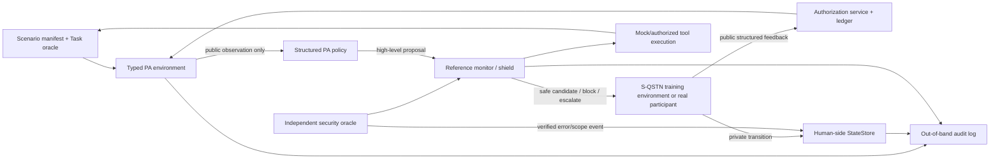

# RL Personal Assistant 与 S-QSTN：研究框架及去循环验证协议

> 文档性质：基于项目现状、已有草案与原始学术文献的研究设计建议。  
> 核心目标：给出可落地的 Personal Assistant RL 框架，并把 S-QSTN 从“训练者兼裁判”降为有边界的训练环境组件。  
> 结论强度标记：**项目事实**、**文献事实**、**设计建议**分开表述。

## 0. 结论先行

建议把下一阶段定义为：

> **Preference-conditioned, authority-aware, shielded POMDP/CMDP Personal Assistant**

中文可以写成：

> **偏好条件化、授权感知、带独立安全屏障的部分可观测约束决策助手。**

它不是一个直接对自然语言 token 做 PPO 的端到端 agent，而是一个先选择可审计高层动作、再由固定/监督式语言层表达的 sequential controller。

关键决策有五条：

1. **保留 classification 与 WP-FTS MAB**：它们分别作为 stated-policy prior、个体化 belief warm-start 和强基线；不把它们误写成安全控制器。
2. **RL 只接管真正的长期决策**：当前动作会改变授权 ledger、后续询问、用户公开反馈、错误修复和任务结果时，才需要 RL。单轮问题仍由 MAB/分类器回答。
3. **S-QSTN 只模拟用户侧反馈与 transition**：它不定义 PA 是否犯错、不写授权 ledger、不判断 objective safety，也不是最终 gold evaluator。
4. **硬安全由 reference monitor/shield 保证**：安全不变量不与任务效用、满意度或少打扰做可补偿加权。[CPO](https://proceedings.mlr.press/v70/achiam17a.html) 支持 reward 与 constraints 分开；[shielding](https://ojs.aaai.org/index.php/AAAI/article/view/11797) 支持在 learned policy 外拦截不安全动作。
5. **最终证据来自独立 oracle 与 sealed human evaluation**：同一个 S-QSTN 可以参与训练，但不能同时承担 reward、调参和最终评价。

因此，眼下最正确的下一步不是立刻训练 neural RL，而是先完成 typed environment、authorization service、reference monitor、public feedback adapter 与 leakage tests。项目已有的 [Personal Assistant RL 启动计划](../personal_assistant_rl_plan_zh.md) 对此判断是正确的；本文件进一步补齐其 reviewer-facing 理由和反循环验证协议。

---

## 1. 为什么现在应该从 MAB 进入 RL

### 1.1 已有结果回答了什么

**项目事实：**

- Classification 数据包含 16,361 行、201 位参与者；participant-held-out 上当前最佳 tuned point estimate 约为 Accuracy 0.436、Macro-F1 0.378，但 accuracy 与 over-sharing 风险存在明显取舍，见 [严格分析报告](../classification_experiments/analysis-output/analysis-report.md)。
- WP-FTS 在相同 stated-policy replay 上达到 51.083% JEM；相对 matched frozen control 的 JEM 增益为 8.872 个百分点，但主要改善来自 persistence，false-allow 仍为 98.538%，见 [最终 MAB 结果](../ai_agent_permission_experiment/online_bandit_experiment/RESULTS_COMPARISON_zh.md)。
- 现有 MAB reward 是 selected-action 的四标签 exact match，不测 task outcome、真实 privacy harm、scope validity、revoke、burden 或长期 trust transition。

所以 MAB 已经提供了一个重要结论：**前序公开反馈能帮助个体化 stated-policy prediction，但它不足以解决授权执行和长期安全。**

### 1.2 MAB 与 RL 的干净分界

Contextual bandit 对应 (H=1)：观察当前 context，选择一个动作，获得即时反馈；RL/MDP 对应 (H>1)：动作会改变未来状态和延迟结果。多轮 preference RL 也表明，完整 conversation preference 能捕捉逐轮评分遗漏的延迟影响。[Shani et al., NeurIPS 2024](https://proceedings.neurips.cc/paper_files/paper/2024/hash/d77a7b289361abff82bdd2fb537ae152-Abstract-Conference.html)

本项目中，以下关系一旦成立，就必须进入 sequential RL：

```text
PA action
  -> public user feedback
  -> authorization / task / verified-event transition
  -> future observation and available action
  -> delayed task, burden, repair, revoke and safety outcome
```

S-QSTN 的“错误后变得更警惕”不是麻烦，而正是 RL 必须建模的 delayed transition。真正的问题是如何保证这个 transition 不被当作独立评价证据；第 6 节给出解决方案。

---

## 2. 总体系统架构



### 2.1 组件职责与不可跨越的边界

| 组件 | 负责 | 绝不负责 |
|---|---|---|
| Classification / WP-FTS | stated-policy prior、个体化 belief、baseline | objective necessity、安全真值、真实 disclosure harm |
| Structured PA policy | 在公开 observation 与 safe candidate set 中选择高层动作 | 自己建立授权、读取 S-QSTN 私有 trust/caution |
| S-QSTN | 生成 public user feedback；维护用户侧私有状态 | 定义 PA 对错、写授权、决定工具执行、做最终 gold evaluator |
| Authorization service | grant/edit/revoke/expiry/one-time consumption 的事实来源 | 推测用户心理或任务必要性 |
| Task oracle | mock task transition、completion、quality、retry | 推测用户偏好 |
| Security oracle | `incorrect_explicit`、scope violation、risk tier、minimal set | 模拟用户是否愿意允许 |
| Reference monitor/shield | 执行前 action mask 与二次校验 | 通过 learned reward 猜测硬规则 |
| Human sealed evaluation | 最终 policy ranking、burden/control/acceptance | 参与 simulator 或 policy 调参 |

这一分工与现有 [S-QSTN v2 event schema](../ai_agent_permission_experiment/qstn_simulator/config/v2.0/event_schema.json) 一致：只有 externally verified 或 synthetic-oracle event 可以改变 violation/trust state；普通 allow/deny 不能自证 assistant 犯错。

---

## 3. 正式问题定义：POMDP + CMDP，而非普通 MDP

### 3.1 为什么是 POMDP

真实用户的 trust、caution、理解和容忍度不能被 PA 直接读取；PA 只能看到用户公开说了什么、做了什么以及已有授权。因此令完整环境状态为：

\[
s_t=(c_t,\ell_t,x_t^T,z_t^U,h_t,\omega_u),
\]

其中：

- (c_t)：当前 information-flow context；
- \(\ell_t\)：authorization ledger；
- \(x_t^T\)：task/tool 状态；
- \(z_t^U\)：S-QSTN/真人私有的 trust、caution、burden 等 latent user state；
- \(h_t\)：公开交互历史；
- \(\omega_u\)：用户对 safe objectives 的偏好权重或其 posterior。

PA 只获得：

\[
o_t=\Omega(c_t,\ell_t,x_t^T,h_t,\hat\omega_{u,t},u_t^{OOD}),
\]

不获得 (z_t^U)、future label、raw oracle truth、S-QSTN hidden probability 或 target answer。Dialogue management 使用 belief state 处理不可观测 user state 有成熟先例。[Williams & Young, 2007](https://doi.org/10.1016/j.csl.2006.06.008)

### 3.2 RL-v0 observation

```text
o_t = {
  decision_phase,
  public_task_context,
  bounded_authorization_summary,
  bounded_public_history,
  candidate_action_catalog[K],
  action_mask[K],
  public_budget_and_clock,
  deployable_support_or_ood_summary
}
```

设计原则：

- `necessity_status` 如果现实部署时不可得，就不能作为普通 policy feature；它只能属于 oracle-assisted ablation 或 post-action evaluator。
- classification probability / WP-FTS posterior 只能作为不确定 prior，不能覆盖 reference monitor。
- PA 对 vigilance 的估计必须来自公开历史；不能直接读取 S-QSTN 私有 state，因为真人部署时不存在这条通路。

### 3.3 Hierarchical action space

推荐复用现有草案的八类 authority-aware action：

1. `request_authorization(scope)`
2. `request_refresh(auth_id, scope_patch)`
3. `clarify(question_type)`
4. `deny_with_reason(reason)`
5. `propose_narrow_scope(scope)`
6. `execute_with_authorization(auth_id, op_id)`
7. `escalate(target)`
8. `disable_local_authorization(auth_id)`

每个高层动作再带 communication 参数：

```text
explanation = none | generic | specific_honest | corrective_apology
timing      = in_context | early | repeated
```

自然语言 surface realization 第一阶段应冻结为 template 或监督式 LLM。RL 选择结构化 action/candidate index，不直接探索任意 wording。Hierarchical dialogue policy 能降低 flat action space 的复杂度，并保留跨子任务状态与可解释动作。[Peng et al., EMNLP 2017](https://aclanthology.org/D17-1237/)

### 3.4 三条相互独立的 transition

不要让一个万能 LLM 同时产生所有后果：

\[
P_T(x_{t+1}^T\mid x_t^T,a_t) \quad\text{Task transition}
\]

\[
P_A(\ell_{t+1}\mid \ell_t,y_t^{public}) \quad\text{Authorization transition}
\]

\[
P_U(z_{t+1}^U,y_{t+1}^{public}\mid z_t^U,o_t,a_t,e_t^{verified})
\quad\text{User transition}
\]

Task 和 authorization transition 由独立服务决定；S-QSTN 只负责第三条。`verified_agent_error` 必须先由外部 verifier/oracle 建立，才可进入 S-QSTN transition。

---

## 4. Reward、cost 与用户反馈应怎样设计

### 4.1 不建议继续使用一个任意加权 scalar reward

旧 [reward function 草案](../reward_function_design_zh.md) 将 task、sensitivity、unnecessary access、mismatch、interruption 与 persistence 加权相加，适合作为早期思考清单，但不适合作为最终安全语义：它允许高 task reward 补偿 privacy violation。

更稳妥的形式是：

\[
\max_\pi\;J_{soft}(\pi;\omega_u)
=\mathbb E_\pi\!\left[\sum_t\gamma^t
\omega_u^\top(q_t,-b_t,k_t,r_t^{repair})\right]
\]

subject to：

\[
J_{min}=0,\quad J_{scope}=0,\quad J_{reuse}=0,
\quad J_{exposure}^{k}\le d_k,
\quad J_{prompt}\le d_B.
\]

为避免角色混淆，也可以用下面这个更直观的 bookkeeping 写法实现：

\[
r_t^{soft}=r_{task,t}^{oracle}
-\lambda_p c_{preference,t}^{S\text{-}QSTN}
-\lambda_b c_{burden,t},
\qquad
c_{security,t}=c_{security,t}^{oracle}.
\]

其中 \(r_t^{soft}\) 可以优化，\(c_{security,t}\) 进入 shield/CMDP 与独立报告，不能由 S-QSTN 的 allow/deny 替代。每次 verified violation 都形成**不可被未来正回报冲销的事件成本**。否则会出现 state laundering：PA 先犯错使模拟用户以后更谨慎，后续少暴露反而把早期违规“洗白”。因此至少同时报告 cumulative severe violations、first-violation rate、worst-episode cost 与 trust harm，而不是只报 episode 最终状态或平均 return。

### 4.2 每个信号由谁产生

| 信号 | 来源 | 能否由 S-QSTN 单独产生 |
|---|---|---|
| Task completion/quality/retry | frozen task oracle | 否 |
| Unnecessary disclosure | minimal-set/security oracle | 否 |
| Out-of-scope/expired/revoked reuse | authorization service + oracle | 否 |
| Public accept/edit/deny/revoke | S-QSTN 或真人 public event | 可以，训练时仅作 surrogate |
| Prompt burden | objective prompt/repeat count，或公开带锚点 rating | 可给 rating，但不能读取其 hidden burden bucket |
| Repair success | verified repair action + 后续公开接受/继续 | 部分；objective event 仍外部验证 |
| Preference comparison | 两条均满足 hard constraints 的 trajectory pair | 可以作训练反馈；最终需真人 |

个体化可以学习 \(\omega_u\)，但只在**都通过安全屏障的轨迹**之间学习 task、control、burden 的 soft trade-off。Pairwise trajectory comparison 比要求用户赋绝对数值 reward 更合理。[Sadigh et al., RSS 2017](https://doi.org/10.15607/RSS.2017.XIII.053)；[Shao et al., NeurIPS 2023](https://proceedings.neurips.cc/paper_files/paper/2023/hash/286e7ab0ce6a68282394c92361c27b57-Abstract-Conference.html)

### 4.3 Shield 与 CMDP 的关系

- **Reference monitor**：阻止已知 invalid action 真正执行；目标是 executed hard failure = 0。
- **CMDP costs**：处理仍然 safe、但代价不同的选择，如 valid high-tier exposure、询问次数、fallback、人类接管和 OOD escalation budget。
- **Attempted invalid action**：即便被 shield 拦截，也单独记录为 policy diagnostic，不能与 executed disclosure 混为一项。

若所有 residual cost 都恒为 0，就诚实称为 shielded POMDP，不要为了方法显得复杂而包装成 CMDP。

---

## 5. 推荐训练路线

### Phase A：现在立刻可做的工程（不依赖 human-valid S-QSTN）

1. 冻结 authority FSM：`PROPOSE -> WAIT_AUTHORITY -> LEDGER_UPDATE -> EXECUTE -> POST_RESULT`。
2. 冻结 scenario、candidate action、public feedback、authorization event、observation、outcome/cost schemas。
3. 实现 authorization service、task oracle、security oracle、reference monitor 与 out-of-band audit。
4. 用 `ScriptedUserAdapter` 和 tiny finite MDP 完成 exact DP、tabular/masked Q smoke test。
5. 完成 taint/sentinel leakage、scope、expiry、one-time use、revoke、TOCTOU、fault-injection 测试。

这阶段只能声称 `synthetic engineering diagnostic`。

### Phase B：建立 S-QSTN 的 RL 使用资格

现有 S-QSTN v2 是 categorical bounded-memory substrate，不是 human-calibrated transition model；profile-card held-out accuracy 也不足以把它当反馈 oracle。因此必须新增：

1. formative pilot：冻结 scope/expiry/revoke、public feedback 与 rating anchors；
2. micro-randomized sequential calibration：只用 mock data/tools，记录 action propensity；
3. 分开拟合 feedback model 与 transition model；
4. participant-held-out、trajectory/time-held-out、context-family-held-out fidelity test；
5. frozen baseline policy-ranking gate；
6. OOD/support 与 high-risk safe-fallback gate。

### Phase C：Structured PA 主训练

算法不应在 environment 与数据覆盖未知时过早冻结。按规模递进：

- 小型离散环境：exact constrained DP / tabular or linear learner；
- 有真实 sequential logs：behavior cloning 后用 conservative offline RL；CQL 可缓解离线 distribution shift 下的过高 Q 估计，[Kumar et al., NeurIPS 2020](https://proceedings.neurips.cc/paper/2020/hash/0d2b2061826a5df3221116a5085a6052-Abstract.html)；SPIBB 可在低覆盖状态回退到 behavior baseline，[Laroche et al., ICML 2019](https://proceedings.mlr.press/v97/laroche19a.html)；
- S-QSTN release gate 通过后：masked recurrent constrained actor-critic；一个 soft-return critic，加一个 residual cost critic；hard mask 始终在外部；
- synthetic rollout 从真实/校准状态开始并保持短 horizon，减少 simulator model error 累积。

主 policy 可以写成：

\[
\pi_\theta(a_t\mid o_t,h_t,\hat\omega_{u,t}),\qquad
a_t\in\mathcal A_{safe}(o_t,\ell_t).
\]

无论采用 CPO-style、PPO-Lagrangian 或较简单的 constrained learner，都必须报告 constraint target、dual update、violation curve、baseline fallback 和数据支持范围，不能把算法名称当成安全保证。

---

## 6. 循环验证：风险是什么，怎样彻底拆开

### 6.1 先区分两种“闭环”

**必要的行为闭环：**

```text
assistant error -> verified event -> user becomes cautious
-> later feedback changes -> assistant adapts
```

这是研究对象，必须保留。

**无效的证据闭环：**

```text
S-QSTN defines correctness
-> supplies reward
-> RL optimizes against it
-> same S-QSTN evaluates the optimized RL
-> paper claims human improvement
```

这是需要禁止的 circular validation。

第一种闭环也可以理解为 performative environment dynamics：策略会改变之后遇到的用户状态与反馈分布。它要求 trajectory-level 的随机化和分析，而不是假设 turn-level labels 独立同分布；它本身不构成无效性。[Perdomo et al., ICML 2020](https://proceedings.mlr.press/v119/perdomo20a.html) 形式化讨论了模型决策改变未来数据分布的问题。

形式化地，若：

\[
\pi^*(\phi)=\arg\max_\pi \hat V_{S_\phi}(\pi),
\]

再用同一 \(S_\phi\) 报告 \(\hat V_{S_\phi}(\pi^*)\)，就是对被自适应优化过的 proxy 做 resubstitution evaluation；它不估计真实人群上的 \(V_H(\pi^*)\)。Reward-model overoptimization 已显示 proxy score 继续上升时，独立 gold score 可以下降。[Gao et al., ICML 2023](https://proceedings.mlr.press/v202/gao23h.html)

### 6.2 四道防火墙

#### Firewall 1：Truth firewall

- `incorrect_explicit`、necessity、minimal set、scope validity、risk tier、task outcome 由独立 oracle/ledger 决定。
- S-QSTN allow/deny 不得反向证明 PA 正确或错误。
- PA 错误只有在 `source=external_verified|synthetic_oracle` 且 `verification_status=verified` 时才进入 S-QSTN state。

#### Firewall 2：Learning firewall

- 每个 RL experiment 内冻结 `S_train` 的 weights、prompt、RulePack、transition parameters 和 hashes。
- policy 更新时，simulator 不同步更新；这是明确的 stop-gradient / no-co-adaptation contract。
- S-QSTN public feedback 只进入 soft preference/control/burden channel；hard safety 和 task truth 始终外部产生。

#### Firewall 3：Evaluation firewall

建立三层角色：

```text
S_train : 只用于训练/augmentation
S_eval  : 未参与 policy/reward tuning 的冻结 surrogate suite
H_gold  : sealed humans + verifiable task/security oracle，论文 primary evidence
```

不同 S-QSTN bootstrap/parameter draws、scripted adversarial users 和另一构建方式可以组成 robustness suite；但如果没有第二个经真人校准的 simulator，只能称 `cross-environment robustness`，不能声称一般性的 cross-simulator transfer。

User-simulator 研究已经采用 train-one-simulator/test-another 和 real-user evaluation，[Kreyssig et al., SIGDIAL 2018](https://aclanthology.org/W18-5007/)；自动 simulator score 与 human satisfaction 也可能不一致，[Shi et al., EMNLP 2019](https://aclanthology.org/D19-1206/)。2025 年 SimulatorArena 进一步把 human ranking alignment 作为 simulator 可靠性的核心，而不是只看语言逼真度。[Dou et al., EMNLP 2025](https://aclanthology.org/2025.emnlp-main.1786/)

#### Firewall 4：Governance firewall

- participant、trajectory/time、context family 三个维度整体隔离；禁止随机拆 turn。
- test cohort、scenario families、reward/cost definitions、policy set、threshold、seed 和 evaluator version 在训练前冻结。
- sealed test 只揭示一次；若据其结果改变 rules、reward 或 simulator，该 test 即降级为 development evidence，必须换新 sealed cohort。
- 保存完整 version grid：`policy_version × simulator_version × oracle_version × scenario_version`。
- 对反复查看 holdout 的风险保持透明；adaptive holdout reuse 会过拟合 holdout 本身。[Dwork et al., Science 2015](https://pubmed.ncbi.nlm.nih.gov/26250683/)

### 6.3 建议的数据分区

| 数据/环境 | 用途 | 可以影响什么 | 禁止影响什么 |
|---|---|---|---|
| Existing static survey | classification、MAB、profile prior | stated-policy baselines | sequential transition / human RL claim |
| `H_fit` participant cohort | sequential S-QSTN calibration | feedback/transition parameters | final PA claims |
| `H_dev` disjoint cohort/families | simulator selection、pretraining release gate | simulator/version choice | final policy ranking |
| `S_train^1...K` | RL rollout/augmentation | policy parameters | final human endpoint |
| `S_eval` frozen suite | stress/robustness/model selection if declared dev | limited policy selection | gold claim |
| `H_gold` new sealed cohort | final frozen-policy comparison | publication result only | any further tuning |
| Task/security sealed suites | hard failure、task success、scope validity | final objective metrics | policy observation |

如果资源只能支持两个真人 cohort，最低可接受方案是 `H_fit/dev` 与全新 `H_gold` 完全隔离；不能把现有 90-row QSTN diagnostic 当 `H_gold`。

更完整的 nested protocol 是：在 simulator-validation cohort 内按 participant、完整 trajectory、scenario family 与采集时间整体切分 `H_sim_train/H_sim_dev/H_sim_audit`；`H_sim_audit` 只审计冻结模拟器的 fidelity，不得参与 PA 选模。PA 开发世界再按 persona × scenario family 切分 `W_train/W_dev/W_frozen-audit`，并另做 leave-one-simulator-out。最后的 `H_policy_test` 必须是从未参与 S-QSTN 拟合、transition tuning、reward 设计或 PA 选择的新参与者。比例可以在 power analysis 后预注册；核心是组级隔离和用途隔离，而不是机械追求某个百分比。

如果当前只有静态 permission survey，能验证的仅是 one-step stated preference；trust、caution、burden、revoke 等纵向 transition 仍属于显式假设。此时 S-QSTN 应称为 **assumption-explicit stress-test environment**，不能称为 human-faithful longitudinal simulator。

### 6.4 Policy × evaluator 矩阵

最终表不要只报 diagonal：

| Train environment | Eval: same S-QSTN | Eval: held-out S-QSTN suite | Eval: scripted stress | Eval: H_gold |
|---|---:|---:|---:|---:|
| Rule/MAB baseline | report | report | report | **primary** |
| RL on `S_train^1` | diagnostic | report | report | **primary** |
| RL on ensemble | diagnostic | report | report | **primary** |

报告：diagonal、off-diagonal、worst-environment、simulator-human absolute gap、top-1 agreement、pairwise agreement、Spearman/Kendall、human regret 与置信区间。

### 6.5 OPE 的位置

未来 sequential study 必须记录：

```text
available_action_mask, behavior_policy_id,
exact action propensity, chosen action,
public feedback, objective outcome, version hashes
```

有 support 时才使用 sequential DR/OPE；Jiang 与 Li 将 doubly robust estimator 扩展到 sequential RL，[ICML 2016](https://proceedings.mlr.press/v48/jiang16.html)。现有 WP-FTS `propensity_draws=0`，所以它当前不能被重新包装成 IPS/DR 证据。

---

## 7. 如何控制“正确率漂移”

“让 RL 的新输出继续喂给 S-QSTN，再用 S-QSTN 的变化自动纠正 RL”不是解决漂移的方法；那会产生 moving target 和 self-confirming labels。

正确做法是：

1. **Experiment freeze**：一个实验块中 \(S_\phi\) 固定，策略独立更新。
2. **Conditional calibration dashboard**：按 profile × risk × context × history 报 NLL、Brier、ECE、response TV/JS、false-allow、revoke/repair transition error，而不是只报总 accuracy。
3. **Policy-induced OOD monitor**：监控 RL 访问的 state-action 是否超出 `H_fit` 支持；high-risk + low-support 强制 ask/deny/escalate。
4. **Proxy–gold gap**：持续记录 simulator return 与 oracle/human return 的差，而不是只看 simulator return 上升。
5. **Versioned refresh**：只有新真人 calibration data 才能更新 S-QSTN。更新产生 `S_{j+1}`，不得悄悄覆盖 `S_j`；冻结策略全部进入 \(\pi_i\times S_j\) regression grid。
6. **New test after adaptation**：若利用旧 test 诊断调整过 S-QSTN 或 PA，必须开新的 sealed test。
7. **Distribution-shift alarms**：比较 calibration snapshot 与新 pilot/deployment batch 的 MMD 或 classifier two-sample test；对在线错误/校准流可用 ADWIN 作为报警器。报警只触发 freeze → 人工复核 → 新版本验证，绝不自动回灌新标签。[Gretton et al., JMLR 2012](https://www.jmlr.org/papers/v13/gretton12a.html)；[Rabanser et al., NeurIPS 2019](https://proceedings.neurips.cc/paper/2019/hash/846c260d715e5b854ffad5f70a516c88-Abstract.html)；[Bifet & Gavaldà, SDM 2007](https://epubs.siam.org/doi/10.1137/1.9781611972771.42)

近期研究也观察到 LLM-simulated feedback 会把 dialogue policy 推向 simulator 偏好的窄策略分布，甚至获得短期 proxy success 却损害外部有效性。[Huang et al., AAAI 2026](https://doi.org/10.1609/aaai.v40i26.39348) 一项 2026 年预印本进一步建议用 assistant 与真实人的 downstream performance 衡量 simulator utility，而不是 simulator 自身的拟真分数。[Suh et al., 2026 preprint](https://arxiv.org/abs/2605.09808)

---

## 8. Reviewer-ready 实验设计

### 8.1 主研究问题

> 在相同 deployable observation、structured candidate actions、reference monitor、数据预算和优化预算下，利用公开 history 与 authorization state 的 sequential policy，是否优于 matched myopic policy，并在预注册安全约束内保持有效？

### 8.2 主比较

1. **Matched myopic scoped policy (`gamma=0`) vs sequential policy (`gamma>0`)**：隔离 delayed credit。
2. **Full history vs no-history/no-ledger**：隔离长期公开状态。
3. **Population prior vs public-feedback personalization**：隔离个体化。
4. **Single `S_train` vs ensemble/domain perturbation**：检测 simulator overfitting。

Legacy WP-FTS 与八动作 RL 只能作为 system-level comparison；因为 action space、ledger 与 task outcome 都变了，不能把差异全部归因于“RL 优于 MAB”。

### 8.3 Baselines

- Always ask
- Always deny
- Rule-based least privilege
- Canonical classification/offline MAB
- WP-FTS
- Shielded WP-FTS wrapper
- Matched myopic scoped policy
- Proposed shielded sequential policy

Always allow 只能作为纯 sandbox negative control，不应进入会造成真实披露的 human study。

### 8.4 必做消融

| Ablation | 回答的问题 |
|---|---|
| No history | 性能是否来自 sequential state |
| No authorization ledger | 授权事实是否真正贡献 |
| No public preference update | 个体化是否贡献 |
| Static S-QSTN response | dynamic transition 是否贡献 |
| Error→caution transition on/off | 所声称的长期机制是否真正驱动结果 |
| History intact vs shuffle/reset | policy 是否利用真实序列结构而非边际频率 |
| Oracle-only reward vs + S-QSTN preference | 模拟用户反馈带来的边际价值 |
| S-QSTN-as-safety-label vs oracle + shield（错误设计负对照） | 直接量化职责混淆的偏差 |
| No ensemble/domain perturbation | policy 是否只 exploit 单 simulator |
| Same-simulator vs cross-simulator vs human | 直接测量 sim-to-real gap |
| Frozen vs co-evolving simulator（后者仅 exploratory） | 共同适应是否制造自我确认增益 |
| Short vs long simulator rollout | model bias 随 horizon 的累积 |
| Hidden vs exposed private trust state（exposed 为 leakage sentinel） | 检查不可部署信息泄漏 |
| Scalar penalty vs separate constraints | 任意权重是否掩盖安全失败 |
| No OOD fallback | abstention/escalation 的安全价值 |
| No shield（仅 sandbox） | 区分 policy 学习与外部安全保证 |
| Frozen renderer vs varied wording | 检查 wording exploit |

### 8.5 指标与推断单位

**Objective safety：**

- known-invalid executed failure；
- attempted invalid action 与 monitor intervention；
- unnecessary disclosure、out-of-scope、unsafe reuse；
- L/M/H exposure 与 budget satisfaction；
- high-risk OOD safe-fallback。

**Task：** completion、quality、retry、fallback、episode length、human takeover。

**Human/control：** prompts、repeat count、公开 burden/control rating、accept/edit/deny/revoke、repair recovery、termination。

**Simulator validity：** next-feedback NLL/Brier/ECE、transition calibration、policy ranking agreement、worst-stratum error、OOD coverage。

推断单位必须是 participant/scenario/episode cluster，不是 turn 或 random seed。对 0 次 observed hard failure 仍报告单侧上置信界，不能写“风险等于零”。所有阈值、non-inferiority margin、tie handling、primary endpoint 和 multiplicity rule 必须在 test 前预注册；数值应由 pilot variance、风险容忍和可达到的精度共同决定，不能现在拍脑袋指定。

---

## 9. Reviewer 最可能的质疑与回答

| Reviewer attack | 设计回答 |
|---|---|
| 同一个 S-QSTN 训练又测试，结果是自我实现 | `S_train/S_eval/H_gold` 隔离；primary claim 来自 H_gold 与 independent oracle |
| 用户拒绝本身被当作 PA 犯错 | error 只来自 external verified oracle event；普通 denial 不更新 violation |
| RL exploit simulator wording/style | structured action RL、冻结 renderer、wording perturbation 与 off-diagonal evaluation |
| simulator 与 policy 同步更新，环境不平稳 | experiment-level freeze；stop-gradient；version grid |
| 同一 held-out 被反复看，阈值后定 | one-use sealed cohort；任何适配后更换 test；预注册 threshold |
| 高平均 reward 掩盖保守用户伤害 | worst-profile/risk/context 分层和一侧 CI；hard constraints 不可被平均补偿 |
| OPE 只是形式，日志无 support | 新研究记录 exact propensity/action mask；现有 WP-FTS 不做 OPE claim |
| always-deny 看起来最安全 | 设 task floor、false-deny/utility 指标与 Pareto/constraint comparison |
| S-QSTN v2 被写成真人模型 | 明确称 `rule-informed bounded-memory training surrogate`，不称 human-equivalent simulator |

最稳妥的论文表述：

> **S-QSTN is used as a frozen training environment and secondary stress-test surrogate, not as ground truth. Objective task and security outcomes are generated by independent versioned oracles, and final claims are based on sealed human policy comparisons and verifiable safety tests.**

不应写：

- “S-QSTN proves the RL assistant is human-aligned.”
- “RL reduced real privacy leakage”——除非确实观测并独立验证了 disclosure outcome。
- “The simulator is a validated human model”——当前 v2 没有 calibrated transition evidence。
- “CPO/shield guarantees deployment safety”——理论结论只在明确假设与冻结规则范围内成立。

---

## 10. 建议的实际推进顺序

### 第一个里程碑：RL-v0 plumbing

优先完成：

1. `authority_semantics.md`
2. `scenario_manifest.schema.json`
3. `candidate_action.schema.json`
4. `public_feedback.schema.json`
5. `authorization_event.schema.json`
6. `observation.schema.json`
7. `outcome_cost.schema.json`
8. `safety_constraints.yaml`
9. deterministic environment + ScriptedUserAdapter
10. ledger/reference-monitor/leakage/property tests

同时修复当前 `rule_context_audit.csv` 的 string-iteration/逐字符分号化问题，再把这些审计字段接入 RL logger。

### 第二个里程碑：Simulator release evidence

设计并申请 mock-only sequential human study；冻结 `H_fit/H_dev/H_gold`、propensity logging、public feedback、policy-ranking candidate set 与 analysis plan。

### 第三个里程碑：主模型

在 gate 通过后训练 masked structured sequential policy；先与 matched myopic policy 做机制比较，再做 WP-FTS system-level comparison。最后冻结 policy，进入全新的 human policy-ranking evaluation。

---

## 11. Devil's-advocate 结论

### Verdict: REVISE-BEFORE-RL-TRAINING

没有发现要求放弃 RL 主线的 fatal flaw；真正的 Critical 风险是：**当前 S-QSTN v2 尚无 human-calibrated sequential transition，若现在直接用其训练并评价 RL，核心 human-alignment claim 将失效。**

修复条件已经明确：

- 先完成 typed environment 与独立 truth components；
- 再完成 sequential calibration、sealed fidelity 与 policy-ranking gate；
- 最终使用独立 humans/oracles，而非同 simulator 的 diagonal score。

最强反方观点是：“你们只是训练了一个更会讨好自制 simulator 的 policy。”本协议的设计目标，就是让这一反驳可以被数据直接检验：看 off-diagonal、worst-environment、oracle safety、sealed human ranking 与 proxy–gold gap，而不是要求 reviewer 相信 S-QSTN 本身。

---

## 12. 主要文献

1. Achiam et al. (2017). [Constrained Policy Optimization](https://proceedings.mlr.press/v70/achiam17a.html). ICML.
2. Alshiekh et al. (2018). [Safe Reinforcement Learning via Shielding](https://ojs.aaai.org/index.php/AAAI/article/view/11797). AAAI.
3. Shani et al. (2024). [Multi-turn Reinforcement Learning with Preference Human Feedback](https://proceedings.neurips.cc/paper_files/paper/2024/hash/d77a7b289361abff82bdd2fb537ae152-Abstract-Conference.html). NeurIPS.
4. Shao et al. (2023). [Eliciting User Preferences for Personalized Multi-Objective Decision Making through Comparative Feedback](https://proceedings.neurips.cc/paper_files/paper/2023/hash/286e7ab0ce6a68282394c92361c27b57-Abstract-Conference.html). NeurIPS.
5. Gao et al. (2023). [Scaling Laws for Reward Model Overoptimization](https://proceedings.mlr.press/v202/gao23h.html). ICML.
6. Shi et al. (2019). [How to Build User Simulators to Train RL-based Dialog Systems](https://aclanthology.org/D19-1206/). EMNLP-IJCNLP.
7. Kreyssig et al. (2018). [Neural User Simulation for Corpus-based Policy Optimisation of Spoken Dialogue Systems](https://aclanthology.org/W18-5007/). SIGDIAL.
8. Peng et al. (2018). [Deep Dyna-Q](https://aclanthology.org/P18-1203/). ACL.
9. Dou et al. (2025). [SimulatorArena](https://aclanthology.org/2025.emnlp-main.1786/). EMNLP.
10. Huang et al. (2026). [Simulated Rewards, Skewed Strategies](https://doi.org/10.1609/aaai.v40i26.39348). AAAI.
11. Jiang & Li (2016). [Doubly Robust Off-policy Value Evaluation for Reinforcement Learning](https://proceedings.mlr.press/v48/jiang16.html). ICML.
12. Thomas et al. (2015). [High Confidence Policy Improvement](https://proceedings.mlr.press/v37/thomas15.html). ICML.
13. Dwork et al. (2015). [The Reusable Holdout](https://pubmed.ncbi.nlm.nih.gov/26250683/). Science.
14. Malkin et al. (2022). [Runtime Permissions for Privacy in Proactive Intelligent Assistants](https://www.usenix.org/conference/soups2022/presentation/malkin). SOUPS.
15. Perdomo et al. (2020). [Performative Prediction](https://proceedings.mlr.press/v119/perdomo20a.html). ICML.
16. Gretton et al. (2012). [A Kernel Two-Sample Test](https://www.jmlr.org/papers/v13/gretton12a.html). JMLR.
17. Rabanser et al. (2019). [Failing Loudly: An Empirical Study of Methods for Detecting Dataset Shift](https://proceedings.neurips.cc/paper/2019/hash/846c260d715e5b854ffad5f70a516c88-Abstract.html). NeurIPS.
18. Bifet & Gavaldà (2007). [Learning from Time-Changing Data with Adaptive Windowing](https://epubs.siam.org/doi/10.1137/1.9781611972771.42). SDM.

## 13. Evidence / inference boundary

- 文献直接支持：多轮反馈需要 sequential formulation；simulator bias 会影响下游 policy；proxy overoptimization、adaptive holdout reuse、cross-simulator/real-user evaluation 与 reward/constraint separation 都是真实方法学风险。
- 本项目直接支持：classification/MAB 的严格边界、S-QSTN v2 的 verified-event boundary、现有 false-allow 与未记录 propensity、尚未实现的 PA environment/oracles。
- 本文件的研究设计推断：八动作 authority-aware controller、四道防火墙、三层 evaluator、数据分区、具体 gate 和实施顺序。这些需要通过 pilot、REB/伦理审查和预注册进一步冻结。
