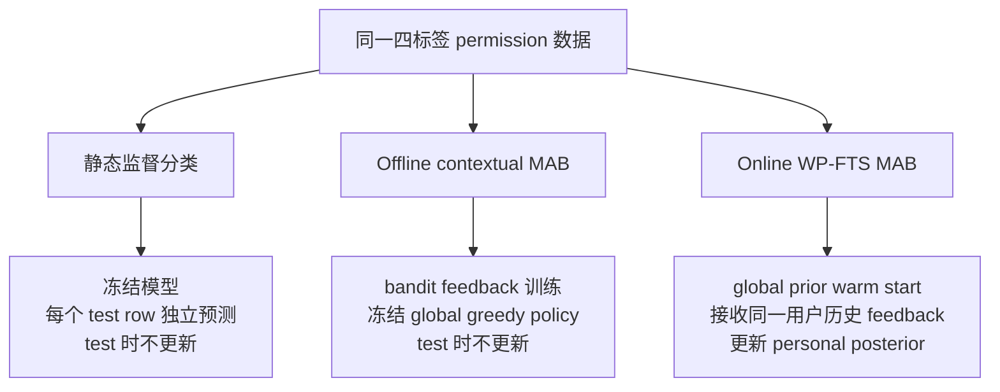

# 静态分类与 Offline / Online MAB 扩展比较

> 更新时间：2026-08-11  
> 数据：同一份 16,361 行、201 名参与者的四标签 permission 数据。  
> 共同测试 cohort：41 名 held-out 参与者、3,323 行；参与者集合与真实标签已经逐行核对一致。  
> 用途：把经典/语义静态分类与 Offline/Online Multi-Armed Bandit 放进同一个研究地图，同时避免把不同信息条件下的结果误写成统一排行榜。

## 一分钟结论

- **静态分类 benchmark** 仍是 Flat LR tuned：测试时不接收用户反馈，效果与风险较均衡。
- **语义分类 baseline** 仍是 ModernBERT：四个端到端 fine-tuned Transformer families 中最均衡，但没有超过 Flat LR；`DistilBERT initial` 指首个正式 fine-tuning run，并非未微调 checkpoint。
- **顺序个体化 baseline** 是 Online WP-FTS：在 MAB v2 replay 协议内，all-round JEM 从 Offline MAB 的 43.911% 提高到 51.083%，差值 `+7.173 pp`，95% CI `[+2.789,+12.162]`。
- Online 的提升主要来自 **persistence adaptation**：Persistence accuracy 提高 `+8.909 pp`；Access accuracy 只提高 `+0.153 pp`，CI 跨 0。
- 当前 replay 的安全代理指标不支持安全部署结论：False-allow 为 98.538%；而 Persistent-over-allow 的点估计还从 7.630% 上升到 9.735%。
- WP-FTS 的 51.083% 不能用来宣称“全面胜过 LR/Transformer”，因为它在测试 replay 中使用了同一用户此前的反馈，且特征、训练反馈和汇总单位也不同。

## 三种实验范式分别回答什么问题

| 范式 | 主要研究问题 | 训练信号 | Test-time 用户反馈 | 当前代表方法 |
|---|---|---|---|---|
| 静态监督分类 | 能否根据场景与用户字段直接预测四类回答？ | 每行完整四分类标签 | 无 | Flat/Ordinal/Factored LR、DistilBERT、RoBERTa、DeBERTa、ModernBERT |
| Offline contextual MAB | 使用 selected-action reward 学到的 global policy，冻结后能否匹配 held-out 用户？ | 只用被选 action 的 exact-match reward 更新 learner | 无 | Canonical factored Thompson training + frozen posterior-mean greedy test |
| Online personalized MAB | 同一新用户的顺序反馈能否改善后续 permission policy？ | global prior + 当前用户先前 selected-action feedback | 有，但只在完整 query bundle 行动后揭示 | WP-FTS |

WP-FTS 是 **Warm-started Personalized Factored Thompson Sampling**。每位测试参与者拥有独立 personal posterior；不会把一个用户的反馈传给另一个用户，global state 在 test 中也保持冻结。

## 四个 action 与四分类标签完全同构

| Action / label | Access | Persistence policy | 原始回答 |
|---:|---|---|---|
| 0 | deny | persist current deny | No, never share |
| 1 | deny | ask next time | No, but ask me next time |
| 2 | allow | ask next time | Yes, but ask me next time |
| 3 | allow | persist current allow | Yes, always share |

因此下面这些指标的**逐事件公式**可以映射，但 aggregation protocol 仍不同：

- MAB `JEM` 与四分类 `Accuracy` 都是 `predicted label == true label`；
- MAB `False-allow` 与 classification 的 `Over-sharing` 都以“真实为 labels 0/1”的事件为分母，分子是预测为 labels 2/3；
- MAB `Erroneous-always-allow` 与 classification 的 `Persistent-over-allow` 都以“真实为 labels 0/1/2”的事件为分母，分子是预测为 label 3；
- MAB 的 `Under-persistence`/`Over-persistence` 是另一组 persistence factor 指标，不能当作 Persistent-over-allow；
- 当前 MAB 正式结果没有报告 QWK，因此统一表必须保留为 `—`，不能自行补值。

静态 classification rate 在单次 3,323 行 frozen pass 上聚合；MAB rate 在 20 个 paired streams 的 66,460 个重复测试事件上 pooled。即使分子/分母事件公式相同，也不能忽略这种 aggregation 差异。

## 为什么仍然不能硬排一个“全局冠军”

虽然测试 cohort 和标签相同，实验信息条件并不相同：

| 比较维度 | 静态 LR / Transformer | Offline canonical MAB | Online WP-FTS |
|---|---|---|---|
| 选参 / 训练参与者 | 160 人 outer-train 内选参或 inner split | 120 train / 40 validation 选参；选定后用 160 人重拟合 global prior | 与 Offline 使用相同 global prior 协议 |
| Test participants / rows | 41 人 / 3,323 行 | 相同 41 人 / 3,323 行 | 相同 41 人 / 3,323 行，每个 replay stream 均覆盖全部行 |
| 主要 features | 较丰富，含 query text、necessity、人口统计、AI/隐私态度等 | 6 个 runtime fields | 与 Offline 相同 6 个 runtime fields |
| MAB 的 6 个字段 | 不适用 | `domain`、`tool`、`raw_data_type`、`generic_data_type`、`concern_domain`、`privacy_importance` | 完全相同 |
| Test 时是否更新 | 否 | 否 | **是：吸收同一用户先前 bundle feedback** |
| 结果汇总 | 一次 frozen prediction pass | 20 个 paired stochastic runs/streams 的 pooled metrics | 20 个 paired randomized replay streams 的 pooled metrics |
| 主要不确定性报告 | 静态模型各自的 participant bootstrap；Transformer 主要为单 training seed | 与 Online 配对的 5,000 次 participant-cluster bootstrap | 同左；重抽样单位为 41 位 participant，不是把 20 seeds 当独立用户 |

MAB v2 的 all-round 汇总包含 `3,323 × 20 = 66,460` 个预测事件，但它们不是 66,460 个独立样本。当前也没有完成静态分类器与 MAB 的跨范式 paired bootstrap。因此下面的跨范式表只能叫“共享指标的描述性快照”。

## 共享指标的描述性快照：不是统一 leaderboard

| 范式 | 方法 | Test 时更新 | Accuracy / JEM | Macro-F1 | QWK | Over-sharing / False-allow ↓ | Persistent-over-allow / Erroneous-always-allow ↓ |
|---|---|---:|---:|---:|---:|---:|---:|
| 静态经典 | Flat LR tuned | 否 | 40.927% | 37.065% | 0.3155 | 42.571% | 21.043% |
| 静态经典 | Ordinal LR tuned | 否 | 42.732% | 37.436% | 0.3178 | 48.821% | 29.885% |
| 静态经典 | Factored LR tuned | 否 | 43.635% | 37.762% | 0.2741 | 54.717% | 22.281% |
| 静态语义 | DistilBERT initial | 否 | 36.864% | 32.793% | 0.2388 | 50.590% | 39.523% |
| 静态语义 | RoBERTa-base | 否 | 44.689% | 33.514% | 0.2465 | 69.340% | 32.714% |
| 静态语义 | DeBERTa-v3-small | 否 | 43.334% | 32.630% | 0.2903 | 68.750% | 28.824% |
| 静态语义 | ModernBERT-base | 否 | 38.580% | 35.026% | 0.2823 | 43.278% | 23.342% |
| Offline MAB | Canonical global greedy | 否 | 43.911% | 20.473% | — | 100.000% | 7.630% |
| Online MAB | WP-FTS all-round | **是** | 51.083% | 28.058% | — | 98.538% | 9.735% |

这张表不能被解读为：Online MAB 的 51.083% 证明它比全部静态分类器更好。它获得了静态模型没有的 test-time same-user feedback；而且 Macro-F1 只有 28.058%，False-allow 仍为 98.538%。同样，Offline MAB 的 Persistent-over-allow 很低，也不能掩盖其 100% False-allow：它几乎总是先作出 allow access，再在 persistence bit 上变化。

## Offline MAB vs Online WP-FTS：正式 v2 all-round 对比

以下是可以严格进行的 **MAB 内部比较**。两个策略使用相同 action space、features、split 和 stated-policy exact-match reward。

所有差值和置信区间都由底层未四舍五入数值计算，再显示为三位小数。因此直接用表中已经四舍五入的两列相减，个别位置可能相差 `0.001 pp`；这不是原始结果矛盾。

| 指标 | Offline canonical | Online WP-FTS | Online − Offline | 95% participant-cluster CI |
|---|---:|---:|---:|---:|
| JEM / 四分类 Accuracy ↑ | 43.911% | **51.083%** | **+7.173 pp** | **[+2.789,+12.162]** |
| Four-class Macro-F1 ↑ | 20.473% | **28.058%** | **+7.585 pp** | **[+3.377,+11.006]** |
| Access accuracy ↑ | 74.481% | 74.634% | +0.153 pp | [−0.145,+0.645] |
| Persistence accuracy ↑ | 54.684% | **63.593%** | **+8.909 pp** | **[+3.450,+15.219]** |
| False-allow / Over-sharing ↓ | 100.000% | **98.538%** | **−1.462 pp** | **[−2.980,−0.281]** |
| False-deny ↓ | **0.000%** | 0.295% | +0.295 pp | [+0.204,+0.415] |
| Under-persistence ↓ | 87.362% | **69.443%** | **−17.919 pp** | **[−28.229,−6.387]** |
| Erroneous-always-allow / Persistent-over-allow ↓ | **7.630%** | 9.735% | +2.104 pp | [−1.825,+7.080] |

核心模式很清楚：JEM、Macro-F1 和 persistence 均改善；access 的变化很小且 CI 跨 0。False-allow 虽下降，但依然接近 100%；Persistent-over-allow 的点估计反而上升，且 CI 跨 0。因此只能说 WP-FTS 提高了 stated-policy fidelity，主要来自 persistence 个体化，不能说它已成为安全策略。

## Post-adaptation rounds 10–18

`rounds 10–18` 指每位参与者随机 bundle 序列中的第 10 到第 18 个 bundle position，不是普通 CSV 行号。每个 `(participant_id, query_id)` bundle 的所有 action 都先选完，之后才揭示反馈；全部 41 名测试参与者都覆盖该窗口。

| 指标 | Offline canonical | Online WP-FTS | Online − Offline | 95% participant-cluster CI |
|---|---:|---:|---:|---:|
| JEM / Accuracy ↑ | 43.598% | **53.863%** | **+10.265 pp** | **[+4.025,+17.250]** |
| Macro-F1 ↑ | 20.359% | **30.778%** | **+10.418 pp** | **[+4.989,+14.600]** |
| Persistence accuracy ↑ | 54.216% | **66.572%** | **+12.356 pp** | **[+4.770,+20.911]** |
| False-allow ↓ | 100.000% | **98.205%** | **−1.795 pp** | **[−3.866,−0.209]** |

Late-round 的点估计增益比 all-round 更大，与“随着同一用户反馈累积，personal posterior 逐步适应”的机制相符。不过，本分析没有直接检验“late-round 差值减去 all-round 差值”这一 interaction，因此不能把它写成已显著证明的时间趋势。这里使用正式 CSV 的 `−1.795 pp`；截图中的 `−1.798 pp` 是一处显示笔误。

## 为什么还需要 matched frozen control

Online WP-FTS 与 canonical Offline MAB 的比较同时改变了 personal posterior、tempering 和 action-selection mechanism，所以 `+7.173 pp` 不能全部归因于“在线更新”。更接近 update-only 问题的是 **matched frozen tempered FTS control**：它与 WP-FTS 使用相同 replay/action-selection 机制，但永远不吸收用户反馈。

| 指标 | Frozen control | Online WP-FTS | Online − Frozen | 95% participant-cluster CI |
|---|---:|---:|---:|---:|
| JEM ↑ | 42.212% | **51.083%** | **+8.872 pp** | **[+4.595,+13.830]** |
| Macro-F1 ↑ | 18.806% | **28.058%** | **+9.252 pp** | **[+5.390,+12.402]** |
| Access accuracy ↑ | 74.272% | **74.634%** | **+0.363 pp** | **[+0.108,+0.790]** |
| Persistence accuracy ↑ | 53.255% | **63.593%** | **+10.339 pp** | **[+5.066,+16.472]** |
| False-allow ↓ | 99.304% | 98.538% | −0.767 pp | [−2.241,+0.380] |

这个控制支持“在当前 replay simulation 中，吸收同一用户此前 feedback 能改善后续 stated-policy fidelity”，但不证明真实 deployment 中的隐私泄露、用户满意度或长期 utility 已改善。

## 当前研究定位

下表描述的是三种 **baseline roles**，不是每种实验范式只允许保留一个方法。具体到 MAB 内部，canonical Offline global greedy 仍是冻结 comparator，而 WP-FTS 是当前 sequential-personalization baseline。

| 角色 | 当前方法 | 能回答的问题 | 不能回答的问题 |
|---|---|---|---|
| 静态分类 benchmark | Flat LR tuned | 冷启动、新参与者、已见场景的静态预测 | 收到用户反馈后如何适应 |
| 语义 classification baseline | ModernBERT | 预训练语言表示在相同四分类任务中的表现 | 个体化在线学习或安全约束 |
| Sequential personalization baseline | WP-FTS | replay 中同一用户反馈是否提高后续 fidelity | 真实 privacy harm、长期 return、安全 deployment |
| 后续安全决策层 | CMDP / constrained RL（尚未由本结果完成） | 长期状态、prompt burden、privacy budget 与约束 | 不能由当前 MAB 结果代替 |

## 可以和不可以说什么

可以说：

> 在相同 MAB v2 replay 协议内，WP-FTS 相对 canonical Offline MAB 提高了四类 stated-policy fidelity，且增益主要来自 persistence adaptation；matched frozen control 进一步支持 same-user feedback update 的作用。

不可以说：

- “WP-FTS 51.083% 因而全面优于所有 LR/Transformer”；
- “Online MAB 已将 false-allow 降到可接受水平”；
- “当前结果证明真实隐私泄露减少”；
- “20 个 replay seeds 等于 20 组独立用户样本”；
- “Online vs canonical Offline 的全部差值都由 posterior update 单独造成”；
- “问卷中的随机 bundle 顺序等同于真实时间序列”。

## 证据入口

- [Online MAB 文档总览](../ai_agent_permission_experiment/online_mab/README.md)
- [最终结果摘要](../ai_agent_permission_experiment/online_mab/01_RESULT_SUMMARY_zh.md)
- [Online WP-FTS 方法说明](../ai_agent_permission_experiment/online_mab/02_ONLINE_MAB_METHOD_zh.md)
- [Offline vs Online 完整对比](../ai_agent_permission_experiment/online_mab/03_OFFLINE_VS_ONLINE_COMPARISON_zh.md)
- [整理后的最终结果 CSV](../ai_agent_permission_experiment/online_mab/offline_vs_online_final_results.csv)
- [v2 run config](../ai_agent_permission_experiment/online_bandit_experiment/results/participant_heldout_wp_fts_v2/run_config.json)
- [v2 全部策略测试指标](../ai_agent_permission_experiment/online_bandit_experiment/results/participant_heldout_wp_fts_v2/test_metrics_summary.csv)
- [Online vs canonical Offline bootstrap](../ai_agent_permission_experiment/online_bandit_experiment/results/participant_heldout_wp_fts_v2/online_vs_canonical_greedy_bootstrap_summary.csv)
- [Online vs matched frozen bootstrap](../ai_agent_permission_experiment/online_bandit_experiment/results/participant_heldout_wp_fts_v2/participant_bootstrap_summary.csv)
- [Leakage checks](../ai_agent_permission_experiment/online_bandit_experiment/results/participant_heldout_wp_fts_v2/leakage_checks.json)
- [Canonical Offline MAB 说明](../ai_agent_permission_experiment/bandit_experiment/README.md)

本对比只使用最终 `participant_heldout_wp_fts_v2`。`participant_heldout_wp_fts_v1` 是早期协议审计记录；早期带人工 reward weights 的 legacy MAB 也不进入本表。历史 5-seed Offline JEM 43.780% 与这里的 43.911% 不矛盾：当前 Offline/Online 表使用的是 v2 的 20-stream canonical rerun。
