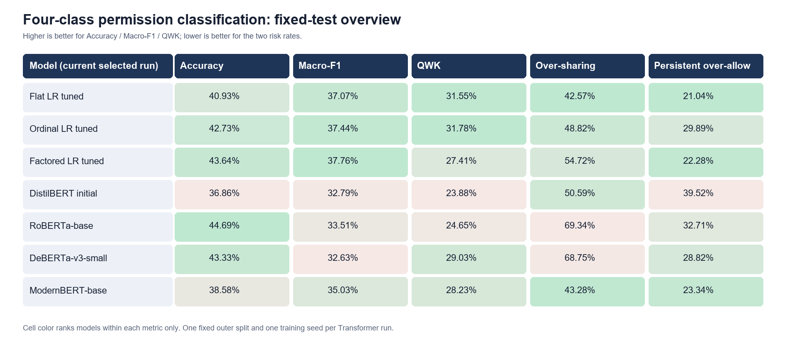
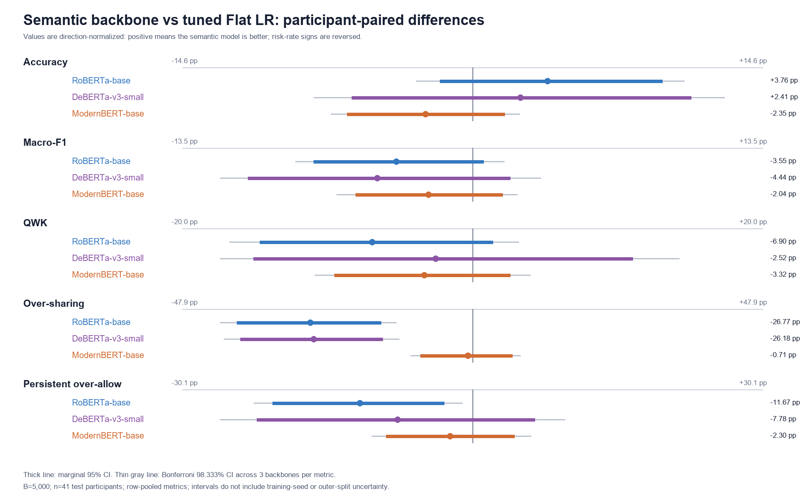
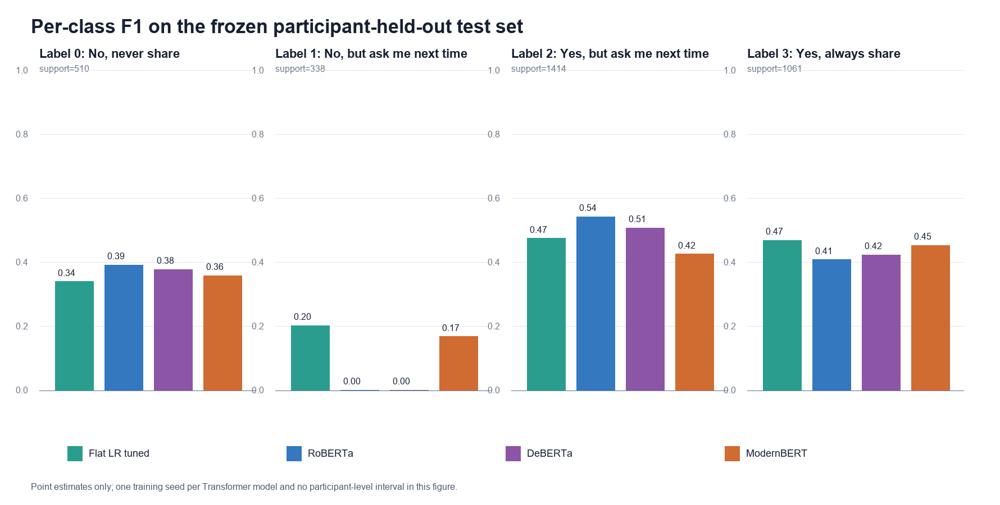

# Semantic Classification / Round 1 / Round Review / 2026-08-10

## 1. Executive Summary

本轮在相同四标签、相同输入字段和同一冻结 participant-heldout 测试集上，完成了 RoBERTa-base、DeBERTa-v3-small、ModernBERT-base 三个端到端语义分类模型。三个模型都通过 inner participant validation 选择 learning rate、loss weighting 和 epoch，之后只评估冻结 test 一次。

结论很清楚：**没有一个新语义模型在主指标 Macro-F1 上超过 tuned Flat Logistic Regression**。RoBERTa 的 Accuracy 最高，但过度允许风险很高；DeBERTa 也有相同问题；ModernBERT 是三个语义模型中最均衡的，但点估计仍未全面超过 Flat LR。

因此本轮决策是：继续把 **Flat LR tuned** 作为默认 benchmark；保留 **ModernBERT** 作为当前最有价值的 semantic baseline；暂不继续横向增加更多端到端 Transformer backbone。

## 2. Experiment Identity and Decision Context

此前 DistilBERT 没有超过 Flat LR，但单个弱 backbone 的负结果不能代表所有语义模型。本轮选择三条不同预训练路线：

- RoBERTa-base：经典强化 MLM encoder；
- DeBERTa-v3-small：disentangled attention + replaced-token detection；
- ModernBERT-base：更新的长上下文 encoder 架构。

本轮要回答的不是“模型是否真正理解隐私语义”，而是一个更窄的问题：在现有字段和固定评估协议下，更强的预训练 encoder 是否能给出比经典 LR 更好的初始分类对照。

## 3. Setup and Evaluation Protocol

- 数据：16,361 行、201 participants；SHA-256 `4a6f61191318eaa79ba2fac1ab80e6fb850e099f1f0178eef2f53b3b527fe463`。
- Outer split：13,038 行/160 人训练；3,323 行/41 人测试；participant overlap=0；seed 42。
- Inner split：10,417 行/128 人训练；2,621 行/32 人 validation；seed 20260809。
- 任务：直接预测四个原始 permission labels `0..3`。
- 主指标：Macro-F1；辅助指标：Accuracy、QWK、Over-sharing、Persistent-over-allow。
- 服务器：RTX 3090、PyTorch 2.6.0+cu124、Transformers 5.5.0、FP16 autocast、TF32。
- 训练 seed：每个 Transformer 只有一个 seed 42。

新模型选中参数：

| 模型 | Inner-validation 选中参数 | Best epoch | Validation Macro-F1 |
|---|---|---:|---:|
| RoBERTa-base | `lr=2e-5`, `loss_weighting=none` | 1 | 0.3389 |
| DeBERTa-v3-small | `lr=1.5e-5`, `balanced` | 1 | 0.3543 |
| ModernBERT-base | `lr=3e-5`, `balanced` | 2 | 0.3521 |

三份 run 的 source snapshot 完全相同，SHA-256 为 `f8990f5996884a32d7d1bb9bcca3aaa1260b72d8af2a53a5f640a1ab0f699321`。该版本显式执行 `model.float()`，确保 FP16 checkpoint 在 AMP 下使用 FP32 master parameters。

## 4. Main Findings

### 当前主要方法的冻结测试点估计

| 方法 | Accuracy ↑ | Macro-F1 ↑ | QWK ↑ | Over-sharing ↓ | Persistent-over-allow ↓ |
|---|---:|---:|---:|---:|---:|
| Flat LR tuned | 40.927% | 37.065% | 0.3155 | **42.571%** | **21.043%** |
| Ordinal LR tuned | 42.732% | 37.436% | **0.3178** | 48.821% | 29.885% |
| Factored LR tuned | 43.635% | **37.762%** | 0.2741 | 54.717% | 22.281% |
| DistilBERT initial | 36.864% | 32.793% | 0.2388 | 50.590% | 39.523% |
| RoBERTa-base | **44.689%** | 33.514% | 0.2465 | 69.340% | 32.714% |
| DeBERTa-v3-small | 43.334% | 32.630% | 0.2903 | 68.750% | 28.824% |
| ModernBERT-base | 38.580% | 35.026% | 0.2823 | 43.278% | 23.342% |

这张表说明“最好”取决于目标：RoBERTa 的 Accuracy 最高，Factored tuned 的 Macro-F1 最高，Ordinal tuned 的 QWK 最高；但 Flat tuned 的权限风险最均衡。Factored、RoBERTa、DeBERTa 的较高性能点估计伴随明显更多 over-sharing。

### 新模型相对 Flat LR 的主指标

差值为 `semantic − Flat LR`，单位为百分点；区间是 5,000 次 participant-paired cluster bootstrap 的 marginal 95% CI。

| 模型 | Δ Macro-F1 | 95% CI |
|---|---:|---:|
| RoBERTa-base | −3.551 pp | [−7.394, +0.514] |
| DeBERTa-v3-small | −4.435 pp | [−10.444, +1.768] |
| ModernBERT-base | −2.039 pp | [−5.435, +1.419] |

三个区间均跨 0，但点估计都低于 Flat LR；当前没有证据支持任何新 backbone 在主指标上更好。

### 权限风险

- RoBERTa Over-sharing 比 Flat LR 高 26.769 pp，95% CI `[+15.072,+38.844]`；Persistent-over-allow 高 11.671 pp，CI `[+2.905,+20.732]`。
- DeBERTa Over-sharing 高 26.179 pp，CI `[+14.775,+38.253]`；Persistent-over-allow 高 7.781 pp，但 CI 跨 0。
- ModernBERT 两项风险分别高 0.708 pp 和 2.299 pp，两个 CI 都跨 0；它最接近 Flat LR，但不能据此称为等效或同样安全。

RoBERTa 两个风险区间、DeBERTa 的 Over-sharing 区间，在每个指标三个 backbone 对比的 Bonferroni 98.333% CI 下仍位于不利方向。

## 5. Statistical Validation

- 抽样单位是 participant cluster，不是 3,323 个 row。
- 每次有放回抽取 41 名 participant，并将其全部行同时用于 LR 和三个语义模型；estimand 是 row-pooled metric。
- Bootstrap：B=5,000，seed 20260810，percentile CI。
- 主比较家族是三个 backbone 相对 Flat LR 的 Macro-F1；同时给出 marginal 95% CI 与 Bonferroni 98.333% CI。
- 不报告普通行级 p-value，也不把 participant bootstrap 当作多训练 seed 的替代品。

完整统计表见 [bootstrap summary](../analysis/semantic_backbones_20260810/semantic_vs_flat_lr_bootstrap_summary.csv)；所有 replicate 见 [paired bootstrap replicates](../analysis/semantic_backbones_20260810/paired_cluster_bootstrap_replicates.csv)。

## 6. Figure-by-Figure Interpretation

### Figure 1：全部主要方法的指标总览

- 为什么展示：同时查看性能和权限风险，避免只按 Accuracy 选模型。
- 观察：RoBERTa Accuracy 高，但风险最差；Factored tuned Macro-F1 高，但 over-sharing 高；Flat tuned 更均衡。
- 支持的解释：当前不存在一个在所有指标上占优的模型。
- 决策变化：默认 benchmark 继续用 Flat tuned，而不是 RoBERTa 或 Factored tuned。

### Figure 2：三个新 backbone 相对 Flat LR 的配对差值

- 为什么展示：把效应大小和 participant 抽样不确定性放在同一图中。
- 观察：三个模型的 Macro-F1 点都在 Flat LR 一侧；RoBERTa/DeBERTa 的 over-sharing 明显不利。
- 支持的解释：当前数据不支持新 backbone 替代 Flat LR。
- 决策变化：若继续语义实验，优先研究受控融合，而不是继续堆 backbone。

### Figure 3：逐类 F1

- 为什么展示：解释 Accuracy 和 Macro-F1 的分歧。
- 观察：RoBERTa 与 DeBERTa 对 label 1（拒绝但下次询问）的 F1 都是 0；ModernBERT 为 0.167，Flat tuned 为 0.201。
- 支持的解释：高 Accuracy 主要没有转化为少数类均衡识别。
- 决策变化：后续优化应把 label 1 和过度允许作为 guardrail。

## 7. Failure Cases, Negative Results, and Limitations

- 三个语义模型都没有提升主指标；这是有价值的初步负结果。
- RoBERTa/DeBERTa 倾向允许类，导致 Accuracy 尚可但 over-sharing 很高。
- 每个 Transformer 只有一个训练 seed；CI 不覆盖优化随机性。
- 只有一个 outer participant split，且 train/test 共享全部 query/templates；结果只表示“新参与者、已见场景”。
- LR 与 Transformer 虽使用同一源字段，但完整 preprocessing pipeline 不同。因此不能把差异因果归因于预训练语义表示。
- 归档是 `results_without_model`，没有 final checkpoint；预测、配置和源码可审计，但不能在本地直接恢复同一权重做新推理。

## 8. What Changed Our Belief

- 被削弱的假设：只要换成更强 encoder，就会自然超过 TF-IDF/One-Hot LR。
- 被加强的判断：当前任务中个体偏好和类别不平衡可能比通用文本语义更主导；安全指标必须独立于 Accuracy 监控。
- 尚未解决：frozen semantic embedding + LR、语义与人口统计 late fusion 是否能以更受控方式利用语义。

## 9. Next Actions

1. 停止继续无差别增加端到端 Transformer backbone。
2. 保留 ModernBERT 作为当前 semantic baseline；Flat tuned 继续作为默认 benchmark。
3. 若继续实验，优先做三项受控 ablation：text-only、tabular-only、frozen semantic embedding + tabular LR。
4. 若要形成论文级语义结论，补至少 3–5 个训练 seed，并预先冻结模型选择与风险 guardrail。

## 10. Artifact and Reproducibility Index

- [严格分析报告](../analysis/semantic_backbones_20260810/analysis-report.md)
- [统计附录](../analysis/semantic_backbones_20260810/stats-appendix.md)
- [Figure catalog](../analysis/semantic_backbones_20260810/figure-catalog.md)
- [全部模型指标 CSV](../analysis/semantic_backbones_20260810/all_model_metrics.csv)
- [选中超参数 CSV](../analysis/semantic_backbones_20260810/selected_hyperparameters.csv)
- [分析 manifest](../analysis/semantic_backbones_20260810/analysis_manifest.json)
- [RoBERTa server return](../artifacts/server_returns/semantic_nlp_fp32fix_v1_roberta_base/)
- [DeBERTa server return](../artifacts/server_returns/semantic_nlp_fp32fix_v1_deberta_v3_small/)
- [ModernBERT server return](../artifacts/server_returns/semantic_nlp_fp32fix_v1_modernbert_base/)
- [原始返回归档](../artifacts/archives/)
- [可复现分析脚本](../scripts/analyze_semantic_backbones.py)

