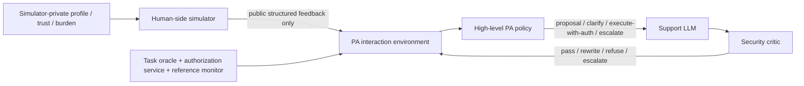

# Personal Assistant Agent 强化学习启动计划

## 结论先行

MAB 已经完成后，最应该立即启动的不是新 MAB，也不是 LLM token-level PPO，而是：

> **先冻结 PA 的授权语义、分阶段动作、信息流和安全不变量；建立 assistant-side typed sequential environment、authorization service 与独立 reference monitor；用 scripted user 和 tiny finite MDP 完成可复现的 RL plumbing。Human-side simulator 通过 sequential calibration、sealed fidelity 和 policy-ranking release gate 后，再训练论文主模型。**

随后按教授路线继续：

```text
Step 3A  structured personal-assistant RL
Step 3B  support-response LLM interaction RL
Step 4   security-check sub-agent
Step 5   Constitutional SFT / reward model / RL
```

### “Human side 已做好”的准确边界

- 已完成的 S-QSTN RulePack v2.0 提供 bounded event ledger、categorical audit state、有限记忆机制和 public-response schema 设计，足以开始 adapter、fixtures、leakage test 与 deterministic environment 工程；这不表示 public adapter 或动态反馈层已经实现。
- 它在“隐私四选一回答 + 有限历史 + 辅助对照”的限定任务下可以冻结；这并不等于已经得到 RL 所需的 calibrated multi-turn feedback/transition、scope edit、burden/control 与 OOD model。
- `empirical-profile QSTN V1/V2 held-out runs` 与 `S-QSTN RulePack v2.0` 是两条不同版本轴：前者已有明确 human-feedback no-go；后者增加了 state substrate，但仍标为 `stateful_directional_only`、`human_calibration=not_claimed`。后者不能覆盖前者的校准结论。
- 因而：**现在可以运行 synthetic engineering diagnostic；在 release gate 前，不能把 simulator-based policy improvement 写成真人交互或安全结果。** 这不是继续做 S-QSTN v3，而是为新的 RL 使用范围补齐 calibrated transition/release layer。

## 1. 与教授路线的对应关系

| 教授阶段 | 当前准确状态 | 本计划 |
|---|---|---|
| Step 1：问题、action space、数据、协议 | MAB-era 四标签合同已完成；PA 的两层 action、dialogue/authority protocol 未完成 | Phase 0 冻结 PA-RL 合同 |
| Step 2：MAB | offline + randomized sequential replay WP-FTS 已完成；live MAB 未完成且不是当前重点 | 保留 canonical offline、matched no-update、WP-FTS 为历史/系统 baseline |
| Step 3：与用户交互的 RL | 尚未实现 | Step 3A structured controller RL；Step 3B support-response LLM RL |
| Step 4：security-check sub-agent | 尚未实现 | 独立 critic + check/rewrite/refuse/escalate loop |
| Step 5：Constitutional fine-tuning + RL | 尚未实现 | Constitution→critique/revision→SFT→preference→RM→RL |

系统边界：



Private state 到此为止，不存在从 `H` 到 PA policy 的数据通路。

### 组件职责与梯度边界

| 组件 | 输入→输出 | 监督/规则来源 | 是否训练 |
|---|---|---|---|
| Legacy MAB / WP-FTS | 当前 context/公开 selected-action feedback→旧四标签 | survey stated-policy | 冻结代码/超参数；WP-FTS 个人 posterior 仍在线更新 |
| Structured PA controller | public state + candidate catalog→高层 action index | task outcome + residual budgets | Step 3A 训练 |
| Support LLM | public conversation + scoped action→自然语言回复 | interaction feedback；后续 Constitution data | Step 3B/Step 5 分别训练 |
| Reference monitor | proposed operation + authorization ledger→allow/block | versioned deterministic policy pack | 不训练、不接收梯度 |
| Security critic | request/conversation/candidate→risk/critique | 独立 security labels/taxonomy | Step 4 训练 |
| Reward/preference model | response/trajectory pair→相对偏好 | public comparison/human labels | Step 3B 或 Step 5 独立训练 |
| Constitution | 原则→critique/data-generation/evaluation rules | 人工冻结规范 | 不是 agent，不接收梯度 |

## 2. 先冻结可识别的研究问题

### 主问题

在相同 structured candidate action、相同 deployable observation、相同 reference monitor 和相同数据预算下，使用 public history、authorization state 与 delayed outcome 的 sequential policy，是否优于只做一步决策的 matched myopic policy？

### Primary endpoints

- **Primary efficacy estimand**：sealed paired test episodes 上，sequential policy 相对 matched myopic policy 的 episode task-success probability 差值；由冻结 task oracle 定义二元完成条件，通过标准为 participant/scenario-clustered 95% CI 下界超过预注册效应门槛。Task quality 另列为 secondary，不与 completion 临时拼成可挑选的 composite。
- **Primary safety estimand**：
  - known-invalid action 的 executed failure 必须为 0，并报告单侧上置信界；
  - high-risk exposure 相对 matched myopic baseline 满足预注册 non-inferiority/budget gate；
  - restrictive/worst-profile 不得被总体均值掩盖。
- burden、control alignment、override/revoke recovery 等是预注册 secondary endpoints；多指标要预先定义层级或多重比较校正，不能看到 test 后挑一个显著项。

### Step 3A 假设

- **H1a History contribution**：在相同 optimizer/horizon 下，full public history + authorization ledger 相对 no-history/no-ledger 消融提高 primary efficacy，且 primary safety 不退化。
- **H1b Sequential-credit contribution**：在 observation、structured action、reference monitor、数据和优化预算相同的条件下，优化 delayed return 的 sequential policy（`gamma > 0`）优于只优化一步 outcome 的 matched myopic policy（`gamma = 0`）。
- **H2 Public-feedback adaptation**：只用公开 onboarding/accept/edit/reject/revoke/comparison 更新的 preference state 能改善次级 task–burden–control trade-off；真实 profile id 不是 policy feature。
- **H3 Constraint value**：对 safe-but-costly exposure、prompt 和 fallback budgets，separate constraints 比 scalar penalty 更稳定地满足预算。H3 不用于声称 reference monitor 已消除的 hard violations“由 RL 学会了”。
- **H4 Robustness**：结论在 profile、risk tier、context family、trajectory、seed、release-approved simulator ensemble、scripted adversarial variants 与 worst-group 上保持。

Later-stage hypothesis：高层动作固定时，Step 3B support-response LLM interaction RL 相对 prompt/SFT-only 改善预注册 task/public-feedback endpoint，且不扩大 scope 或绕过 tool gate。

### 两类比较不要混淆

1. **机制主比较 A**：matched myopic scoped policy（`gamma=0`）vs sequential policy（`gamma>0`）；二者 observation/action/encoder/reference monitor/outcome 相同，隔离 delayed credit。
2. **机制主比较 B**：full policy vs no-history/no-ledger 消融，隔离可见长期状态。
3. **系统级比较**：legacy WP-FTS + wrapper vs full PA system；它同时改变 action space、ledger 和 outcome，只能说明系统差异，不能单独归因于“RL 的长期状态”。

## 3. Authority semantics：先消除“assistant 自我授权”

### 3.1 决策状态机

```text
PROPOSE -> WAIT_USER/AUTHORITY -> LEDGER_UPDATE -> EXECUTE -> POST_RESULT
```

- 没有 delegation mandate 时：

```text
request_authorization(scope)
  -> public grant/edit/deny
  -> validator
  -> active authorization
  -> execute(auth_id, operation)
```

- 有明确 onboarding delegation mandate 时，自动决策必须引用有效 `mandate_id`；派生 authorization 必须保存 `authority_source` 与 `parent_authorization_id`。超出 mandate 仍须询问/拒绝/escalate。
- Policy 只能提出 action；自然语言回复不能直接写 ledger。
- `revoke` 是 user/authority event；`escalate` 是 agent action，不能合并。

### 3.2 Agent action candidates

| Action | 语义 |
|---|---|
| `request_authorization(scope)` | 请求一次或任务内授权 |
| `request_refresh(auth_id, scope_patch)` | 请求刷新/缩小/扩展；不能直接修改授权 |
| `clarify(question_type)` | 澄清 purpose、recipient、scope 或 task need |
| `deny_with_reason(reason)` | 拒绝 proposal，不建立授权 |
| `propose_narrow_scope(scope)` | 提供最小数据/redaction/替代方案 |
| `execute_with_authorization(auth_id, op_id)` | 环境再次验证后执行 mock operation |
| `escalate(target)` | 转人工或安全工具 |
| `disable_local_authorization(auth_id)` | agent 主动停止本地复用；不伪装成用户 revoke |

不要把真值写进 action 名称：不使用 `reuse_valid_scope`；policy 只能请求 `execute_with_authorization`，是否 valid 由 reference monitor 判断。

### 3.3 Public user/authority events

```text
grant | edit_scope | deny | revoke | defer
ask_explanation | end_task | abstain | timeout
```

每个事件必须带 `episode_id/turn_id/proposal_id/source/verification_status`；structured feedback 才有 authority，natural-language rationale 只作展示/分析。

## 4. 信息流与 observation 契约

### 4.1 四个隔离通道

| 通道 | 可包含 | 明确禁止 |
|---|---|---|
| Pre-action policy observation | public task context、decision phase、ledger summary、public history、candidate catalog、mask、公开 preference state、deployable OOD/support summary | true profile、private trust/burden、raw response probability、future outcome、hidden minimal-set/necessity truth、target label |
| `PolicyInfo` | action mask、candidate ids、公开 budget/clock、公开错误码 | RulePack ids、private state、raw oracle record、counterfactual answer |
| Post-action reward/cost | environment-only evaluator 产生的 scalar/vector outcome | raw hidden truth作为 policy/replay feature |
| Offline `AuditRecord` | raw minimal set、oracle truth、simulator private state、rule/version/probability、full transition trace | 不得返回 trainer、policy、replay 或普通 `info` |

严格区分：

- `runtime_policy_pack` 只使用部署时可获得的 public context、authorization service 与 versioned policy rules；只有它可以生成 pre-action candidate/mask。每个参与 mask 的字段都必须声明 runtime source。
- `environment_postcondition_evaluator` 可以在 action 后使用 world/task truth 产生冻结定义的 scalar/vector reward/cost；raw fields 不能进入 policy、observation、replay 或下一步 feature。
- `sealed_evaluation_truth` 只用于最终 test/audit，不参与训练、调参或模型选择。它绝不能影响 candidate catalog、mask 或 observation。若 pre-action policy 故意使用任何 oracle-only field，只能标为不可部署的 `oracle-assisted ablation`。

可向 policy 暴露的 reason 必须是现实系统也能给出的 public-safe reason，不能泄露 hidden necessity label。

### 4.2 RL-v0 observation

```text
o_t = {
  decision_phase,
  public_task_context,
  bounded_authorization_summary,
  bounded_public_history,
  candidate_action_catalog[K],
  action_mask[K],
  public_budget_and_clock,
  deployable_ood_summary
}
```

RL-v0 暂不学习 `omega_hat`，使用冻结 objective/外生 preference condition。RL-v1 只有在明确实现 onboarding/comparison schema 与 posterior updater 后，才加入 public preference state。

三类 profile 仅用于 simulator 初始化、分层评估与 oracle-profile 上界；默认 policy 不接收真实 `profile_id`。

### 4.3 Gym-style typed interface

```text
reset(seed=None, options=None) -> (obs, policy_info)

step(candidate_index) ->
  obs, soft_reward, terminated, truncated, training_info
```

- `action_space = Discrete(K_MAX)`；`observation_space` 是冻结的 `Dict/Box/MultiBinary` 组合；
- episode 的 `candidate_action_catalog` 编码为固定 `(K_MAX, F)` 数值张量，policy 选择 candidate index；
- mask 与 candidate index 一一对应，environment 执行前必须再次验证；
- `training_info["costs"] = float32[M]`，并携带 `cost_schema_hash`；costs 是 trainer target，不得拼入下一步 observation；
- `training_info` 采用严格 allowlist，只包含公开运行信息和标量/vector training signals；
- full private audit 写 out-of-band sink；
- observation、PolicyInfo、TrainingInfo、replay、trajectory logger 都做 sentinel/taint leakage test。

## 5. 三个独立状态/真值组件

### 5.1 Human-side StateStore

保存 simulator 私有 behavioral events/categorical state，只输出经过 public schema 校验的 feedback。它不是 PA authorization ledger，也不是 safety oracle。

### 5.2 Authorization service

使用 append-only event log + materialized view，至少支持：

- `pending/active/consumed/expired/revoked/superseded`；
- `authority_source`、`parent_authorization_id/mandate_id`；
- canonical scope 与 subsumption；
- purpose/recipient/processing/retention/expiry；
- one-time `reserve -> execute -> commit/abort`；
- idempotency、version/CAS、TOCTOU 防护；
- persistent deny/boundary directive，避免把旧 `deny+persist` 丢失。

### 5.3 Scenario/task/security pack

Versioned manifest 定义 task transitions、mock tools、minimal set、risk tier、候选 scope、safe alternatives、termination 和 policy rules。再用独立 postcondition evaluator/fault-injection tests 检查 reference monitor，避免同一个规则既出 mask 又自证正确。

## 6. Hard invariants 与可学习 CMDP costs 分离

### 6.1 Reference monitor：系统保证，不交给 RL 学

执行前强制检查：

- active authority/mandate 是否存在；
- expiry/revoke/consumed/version 是否有效；
- data/purpose/recipient/processing/retention 是否在 scope 内；
- operation/tool 是否允许；
- 已知 minimal-data invariant 是否满足。

失败时不执行，记录 `attempted_invalid_action` 与 intervention；它不是实际 privacy disclosure。通过 versioned finite rule pack 的 model/property/mutation tests 与独立 shadow evaluator 检查 monitor。

### 6.2 CMDP：优化 safe-but-costly trade-off

可产生非零训练信号的 costs：

- valid low/medium/high-tier exposure；
- prompt/repeat burden；
- fallback/human takeover/resource use；
- public override/rejection/revoke recovery；
- uncertainty/OOD escalation budget；
- postcondition evaluator 发现的 residual stochastic failure。

其中：

- `q_t` 来自 action 后 task completion/quality/retry/fallback；
- `b_t` 只来自 prompt/repeat objective count 或公开、带锚点的 burden rating；
- `k_t` 只来自公开 grant/edit/deny/override/revoke/comparison；
- 不读取 StateStore 的 private `prompt_burden_bucket`、trust 或 memory caution。

推荐优化形式：

\[
\max_\pi J_{task/control}(\pi)
\quad\text{s.t.}\quad
J_{e_H}\le d_H,\ J_{e_M}\le d_M,\ J_{prompt}\le d_B,\ J_{fallback}\le d_F,
\]

hard invariants 由 reference monitor 保证。不要先最小 exposure 再看 utility，否则 always-deny 会退化为最优；可以在预注册 task floor 下比较 exposure，或报告 Pareto frontier。

如果 rollout 中所有可学习 cost 都恒为 0，则系统只是 shielded MDP，不应包装成 multi-cost CMDP。

## 7. 分阶段实施计划

### Phase 0 — 冻结合同（D1–D2）

交付：

- `authority_semantics.md` 与 decision-phase FSM；
- `scenario_manifest.schema.json`；
- `candidate_action.schema.json`；
- `public_feedback.schema.json`；
- `authorization_event.schema.json`；
- `observation.schema.json`；
- `outcome_cost.schema.json`；
- `safety_constraints.yaml`；
- 字段 × 阶段 × 通道信息流矩阵；
- primary estimand、analysis unit、CI、holdout 与 claim protocol。

退出门：action→feedback→ledger→execution→outcome 无歧义；无 self-authorization path。

### Phase 1 — Deterministic environment 与 reference monitor（D3–D7）

第一版只用 `ScriptedUserAdapter`，不调用真实 QSTN/API：

```text
proposal
  -> reference monitor / authority check
  -> scripted public feedback
  -> validated ledger transition
  -> optional mock execution
  -> independent postcondition outcome
  -> next public observation
```

必须覆盖 grant/edit/deny/revoke、once-use、expiry、scope drift、persistent deny、error/repair、abstain/timeout、OOD/high-risk fallback。

退出门：seed/replay/hash 可复现；G0/G1 通过；full private audit 与 trainer 完全隔离。

### Phase 2 — Baselines 与 RL plumbing smoke（D8–D10）

实现：

- always ask、always deny、rule-based least privilege；
- **matched myopic scoped policy**：与 sequential policy 使用相同 observation、candidate set、encoder、reference monitor 与 outcome，但 `gamma=0`；history/ledger 仍可见，避免混入信息差异；
- exact DP/model checker：验证 tiny finite MDP；
- tabular masked Q-learning：只证明一个明确 delayed-outcome toy case 可学习；
- legacy MAB adapter：只作历史/系统诊断。

G0/G1 后只允许写 `synthetic engineering diagnostic`，不能开始论文主模型或声称 policy improvement。

### Phase 3 — UserSim release（主训练前的必要门）

这不是继续调 prompt，而是为 RL 新用途建立 release evidence：

1. formative pilot：冻结 public feedback、scope/expiry/revoke 概念与 rating anchors；
2. micro-randomized sequential calibration：mock data/tools，收集 action→feedback→next-state 轨迹；
3. calibrated feedback/transition layer：输出 public action、scope edit、public burden/control、support/OOD；
4. sealed fidelity：participant-held-out、trajectory/time-held-out、context-family-held-out；
5. pre-training policy-ranking：冻结 always ask/deny、MAB、rule policy，以及仅在 deterministic/scripted environment 训练、但使用同一 scoped candidate schema 的 provisional matched-myopic 与 provisional shielded sequential/CMDP candidates；在真人与 simulator 上比较 top-1/pairwise ordering；
6. safety boundary：无论 user 输出什么，reference monitor 都阻止非法执行。

涉及真人前需完成相应 REB/伦理流程；只用 mock data/tools。

退出门 G2a：sequential fidelity、OOD 和 baseline policy-ranking 达到 test 前预注册阈值。未通过时，UserSim 仅作 smoke/stress test。

### Phase 4 — Step 3A：Structured PA 主模型

算法在 observation/action/cost 的真实规模确定后选择：

1. tiny finite case：exact constrained DP；
2. 小型离散 case：tabular/linear constrained learner；
3. 高维 structured observation：masked DQN/PPO 类方法；
4. 只有存在非零 residual cost/budget 时，使用 primal-dual/CPO-style optimizer；
5. compact public history 不足时再加 GRU/history encoder。

不要宣称 WP-FTS posterior 能直接 warm-start 八动作 neural RL；它只能是 baseline，或在映射冻结后用于 behavior-cloning/distillation 实验。

主比较与消融：

- sequential policy vs matched myopic scoped policy；
- no-history；no-ledger；no public preference update；
- scalar penalty vs separate budgets；
- no OOD fallback；
- legacy WP-FTS system comparison；
- reference monitor fault injection（只作防护测试）。

退出门 G3：primary efficacy 的 participant/scenario-cluster CI 优于 matched myopic；primary safety、budget 与 worst-profile 通过预注册 gate。

### Phase 5 — 严格评估与 final human ranking

隔离轴：profile、risk tier、context family、trajectory/time、test seed、high-risk/OOD sealed suite。跨环境 robustness 限定为 release-approved calibrated ensemble、bootstrap/parameter perturbations 和 scripted adversarial variants；没有第二个有效 simulator 时，不声称一般性的 cross-simulator transfer。

指标：

- executed hard failure、attempted invalid、monitor intervention；
- L/M/H exposure 与 budget satisfaction；
- task completion/quality/retry/fallback；
- prompts/repeats、公开 burden/control、override/revoke recovery；
- learning/cost curves、stability、sample efficiency；
- profile × risk × context 与 worst-group CI。

冻结候选 policy 后做 G2b/final policy-ranking：真人与 simulator 的 top-1、pairwise agreement、rank correlation 与 human regret。主比较使用 paired episodes/common random numbers；synthetic 按 scenario/user seed 聚类，真人按 participant 聚类。未通过则 simulator 结果不能支撑 human-interaction claim。

### Phase 6 — Step 3B：Support-response LLM interaction RL

这是教授 Step 3 的第二部分，不能与 Constitutional RL 混为一谈。

1. 冻结 structured controller 与 tool gate；
2. support LLM 根据 `public conversation + scoped high-level action` 生成回复；
3. 先用 template/frozen prompting 建 response baseline；
4. 收集公开 accept/edit/reject、clarification success、task progress、burden rating 或 A/B interaction preference；
5. 训练非-Constitution 的 interaction reward/preference model；
6. 对 response policy 做 KL-regularized RL；
7. 比较 prompt-only/SFT-only 与 interaction RL，检查 scope conformance、诱导同意、prompt injection 和 task utility。

如果本阶段不做，论文只能声称完成 Step 3A，不能写“教授 Step 3 已完整完成”。

### Phase 7 — Step 4：Security-check sub-agent

```text
input  = user request + conversation + candidate response + requested data/tool + scoped action
output = safe/unsafe + risk type + severity + violated principle + repair suggestion
```

训练样本来自冻结 scenario/threat taxonomy、人工/独立规则标注与仅用于训练的合成攻击；task-family 与 attack-family 必须整体留出。训练集覆盖 PII、credential harvesting、unauthorized access、scope expansion、expired/revoked reuse、prompt injection 与 unsafe tool call。比较 no-critic、deterministic rule checker 与 learned critic。执行：

```text
candidate -> critic -> pass | request-rewrite | refuse | escalate
          -> separate assistant/rewriter -> critic re-check
          -> reference monitor -> mock tool
```

独立报告 high-risk false negative、rewrite success、latency 与 utility。Critic 解释/检查 versioned policy，不创造安全真值。

### Phase 8 — Step 5：Constitutional SFT/RM/RL

1. 冻结 Constitution；
2. 生成 safe/unsafe response pairs；
3. Constitution critique/revision；
4. assistant SFT；
5. A/B output 与 constitutional/human preference；
6. 独立 reward model；
7. assistant LLM RL；
8. 独立 safety holdout、human evaluation、red-team regression。

Step 5 的 token-level RL 永远不能绕过 structured controller、authorization service、reference monitor 与 tool gate。

至少比较 SFT-only、Step 3B interaction-RL、constitutional SFT、constitutional SFT+RM/RL、no-constitution 与 no-critic；关键比较尽量匹配训练数据量、采样预算与计算量。

## 8. Baseline 矩阵

| Policy | 作用 | 能否识别长期状态价值 |
|---|---|---|
| Always ask / deny | 极端 control/utility baseline | 否 |
| Rule least-privilege | 非学习安全 baseline | 否 |
| Canonical offline greedy | 历史 Step 2 reference | 否 |
| Matched no-update FTS | 隔离个人 posterior 更新 | 否 |
| WP-FTS（算法/超参冻结，个人 posterior 在线更新） | 历史个体化系统 baseline | 单独不能 |
| **Matched myopic scoped policy** | 与 RL 同 observation/action/monitor，仅 `gamma=0` | **是，H1b 主 comparator** |
| Sequential no-history/no-ledger | 机制消融 | 是 |
| Shielded MDP | hard invariants + soft reward | 部分 |
| Shielded CMDP | hard invariants + residual budgets | 是，若 cost 非零 |
| Response prompt/SFT-only | Step 3B LLM baseline | 否 |
| Response interaction RL | Step 3B 主模型 | 针对 response policy |

Legacy WP-FTS 的 98.538% 是 **survey true-deny 条件下的 stated-preference false-allow**，不是新环境的 executed privacy violation；相对 matched frozen 的变化 CI 跨 0，不能写成 online feedback 已显著提升 access safety。

## 9. Go/No-Go 门槛

| Gate | 顺序与通过条件 |
|---|---|
| G0 Authority/schema/leakage | phase FSM 无 self-authorization；typed spaces 固定；sentinel test 证明 hidden/future/oracle raw fields 未进入 policy/info/replay |
| G1 Reference monitor | 对 versioned finite policy pack 的 model/property/mutation tests 通过；known-invalid executed failure=0；在冻结且有限的 sealed high-risk/OOD suite 上 100% ask/deny/escalate fallback，不外推所有未知 OOD |
| G2a UserSim pre-training release | sequential/held-out fidelity、OOD，以及包含 provisional matched-myopic 与 shielded sequential/CMDP family 的冻结 policy-ranking 达到预注册阈值；否则禁止主训练 |
| G3 Structured RL value | 单一 primary efficacy endpoint 改善；primary safety one-sided bound/non-inferiority、budget、worst-profile 全通过 |
| G2b Final human ranking | 冻结 final policy 后，human 与 simulator ranking 一致；否则只能写 simulation result |
| G4 Step 3B response RL | 相对 prompt/SFT-only 改善预注册 interaction endpoint，且 scope conformance/safety 不退化 |
| G5 Security critic | 独立 high-risk FN、repair 和 latency gate 通过 |
| G6 Constitutional RL | 独立 safety/human/regression 不退化，reference monitor 仍有效 |

阈值、analysis unit、tie handling、CI、non-inferiority margin 与 sample-size rule必须在 test 前冻结。Synthetic 用 scenario/episode cluster；真人数据用 participant-cluster，并报告 context/profile 分层。

## 10. 第一轮 10 个工作日 backlog

| 日程 | 交付与验收 |
|---|---|
| D1 | 冻结 authority semantics、phase FSM、信息流矩阵 |
| D2 | 联合冻结 scenario、candidate action、public feedback、authorization event、outcome/cost schema |
| D3 | event-sourced ledger、scope matcher、expiry/one-use 不变量测试 |
| D4 | candidate builder、pre-exec reference monitor、独立 postcondition evaluator；property/fault tests |
| D5 | ScriptedUserAdapter、task oracle、reward/cost/termination/prompt-budget 公式 |
| D6 | 固定 Gym spaces、encoder、PolicyInfo/AuditRecord 通道与独立 RNG streams |
| D7 | grant/edit/revoke/drift/error/repair/OOD fixtures；replay hash 与 leakage sentinel tests |
| D8 | always ask/deny、least privilege、matched myopic scoped baseline；legacy MAB 诊断 adapter |
| D9 | exact DP oracle + tabular Q smoke，验证明确 delayed-outcome toy case |
| D10 | `RL-v0 environment audit`；G0/G1 通过后只进入算法 smoke/选择 |

前 10 天明确不做：真实 QSTN API、learned preference posterior、PPO/CPO 主训练、support LLM、human-faithful claim。

## 11. 最容易走错的七件事

1. 把“长期回答/有限记忆”写成“已校准的 human transition model”。
2. 让 assistant 通过 `allow_*` 或自然语言给自己建立授权。
3. 把 private profile/trust/burden 或 raw oracle label放进 observation/info/replay。
4. 用 reference monitor 已完全消除的违规训练 cost critic，并声称 RL 学会了安全。
5. exposure-first 且无 task floor，导致 always-deny 退化最优。
6. 用旧四标签 WP-FTS 对比八动作 RL，然后把所有差异归因于长期状态。
7. 把 structured controller RL、support-response interaction RL 与 Constitutional RL 写成同一个训练阶段。

## 12. 建议论文主线

> 在 randomized sequential replay 中，WP-FTS 的 selected-action survey feedback 主要改善 persistence fidelity，但其 survey true-deny 条件下 stated-preference false-allow 仍为 98.538%，且不代表真实 privacy harm。我们因此把 personal assistant 升级为 authority-aware sequential system：reference monitor 保证可判定授权不变量，matched-action sequential policy 在 residual exposure/prompt budgets 下优化长期 task outcome，human-side simulator 经过独立 release gates 后才用于主训练与评估。随后，structured policy 约束 support-response LLM interaction RL、security critic 与 Constitutional RL。

## 13. 本地证据依据

- 教授路线：`ai_agent_permission_experiment/proposal/proposal_zh.md:34-42`
- Step 3–5 缺口与两层 agent：`proposal_review.md:53-134,156-210`
- WP-FTS 方法/边界：`ai_agent_permission_experiment/online_mab/02_ONLINE_MAB_METHOD_zh.md:126-147,269-281`
- WP-FTS 结果：`ai_agent_permission_experiment/online_mab/01_RESULT_SUMMARY_zh.md:5-76`
- PA/QSTN 状态隔离与 public schema：`ai_agent_permission_experiment/qstn_simulator/SECURITY_BEHAVIOR_RULES_QSTN_DESIGN_zh.md:24-51,87-132,326-355`
- S-QSTN v2 有限用途冻结：`_codex_s_qstn_versioning/S_QSTN_v2.0_Rules_Principles_Coverage_and_Research_Readiness_zh.md:148-219,238-265`
- `stateful_directional_only`：`ai_agent_permission_experiment/qstn_simulator/config/v2.0/security_behavior_rules.json:1-12`
- empirical-profile QSTN V1/V2 no-go：`ai_agent_permission_experiment/qstn_simulator/outputs/minimal_heldout_calibration_v2/CROSS_VERSION_REVIEW_zh.md:48-72`
- CMDP / UserSim release gates：`Dynamic_UserSim_Research_Design/CMDP_REWARD_POLICY_QSTN_FEASIBILITY_zh.md:41-187,210-276`
