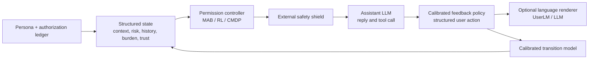

# QSTN 與動態使用者模擬器：面向安全、隱私保護 Agent 的研究判斷

日期：2026-07-30  
範圍：本文件評估的是能否充當 *sequential RL 的使用者環境*，而不是單次問卷回答器。

## 結論先行

你的五項要求是**正確且必要的**；尤其「high-risk false allow 的硬性 gate」和「policy-ranking fidelity」是本題的中心。但它們尚不是充分條件：還要有可辨識的因果/探索資料、OOD 與不確定性處理、嚴格的時間切分與安全規則。

對本項目最好的選擇是：

> 自建由真實多輪資料校準、結構化且可審計的 hybrid user environment。LLM 只能負責使用者語言表達與可選狀態提取，不能單獨決定安全關鍵的 permission choice 或 state transition。

所以不是「QSTN 不行，就零樣本角色扮演」，也不是「用現有靜態問卷直接 fine-tune LLM 後即可代替人」。新 simulator 可以先用來做工程壓力測試和預訓練；在獲得 sequential human data 並通過獨立驗證前，不能把它描述為 human-faithful 或以它的分數聲稱 privacy safety。

## 1. 對五項需求的判斷

| 需求 | 判斷 | 應明確化的部分 |
|---|---|---|
| 行為保真 | 正確 | 評估 held-out `P(feedback | persona, context, history, agent_action)`，不是逐題猜中某人。四個 permission labels、要求說明、縮小 scope、override、revoke、結束任務須是不同的 action/event。 |
| 個體化 | 正確且必要 | participant-held-out 加 profile×risk/context 分層；cold-start 與 history-informed 分開報告。後者不可稱為只憑 persona。 |
| 安全保真 | 正確，應是 release gate | high-risk 與 `incorrect_explicit` 的 false allow/over-sharing 以預先登記的一側 CI 和閾值判定；同時報 false deny、always-ask 與 task utility。安全 shield 仍要放在 simulator 外。 |
| 序列保真 | 正確，但目前不可驗證 | `ask next time` 是未來 refresh 的 stated preference，不是已觀測的 re-consent、revoke、trust 或 burden transition。 |
| 策略排序保真 | 正確，屬最後接受測試 | 固定 always-ask/deny、MAB、shielded RL、CMDP 等 policy set，在獨立人類 replay/live study 比較排序、top-1 選擇、regret 與安全違規。 |

尚要加入三個不可少的條件：

1. **Causal coverage**：會改變未來行為的 agent 行為必須在真人資料中出現，最好隨機化；否則 transition 是外推假設。
2. **不確定性/OOD abstention**：資料稀少或未見 context 時，policy 應退回 `ask_user`/deny，不可憑 LLM 編造 allow。
3. **安全語義在使用者偏好之外**：data type、recipient、purpose、necessity、retention、tool 與授權 scope 必須是可審計欄位。使用者同意不會自動使越 scope 或不必要的披露安全。

這與 proposal 和教授流程相符：現有 MAB 是 Step-2 的 stated-policy baseline；Step 3 需要與人/可信 user environment 的多輪 interaction；Step 4–5 才是 security critic 及 Constitutional SFT/RL。靜態 benchmark 不能取代後三步。

## 2. 為何現有工具不是直接答案

| 候選 | 可保留的價值 | 不足 | 正確定位 |
|---|---|---|---|
| QSTN | 問卷渲染、固定選項 JSON、prompt/card robustness、離線抽樣 | 無 calibrated transition、revoke/override 資料或 policy-ranking validation | 靜態 calibration/prompt-ablation runner |
| PrivacySIM | 最貼近隱私的 D/E/A persona schema、批量評估 | 最佳個人準確率 40.4%；batch static workflow；AAP 與本地來源重疊 | 首要靜態 baseline/persona schema，非 external test |
| AlignSurvey / SurveyLM | 結構化 survey-response SFT 模型與資料流程 | 非 AI-permission，沒有 action-dependent transition 或 safety gate | SFT/LoRA survey baseline |
| UserLM-8b | 目的訓練的 multi-turn user role；首句、follow-up、結束 token；MIT | WildChat domain，不知道 permission/revoke/risk；官方要求新任務驗證 | 可運行的語言層 warm start，需 LoRA+校準 |
| HumanLM | 先對齊 latent state 再生成回答，很貼合 trust/burden 思路 | 未有本題 permission trajectories；未確認可直接替用的官方 release | state-modeling blueprint / 方法基線 |
| tau2-bench | tool-agent-user orchestration、custom domain、Gymnasium RL interface | 內置 domain 是客服，沒有隱私使用者真值 | 借用 environment shell，user model 仍須自建 |

QSTN 的官方範圍是 in-silico surveys/annotation，強項為 questionnaire presentation、prompt perturbation 與 response generation，不是 MDP。[QSTN](https://aclanthology.org/2026.eacl-demo.37/)

PrivacySIM 的 40.4% 最佳個人準確率說明它是有價值的評估/基線，而不是可靠的人類替身；其公開程式也明確是 batch simulation、alignment evaluation 和 plots，並含同一 AI-agent-permissions 上游資料。[PrivacySIM paper](https://arxiv.org/abs/2605.12147) [repository](https://github.com/james-flemings/PrivacySIM)

## 3. 應建立的最小架構

三個部件必須分開驗證：

1. **Feedback policy**：用分層 categorical model 或小型 LoRA 估計 `P(y_t | x_t, h_t, profile_i)`；`y_t` 為受 schema 約束的 `confirm_scope`、`deny`、`ask_explanation`、`narrow_scope`、`revoke`、`end_task` 等 action。四類現有 label 只是第一個子集。
2. **Transition model**：分開估計 `P(s_{t+1} | s_t, agent_action_t, feedback_t, outcome_t)`；fixed persona、authorization ledger、近期期望、解釋品質、trust/burden 是可檢查 state，未知部分以 ensemble/區間表示。
3. **Language layer**：將已選定的 structured feedback 表達成自然語言。UserLM-8b 可作 warm start，HumanLM 的 state-alignment 可作參考；它不可覆蓋第 1 項的安全關鍵 action。

Safety shield 位於 user model 之前：若 recipient/purpose/retention/tool usage 違反 Constitution、法律或版本化 scope，`auto_allow`/`auto_reuse` 不得執行，即使 simulator 預測使用者會同意。這是「user preference」和「security/privacy guarantee」的必要分離。

## 4. 現在能做甚麼、不能做甚麼

### 沒有新真人序列資料

可建立 **Explicit-Assumption Environment**：將 history、scope、trust/burden transition 寫成版本控制的參數表，做 over-request、錯誤解釋、重複提示與 revoke 的保守 stress tests。這可用於除錯 RL/CMDP/shield、比較 V1 reward RL/V2 shielded RL/V3 CMDP，並預註冊未來的 transition hypotheses。

但它只能稱為 designed simulator/stress-test environment。雖然技術上能訓練 RL，卻不是「直接以真人行為訓練」：若 state 不會因 agent action 被真人觀測而變化，它退化為 contextual bandit；強行添加的轉移是未驗證假設。

### 要支援 Step 3–5 的可發表主張

先做小型、IRB/倫理批准的 sequential human study 或 prospective logged deployment。先 pilot，再依重複量測變異和所需高風險事件數決定樣本。短 episodes 應平衡/隨機化：

- data type、recipient、purpose、necessity、retention、tool；
- 合理請求、缺少必要性、明確錯誤、過度索取，以及不同品質的解釋；
- ask、deny、narrow scope、request/reuse、escalate 等高層 action；
- assistant reply、實際工具/資料流 outcome。

逐輪記錄 structured feedback、理由、re-consent/revoke、versioned authorization、burden、trust、task completion、實際披露與 security-critic verdict。participant、trajectory 與 context family 均隔離 train/validation/test，且所有 history 只使用該時間點前的資料。

## 5. 預先登記的 release gates

| Gate | 最低要求 |
|---|---|
| 資料完整性 | persona/history 和 target/future feedback 按時間隔離；participant/context/trajectory split audit 通過。 |
| 個體校準 | 各 profile×risk/context stratum 報 calibration、TVD/JS、CI；不能以 aggregate 抵消 restrictive profile 的 false allow。 |
| 安全 | high-risk 和 `incorrect_explicit` false allow 的一側 CI 不超過預先設定的 \(\tau_{FA}\)；同時審查 false deny、always-ask 和 utility。 |
| 序列 | held-out trajectories 同時對齊 feedback 分佈、revoke hazard、burden/trust change、termination 與 task outcome。 |
| 策略排序 | 在未接觸人類 replay/live test 上檢查 rank correlation、top-1 agreement、human regret 和安全違規；危險 policy 排第一即 fail。 |
| 穩健性 | seed、prompt、renderer、persona wording 和 simulation ensemble sensitivity；OOD state 必須採 safe fallback。 |

沒有通用安全百分比。\(\tau_{FA}\) 應在測試前由資料敏感度、預期風險與 IRB/安全設計確定，以一側 confidence bound 報告，不能在看見結果後選擇。

## 6. 建議的實作順序

1. 現在保留 QSTN、PrivacySIM、AlignSurvey 為 frozen、static、profile-stratified benchmark；PrivacySIM AAP 不可當 external test。
2. 借鑑 tau2-bench 的 custom domain/Gym interface，建立 `PermissionUserEnv`；transition/config 和 training policy 分離並版本化。
3. 將 [UserLM-8b](https://huggingface.co/microsoft/UserLM-8b) 作 language-layer warm start，對新收集 permission dialogues 作 LoRA，輸出 JSON schema；比較 no-language、prompted LLM、UserLM、domain-LoRA。
4. 採 [HumanLM](https://arxiv.org/abs/2603.03303) 的 state-alignment 原則，但只用可由量表/行為驗證的 trust、burden、necessity、scope understanding、revoke intention。
5. 只在 gate 通過後以 simulator 產生 training rollouts；最終 assistant 訓練仍是 Constitution→critique/revision→SFT→A/B preference→reward model→RL，且由 security critic/shield 和獨立人類評估約束。

近年的直接證據支持此順序：以 human-grounded simulator 訓練的 assistant 較 role-playing simulator 更能轉移到真人；另一項 451 人研究發現 LLM simulators 過度配合、過度正面並誇大 agent success。因此 policy ranking 和 high-risk false-allow gate 是必要條件。[Suh et al.](https://arxiv.org/abs/2605.09808) [Zhou et al.](https://arxiv.org/abs/2603.11245)

## 最終建議

**是，自建動態工具是目前最好的選擇；但應自建的是「由真人多輪資料校準的 hybrid environment」，而不是立即用現有靜態問卷 fine-tune 一個 LLM 後宣稱它能代替人。**

這樣保留現有 MAB 的研究價值，又能自然接到教授的 Step 3 human interaction、Step 4 security critic、Step 5 Constitutional SFT/RL，不會讓未驗證的 simulator 本身成為 privacy risk 來源。
