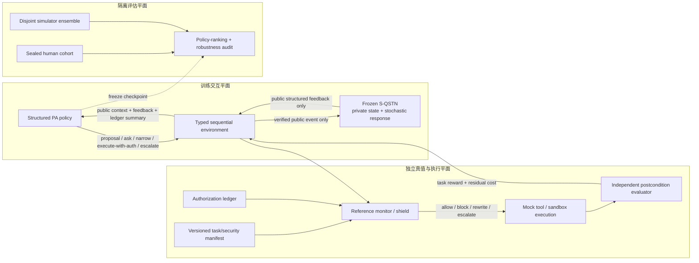

# RL Personal Assistant 总体框架与 PA–S-QSTN 循环验证治理方案

## 结论先行

classification 和 MAB 完成后，下一步不应直接做端到端 LLM PPO。最稳妥且最容易向 reviewer 解释的主线是：

> 建立一个 **authority-aware、shielded、structured CMDP personal assistant**。RL 只学习在合法候选动作中，如何利用公开历史和延迟反馈，在任务成功、打扰、可撤销控制和剩余隐私暴露之间做长期决策；授权合法性和不可违反的安全规则由独立、不可训练的 reference monitor 保证。

S-QSTN 的正确定位是“经真人校准、冻结并带不确定性的用户响应/状态转移模型”，不是 security oracle、完整 reward model 或最终 evaluator。

## 1. 先冻结两个研究问题

### RQ1：RL 是否真的带来序贯价值？

在 observation、structured action space、reference monitor、模型容量和数据预算相同的条件下，使用公开历史、authorization ledger 与 delayed outcomes 的 sequential policy（`gamma > 0`），是否优于 matched myopic policy（`gamma = 0`）？

- 主效能：episode task completion 的差值；
- 主安全性：known-invalid executed action 为 0，high-risk exposure 不劣于预注册预算；
- 次指标：prompt/repeat burden、scope edit、override/revoke recovery、control rating、worst-group performance。

### RQ2：S-QSTN 是否足以支撑该 RL 结论？

S-QSTN 在独立真人纵向数据上，能否同时通过：

1. next-feedback calibration；
2. error/repair/revoke 的 transition fidelity；
3. 对冻结 policies 的 human–sim policy-ranking agreement；
4. simulator-trained policy 的 cross-simulator 与 final-human transfer？

若任一关键 gate 失败，RQ1 只能得到 simulation-only 结论，不能外推到真人。

## 2. 三平面架构



### 为什么这样拆分

- **防止 assistant 自我授权**：PA 只能提出候选 action，不能通过自然语言或 `allow_*` 给自己建立权限。
- **防止 reward 抵消越权**：task reward 再高也不能绕过 reference monitor。
- **防止 hidden-state leakage**：PA 只看到用户公开回答，不看到 S-QSTN 的 trust/caution/profile 真值。
- **防止循环验证**：训练 simulator、客观安全真值和最终 evaluator 是三个独立对象。

## 3. RL-v0 的状态、动作与环境

### Observation

```text
o_t = {
  decision_phase,
  public_task_context,
  bounded_authorization_summary,
  bounded_public_history,
  candidate_action_catalog[K],
  action_mask[K],
  public_budget_and_clock,
  deployable_ood_summary
}
```

禁止输入：真实 profile ID、S-QSTN 私有 trust/caution、raw response probability、未来结果、hidden minimal-set/necessity label、sealed test truth。

### Structured action space

推荐先固定为可审计候选目录，而不是生成自由文本动作：

1. `request_authorization(scope, duration, purpose)`；
2. `clarify(field)`；
3. `narrow_scope(candidate)`；
4. `deny_or_safe_fallback(reason_code)`；
5. `execute_with_auth(auth_id, operation)`；
6. `refresh_authorization(auth_id)`；
7. `escalate_to_user_or_security_check()`；
8. `disable_or_revoke_local_reuse(auth_id)`。

Action mask 只删除当前语义上不适用的候选；reference monitor 在真正执行前必须再次验证，避免 mask 与执行之间的状态变化。

### Authority state machine

```text
PROPOSE -> WAIT_USER/AUTHORITY -> LEDGER_UPDATE -> EXECUTE -> POST_RESULT
```

Authorization ledger 至少记录 scope、purpose、recipient、processing、retention、expiry、revoke、one-time use、authority source 和 version。S-QSTN 的记忆 ledger 不能替代该授权 ledger。

## 4. Reward、cost 与 hard safety 的职责边界

不要把所有目标手工相加成一个分数。推荐：

\[
\max_\pi J_{task/control}(\pi)
\quad \text{s.t.} \quad
J_{exposure,H}\le d_H,\;
J_{prompt}\le d_B,\;
J_{fallback}\le d_F,
\]

同时让 reference monitor 强制 hard invariants。

| 信号 | 来源 | 用法 |
|---|---|---|
| task completion/quality/retry | mock tool + postcondition evaluator | soft reward |
| prompt/repeat count | environment log | burden cost |
| valid scope exposure by risk tier | manifest + executed operation | privacy/exposure cost |
| grant/edit/deny/revoke/comparison | S-QSTN 的公开输出 | noisy preference/control feedback |
| invalid/expired/revoked/out-of-scope operation | authorization service + monitor | 执行前 hard block；另记 attempted-invalid |
| high-risk/OOD | independent policy pack | 强制 ask/deny/escalate，不由 S-QSTN 投票决定 |

关键原则：**不要直接奖励 `allow`。** 否则 PA 会学会说服 S-QSTN，而不是尊重用户。S-QSTN 反馈最多进入 control/preference 的软目标，不能替代授权真值或安全真值。

## 5. 算法路线

### Phase A：先验证环境，不接 S-QSTN

- `ScriptedUserAdapter`；
- exact DP/model checking 的 tiny finite MDP；
- tabular masked Q-learning 的 delayed-outcome smoke test；
- always ask、always deny、least privilege rule；
- matched myopic scoped policy（同 observation/action/monitor，仅 `gamma=0`）。

理由：若 tiny MDP 都无法复现、credit assignment 不正确或 hidden truth 泄漏，换 PPO 只会把工程错误放大。

### Phase B：发布 S-QSTN-RL adapter

把当前规则层保留为结构约束，但新增真人校准的 stochastic layer：

\[
P_{\phi}(y_t,z_{t+1}\mid z_t,x_t,a_t,e_t),
\]

其中 `e_t` 必须是外部 verifier 标记的事件；`z_t` 是 simulator 私有状态；PA 只能看到公开 `y_t`。规则可以约束“verified error 不应提高 trust”这样的方向，但错误影响幅度、持续时间和 recovery 速度必须由纵向真人数据估计，并输出不确定性/OOD。

### Phase C：主 structured RL

- 小规模：tabular/linear constrained learner；
- 中高维 structured state：masked PPO 或 DQN；
- 有非零 residual budgets 时：primal-dual/Lagrangian 或 CPO-style constrained optimizer；
- 只有 compact public history 确实不足时才加入 GRU/recurrent encoder。

建议把 masked PPO-Lagrangian 作为工程主实现候选，把 CPO-style 方法作为 constrained baseline；最终选择应由 action/state 规模与 cost sparsity 决定，而不是先按算法名写论文。

### Phase D：再训练自然语言 support LLM

先冻结 structured controller 和 tool gate，再让 LLM 学习如何表达 clarification、explanation、refusal 或 repair。Token-level RL 永远不能改变 scope、创建 authority 或绕过 monitor。

## 6. “PA 犯错使 S-QSTN 警惕”是否构成循环？

### 不一定；这本来就是需要学习的环境动力学

在真实交互中，PA 的错误会改变用户未来行为。若把这种影响全部删除，RL 就退回 myopic MAB，无法研究 trust recovery、revoke 和 delayed consequences。

真正的风险不是“动作影响用户”，而是：

- 谁定义“错误”；
- 谁提供 reward；
- 谁在训练中更新；
- 谁做最终评价。

### 四种会被 reviewer 指出的循环

1. **自我确认**：S-QSTN 根据 PA/S-QSTN 自己的判断认定 PA 犯错，然后用更谨慎的回答证明该错误有害。
2. **代理目标闭环**：PA 优化 S-QSTN 的回答，之后仍用同一 S-QSTN 证明 PA 更好。
3. **共同漂移**：PA 和 S-QSTN 同时在线更新，形成不可复现的 co-adaptation。
4. **数据闭环**：同一批问卷/参与者既训练 S-QSTN、调 RL，又做最终 test。

### 切断循环的九条协议

1. **外部事件认证**：只有 task oracle/reference monitor/postcondition evaluator 可产生 `verified_agent_error`、`verified_scope_violation`、`repair_completed`；ordinary denial 不得触发 trust penalty。你们现有 v2 rules 已符合这一原则。
2. **冻结 simulator 参数**：每个实验 generation 中冻结 `phi`；S-QSTN 的 episode state 可以变化，但模型参数不能随 PA 同步学习。
3. **版本化交替，而非共同训练**：`freeze S_k -> train pi_k -> freeze pi_k -> collect new human calibration -> S_{k+1}`。
4. **三套数据**：S-QSTN calibration cohort、policy development cohort、sealed human evaluation cohort；按 participant、trajectory/time、context family、risk/attack family 隔离。
5. **奖励去中心化**：task、executed exposure、prompt count、authority validity 来自环境；S-QSTN 只提供软反馈，不能成为全部 reward。
6. **simulator ensemble/domain randomization**：从真人 bootstrap/posterior 参数中每 episode 采样一个冻结 simulator；同时加入 scripted conservative/adversarial variants，防止记住单一规则。
7. **OOD 支持检测**：若 policy 把交互推到 calibration support 之外，S-QSTN 必须 abstain；环境回退 ask/deny/escalate。不要让 LLM 在 OOD 区域自信编造用户状态。
8. **cross-simulator evaluation**：训练于 `S_train`，测试于 disjoint `S_eval` 和 scripted variants；必要时用从真实前缀分支的短 rollout，限制模拟误差累积。
9. **最终真人 policy ranking**：冻结 policies 后，由真人独立比较；若 simulator 的 top-1、pairwise order、rank correlation 或 human regret 未过预注册 gate，只能报告 simulation result。

在一次冻结实验中可写成：

\[
\frac{\partial \phi}{\partial \theta}=0.
\]

S-QSTN 的状态随 PA action 改变是合法的 `P(s_{t+1}|s_t,a_t)`；参数随 PA 的优化方向一起改变，才是难以解释的 co-adaptation。

## 7. 不要再只报告“正确率”

动态用户没有一个与历史无关的静态 label。建议把“正确率漂移”拆为四类可验证 estimand：

1. **PA policy outcome**：task completion、valid exposure、prompt burden、override/revoke、executed/attempted violations；
2. **S-QSTN response fidelity**：next-action log loss/Brier/ECE、scope-edit distribution、每个 risk/profile/context 的 false-allow/false-deny；
3. **transition fidelity**：真人与 simulator 在 verified error、repair、repetition、revoke 后的状态/行为变化及置信区间；
4. **downstream validity**：simulator-trained policies 在 disjoint simulator 与真人上的 policy ranking 和 win rate。

如果 PA 在 `S_train` 上 reward 上升、但 cross-simulator 或真人表现下降，应按 reward hacking/simulator exploitation 报告，而不是称为 accuracy improvement。

## 8. 最小可辩护实验矩阵

| 轴 | 最小比较 |
|---|---|
| 序贯价值 | matched myopic `gamma=0` vs sequential `gamma>0` |
| 历史价值 | full history/ledger vs no-history vs no-ledger |
| 安全机制 | no monitor（仅 fault-injection sandbox）vs shielded MDP vs shielded CMDP |
| simulator dependence | train S-QSTN-A → test A/B/scripted/human |
| simulator construction | current directional rule-only vs human-calibrated stochastic layer |
| 用户适应 | frozen population policy vs public-feedback personalization |
| 约束设计 | scalar penalty vs separate budgets |
| OOD | fallback on vs off（off 仅 sandbox ablation） |
| 历史 baseline | offline classifier/MAB、WP-FTS + same authority wrapper |

公平比较时，matched myopic 与 RL 必须使用同一 observation、action catalogue、encoder、monitor、outcome definition 和优化预算。旧 MAB 与新八动作 RL 的系统级差异不能全部归因于“长期 credit assignment”。

## 9. UserSim release gates

### G2a：主 RL 训练前

- micro-randomized longitudinal human calibration；
- participant-held-out、trajectory/time-held-out、context-family-held-out fidelity；
- verified-error/repair/revoke transition calibration；
- OOD detection/abstention；
- 对预先冻结 baseline policies 的 human–sim ranking agreement。

未通过：S-QSTN 只能用于 smoke/stress test。

### G2b：RL 训练后

- 冻结所有 final policy checkpoints；
- 使用从未参与 simulator/RL 调参的真人 cohort；
- 比较 task、burden、control、privacy/exposure 结果和 policy ranking；
- participant/scenario clustered CI；synthetic 使用 common random numbers 和 paired seeds。

未通过：论文明确限制为 simulator-specific improvement。

## 10. Reviewer 最可能提出的质疑与预先回答

| 质疑 | 预先设计的回答 |
|---|---|
| “你们把 bad action→caution 写进规则，再证明 RL 会避免 bad action，是自证。” | rule-only 只作 stress-test/structural prior；效应大小、持续时间、recovery 由随机化真人纵向数据估计，并做 rule-only ablation。 |
| “同一个 S-QSTN 训练又评估，policy 会 exploitation。” | training simulator 不参加 final judgment；做 disjoint simulator、cross-model test 和 sealed human ranking。 |
| “用户同意不等于安全。” | allow 不作为 safety truth；scope validity、risk 与 authority 由 manifest/ledger/monitor 定义。 |
| “shield 已保证安全，RL 的 safe claim 是假的。” | hard safety 归功于 monitor；RL 只主张改善合法动作中的 task–burden–residual exposure trade-off，并报告 attempted-invalid/intervention。 |
| “动态 label 让 accuracy 不可解释。” | 预注册 conditional response/transition estimands 与 episode outcome；不把所有历史状态压成静态 accuracy。 |
| “同一份 survey 支撑全部模块，存在 shared bias。” | 旧 survey 只作 priors/baselines；新纵向 calibration 与 sealed human test 独立招募并分层留出。 |

## 11. 建议的立即实施顺序

### 第一批：现在就做

1. 冻结 authority semantics、FSM、candidate/action/public-feedback/outcome schemas；
2. 实现 event-sourced authorization ledger、scope matcher 和 reference monitor；
3. 实现 typed environment、ScriptedUserAdapter、mock tools、postcondition evaluator；
4. 加入 hidden-state leakage sentinel、property/mutation/fault tests；
5. 跑 exact DP、tabular Q、matched myopic；
6. 输出 RL-v0 engineering audit。

### 第二批：真人校准后做

1. 收集 mock-data、micro-randomized sequential trajectories；
2. 训练/校准 S-QSTN stochastic feedback/transition layer；
3. 通过 sealed fidelity、OOD 和 pre-training policy-ranking gate；
4. 训练 masked PPO/DQN 与 constrained variants；
5. 冻结 policy，做 cross-simulator 和 final-human study。

### 暂时不要做

- 直接 token-level PPO；
- PA 与 S-QSTN 同步在线更新；
- 让 S-QSTN 私有 trust/caution 进入 PA observation；
- 让 S-QSTN 判断 authorization validity 或 objective risk；
- 只用同一 S-QSTN 的 reward/accuracy 宣称 human improvement。

## 12. 可直接写进论文的方法定位

> S-QSTN is treated as a frozen, versioned, human-calibrated transition model for public user feedback, rather than as a security oracle or final evaluator. Objective authorization and safety outcomes are produced by an independent executable specification, authorization ledger, reference monitor, and postcondition evaluator. During each training generation, the simulator parameters remain fixed while the personal-assistant policy is optimized. Simulator-based gains are considered evidence of human-facing improvement only when they transfer to disjoint simulators and preserve the ranking of frozen policies in a sealed human study.

这段表述把“动作会改变用户未来反应”保留下来，同时明确否定“同一 simulator 自己训练、自己定真值、自己宣布成功”的闭环。

## 参考依据

- [How to Build User Simulators to Train RL-based Dialog Systems, EMNLP-IJCNLP 2019](https://aclanthology.org/D19-1206/)
- [Neural User Simulation for Corpus-based Policy Optimisation, SIGDIAL 2018](https://aclanthology.org/W18-5007/)
- [SimulatorArena, EMNLP 2025](https://aclanthology.org/2025.emnlp-main.1786/)
- [One Cannot Stand for Everyone!, ACL 2023](https://aclanthology.org/2023.acl-long.1/)
- [Quantifying the Utility of User Simulators, 2026 preprint](https://arxiv.org/abs/2605.09808)
- [Mind the Sim2Real Gap in User Simulation for Agentic Tasks, 2026 preprint](https://arxiv.org/abs/2603.11245)
- [Safe Reinforcement Learning via Shielding, AAAI 2018](https://ojs.aaai.org/index.php/AAAI/article/view/11797)
- [Constrained Policy Optimization, ICML 2017](https://proceedings.mlr.press/v70/achiam17a.html)
- [Scaling Laws for Reward Model Overoptimization, ICML 2023](https://proceedings.mlr.press/v202/gao23h.html)
- [When to Trust Your Model, NeurIPS 2019](https://proceedings.neurips.cc/paper/2019/hash/5faf461eff3099671ad63c6f3f094f7f-Abstract.html)

