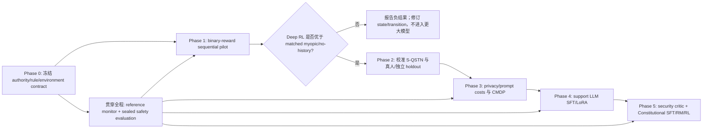

# RL Personal Assistant 后续研究路线审计

## 1. 结论

总体判断是 **Conditional Go（修改后可行）**。

你们提出的主方向——在已完成 classification/MAB 后，先实现一到两个经典 deep-RL baseline，再扩展到 LLM fine-tuning、安全子代理和 Constitutional AI——与项目标书的 Step 3A → Step 3B/4 → Step 5 基本一致。但不能完全按“deep RL + 0/1 → fine-tune LLM → 再找 privacy rules → 最后调 reward”的原顺序执行。

需要做三处关键修订：

1. **deep RL 是待验证的方法选择，不是 personal assistant 的必然要求。** 必须同时保留 exact/tabular、matched-myopic（`gamma=0`）和 no-history baseline，以证明收益确实来自 sequential credit，而不是更大的神经网络。
2. **0/1 reward 只能作为版本化的 pilot reward。** 如果每一步仍独立计算 `1[action == survey label]`，那么实验本质上仍是 neural contextual bandit；必须加入至少一个有延迟后果的 episode，才能检验 RL。
3. **privacy/security rules 不能等 LLM fine-tuning 后再找。** 第一版 rules/constitution、授权语义、action legality 和 held-out safety taxonomy 必须在环境、训练数据和测试集构造之前冻结；后续可以扩充，但不能事后改变初始实验的判分标准。

| 原建议 | 判断 | 建议修订 |
|---|---|---|
| personal assistant 必须用 deep RL | 部分合理 | 高维、历史依赖时有理由；先用 matched simpler baselines 验证必要性 |
| 先做 1–2 个经典算法 | 合理 | 建议 `masked Double DQN + masked PPO` |
| reward 暂用 0/1 | pilot 合理 | 同时做 parity reward 与真正的 terminal sequential reward |
| 后续 fine-tune core LLM | 合理 | 先验证 structured permission controller；LLM 不直接拥有授权权力 |
| fine-tune 后再找 privacy rules | 不合理 | rule pack v0 必须在环境/SFT 数据/测试集之前冻结 |
| 最后再调 reward | 仅部分合理 | rich reward 可后做；outcome schema、metrics、cost channels、split 现在就冻结 |

## 2. 合作者可能说的算法名称

“DWNS actor creative”最可能是 **DQN and Actor–Critic**。需要向合作者确认原词，因为 Actor–Critic 是算法家族，不是一个完整、可复现的算法名称。

当前最有解释力的一对 baseline 是：

| 算法 | 角色 | 为什么适合本项目 | 主要风险 |
|---|---|---|---|
| Masked Double DQN | off-policy、value-based | action 是有限的 structured permission action；replay 较节省 simulator interaction；Double DQN 减少 vanilla DQN 的价值高估 | 对超参数和 Q 值误差敏感；需要正确处理 action mask |
| Masked PPO | on-policy、actor–critic | 提供与 DQN 不同的算法家族；天然产生 stochastic policy；以后较容易接 history encoder 或 constraint extension | 样本消耗较大；比较时必须匹配 environment-interaction budget |

DQN 是经典离散动作 deep RL 基线；Double DQN 专门缓解 DQN 的 value overestimation。[Mnih et al., 2015](https://www.nature.com/articles/nature14236)，[van Hasselt et al., 2016](https://ojs.aaai.org/index.php/AAAI/article/view/10295)。A3C 是经典 Actor–Critic 实例，而 PPO 是目前更容易实现和调试的具体 policy-gradient baseline。[Mnih et al., 2016](https://proceedings.mlr.press/v48/mniha16.html)，[Schulman et al., 2017](https://arxiv.org/abs/1707.06347)。

不建议第一轮同时实现 DQN、A2C/A3C、PPO、CPO。两个主算法已经足够形成 value-based vs policy-based 比较；算法过多会把预算消耗在 tuning，而没有加强研究问题。

## 3. 推荐的两轨路线

这条路线保留“现在就启动经典 deep RL”的速度，同时确保规则、授权和测试标准不会在看到结果以后才确定。

### Phase 0：先冻结实验合同，不先训练

最低交付物：

- authority state machine：`PROPOSE → WAIT_AUTHORITY → LEDGER_UPDATE → EXECUTE → POST_RESULT`；
- structured action catalog 与 action mask；
- authorization ledger、expiry/revoke/scope/purpose/recipient 语义；
- environment `observation/action/transition/termination` schema；
- `reward_v0`、outcome、privacy cost、prompt cost 的版本化字段；
- rule pack v0 与独立 reference monitor；
- train/validation/sealed-test 的 scenario-family、participant 和 attack-family split；
- S-QSTN 的训练反馈用途、版本和 release gate。

规则至少分成四类：

1. **Hard invariants**：无授权、越 scope、已撤销/过期、purpose/recipient 不符等；由 action mask/reference monitor 在执行前阻止。
2. **Soft privacy preferences**：最小披露、提示负担、用户个体差异；后续进入 costs、constraints 或 preference model。
3. **Response principles**：LLM 如何解释、澄清、拒绝和给出安全替代；用于 SFT/Constitution critique。
4. **Attack/evaluation taxonomy**：prompt injection、credential harvesting、scope expansion、跨任务复用等；用于 held-out red-team，而不是只用于训练。

安全规则用于运行时 shield/reference monitor 有明确 safe-RL 先例；硬安全不能只依赖负 reward 或训练后的 critic。[Alshiekh et al., 2018](https://ojs.aaai.org/index.php/AAAI/article/view/11797)。规则来源可综合 Contextual Integrity、NIST Privacy Framework，以及 PrivacyLens、AgentDAM、AgentDojo 的场景/威胁分类，但需要重新映射到本项目的 authority 和 tool semantics，不能直接把外部 benchmark 标签当作本项目 ground truth。[Nissenbaum, 2004](https://digitalcommons.law.uw.edu/wlr/vol79/iss1/10/)，[NIST Privacy Framework](https://www.nist.gov/privacy-framework/privacy-framework)，[PrivacyLens](https://proceedings.neurips.cc/paper_files/paper/2024/file/a2a7e58309d5190082390ff10ff3b2b8-Paper-Datasets_and_Benchmarks_Track.pdf)，[AgentDAM](https://proceedings.neurips.cc/paper_files/paper/2025/hash/c9826b9ea5e1b49b256329934a578d83-Abstract-Datasets_and_Benchmarks_Track.html)，[AgentDojo](https://proceedings.neurips.cc/paper_files/paper/2024/hash/97091a5177d8dc64b1da8bf3e1f6fb54-Abstract-Datasets_and_Benchmarks_Track.html)。

### Phase 1：binary-reward deep-RL pilot

建议明确区分两个 0/1 实验：

**R0 — MAB parity / regression test**

\[
r_t^{parity}=\mathbb{1}[a_t=y_t]
\]

它只验证新的 pipeline 是否能复现/承接现有 stated-policy target。它不证明 privacy、task utility 或长期决策价值。

**R1 — sequential smoke test**

构造至少三步 episode，例如：

1. agent 请求/澄清/提出缩小 scope；
2. user/S-QSTN 返回 grant、edit、deny、defer 或 revoke；
3. agent 在 ledger 和新状态下执行、继续澄清、拒绝或安全退出。

终局 reward 可暂定为：

\[
R^{seq}=\mathbb{1}[\text{task postcondition satisfied under valid authority}]
\]

非法执行由 reference monitor 阻断并记录 `attempted_invalid_action`；不要把“被阻断所以没有泄露”误写成 agent 已学会安全。

如果 structured RL 使用八类动作，而 MAB 使用四类 permission label，则两者没有天然的一一对应 reward。必须预先冻结映射/teacher，或者把主比较改成共同的 terminal task outcome，不能在结果出来后选择对某个算法更有利的映射。

### Phase 2：处理 S-QSTN 的循环验证风险

S-QSTN 可以提供训练中的 interaction feedback，但不能同时成为唯一训练环境、reward source 和最终 judge。否则 PA policy 可能学到的是“如何操纵这个 simulator 的警惕状态”，而不是真实用户隐私偏好。

推荐隔离：

- **训练通道**：固定版本的 S-QSTN 产生 grant/edit/deny/revoke 等 public event；PA 的错误可以使它更警惕，这属于明确建模的 endogenous transition。
- **校准通道**：用独立真人/held-out questionnaire trajectories 检验 response distribution、transition direction 和 policy ranking。
- **测试通道**：sealed S-QSTN seeds/profile/scenario families + deterministic task oracle + 独立 safety evaluator；测试期间不因被测 policy 的结果重新调 S-QSTN rules/parameters。
- **报告边界**：release gate 前只称为 synthetic simulator result，不称 human behavior 或 real-world privacy improvement。

最终评价至少要包含一个不依赖 S-QSTN 自身回答的结果：task postcondition、reference-monitor audit、人工 blind safety review，或独立规则/专家标注的 sealed set。

### Phase 3：再从 shielded MDP 扩展到 privacy-aware CMDP

当真实或可信代理信号可测后，把目标拆为：

\[
\max_\pi J_{task}(\pi)
\quad\text{s.t.}\quad
J_{privacy}\le d_P,\;J_{prompt}\le d_B,\;J_{fallback}\le d_F.
\]

这是项目标书已经主张的“task reward 与 privacy/prompt constraints 分离”。CPO 是后续 constrained baseline 的经典选择，但只有 residual privacy/prompt costs 确实非零且定义可信时才值得实现；否则系统只是 shielded MDP，不能包装成 CMDP。[Achiam et al., 2017](https://proceedings.mlr.press/v70/achiam17a.html)。

### Phase 4–5：LLM fine-tuning、安全 critic 和 Constitutional AI

推荐保持模型边界：

- structured controller 决定 `ask/clarify/narrow/deny/execute/escalate`；
- support LLM 只把已批准的 structured action 转成自然语言或受限 tool proposal；
- authorization service/reference monitor 决定是否实际执行；
- security critic 是额外审查层，不是授权源或唯一 ground truth。

随后按 `Constitution → critique/revision → SFT → preference pairs → reward model → token-level RL` 执行，而不是先 fine-tune 再寻找原则。Constitutional AI 的原始流程也把原则用于 supervised critique/revision 和后续 AI-feedback 阶段。[Bai et al., 2022](https://arxiv.org/abs/2212.08073)。

Rich reward/reward model 可以晚于初步 RL，但 reward tuning 只能在 train/validation 上进行，并保留独立 safety/human test。代理 reward 被过度优化时，真实目标可能反而下降，因此不能用同一个 grader 同时训练和证明安全。[Gao et al., 2023](https://proceedings.mlr.press/v202/gao23h.html)。

## 4. 第一轮可复现实验矩阵

所有方法使用相同 observation、structured action catalog、action mask、reference monitor、scenario split 和 environment-interaction budget；wall-clock 另外报告。

| 层级 | 方法 | 要回答的问题 |
|---|---|---|
| 非学习下界/边界 | always ask、always deny、rule-based least privilege | interruption、task completion 和安全边界在哪里 |
| 既有系统 | WP-FTS + frozen mapping/wrapper | 相对现有 MAB 系统是否有系统级增益 |
| 简单 sequential | exact DP/tiny MDP、tabular Q | 环境和 delayed credit 是否本身可学 |
| 机制对照 | matched myopic `gamma=0` | 相同信息与模型容量下，长期 return 是否真正有价值 |
| 主模型 1 | masked Double DQN | value-based deep RL |
| 主模型 2 | masked PPO | actor–critic deep RL |
| 消融 | no-history、no-ledger、no-public-feedback-update | 增益来自哪类 sequential state |
| 防护测试 | reference-monitor fault injection | monitor 是否独立阻止越权；不作为 policy 性能提升 |

主要指标不要只报 average reward：

- terminal task success 与 learning-curve AUC；
- MAB parity JEM（仅 R0）；
- false allow / false deny；
- `attempted_invalid_action`、monitor intervention、实际 executed violation；
- valid exposure 按 risk tier 分层；
- prompt/repeat count、fallback/escalation；
- override/revoke recovery；
- worst profile/scenario family，以及 OOD/held-out attack family；
- 多 random seeds 的均值、中位数、置信区间和完整 seed-level points。

Deep RL 对实现、超参数和随机种子非常敏感，不能只展示 best seed。[Henderson et al., 2018](https://ojs.aaai.org/index.php/AAAI/article/view/11694)。pilot 至少使用多个预注册 seeds（资源允许时建议不少于 5），主实验的 seed 数和 CI 规则应由 pilot variance/precision 决定，而不是结果显著性决定。

## 5. Go/No-Go 门槛

1. **G0 Environment gate**：tiny MDP 的 exact solution、tabular learner、ledger、termination 和 monitor property/fault tests 全部通过。
2. **G1 Sequential-value gate**：Double DQN/PPO 中至少一个在 sealed delayed-outcome scenarios 上优于 matched-myopic/no-history，并且不是靠更多 observation 或 interaction budget。
3. **G2 Simulator gate**：S-QSTN 通过独立 calibration/policy-ranking test；未通过时只报告 synthetic diagnostic，不做真人泛化主张。
4. **G3 Privacy gate**：privacy/prompt cost 有可审计测量、非零变化和预注册 budget 后，才宣称 CMDP/constrained RL。
5. **G4 LLM gate**：support LLM 不绕过 controller/monitor；task、privacy 和 attack-family holdout 全部通过后才进入 Constitutional RL。

最关键的反证标准是：

> 如果 DQN/PPO 在相同 state/action/monitor/data budget 下不能优于 `gamma=0` 或 no-history policy，那么当前任务定义没有提供 deep sequential RL 的证据。应报告该结果并修订 transition/state，而不是持续调参直到出现正结果。

## 6. 与项目现有标书的对齐

上述路线与现有项目主张一致：当前 MAB 的 0/1 exact match 只测 stated-policy fidelity；后续应把 task reward 与 privacy/prompt costs 分开，并保留独立 security evaluator。参见 [proposal_zh.md](./ai_agent_permission_experiment/proposal/proposal_zh.md) 和 [personal_assistant_rl_plan_zh.md](./personal_assistant_rl_plan_zh.md)。

进入实现前还需要处理一处文档一致性问题：`reward_function_design_zh.md` 把旧的多项手写 scalar reward 写成“当前 reward”，而标书把无权重 exact match 写成当前 reward。建议将前者标为 archive/alternative，并将第一轮 RL 奖励显式命名为 `reward_v0_binary`，否则 reviewer 会看到两套互相冲突的当前定义。

## 7. Reviewer-safe 的阶段表述

建议使用：

> We first instantiate an authority-aware sequential environment and compare two canonical deep-RL families—masked Double DQN and masked PPO—against matched myopic, tabular, rule-based, and legacy MAB baselines. Binary rewards are used only for pipeline parity and delayed-outcome smoke tests; privacy and interruption outcomes are reported separately and later introduced as explicit CMDP costs after measurement validation. A versioned rule pack and an independent reference monitor are fixed before training. The support LLM, security critic, and Constitutional SFT/RM/RL stages are added only after the structured controller and simulator release gates are satisfied.

这比“我们已经决定用 deep RL，先用 0/1，之后再找规则和调 reward”更容易向 reviewer 解释：算法是比较对象，规则是前置规范，binary reward 是 pilot，安全结论来自独立约束与评估。
